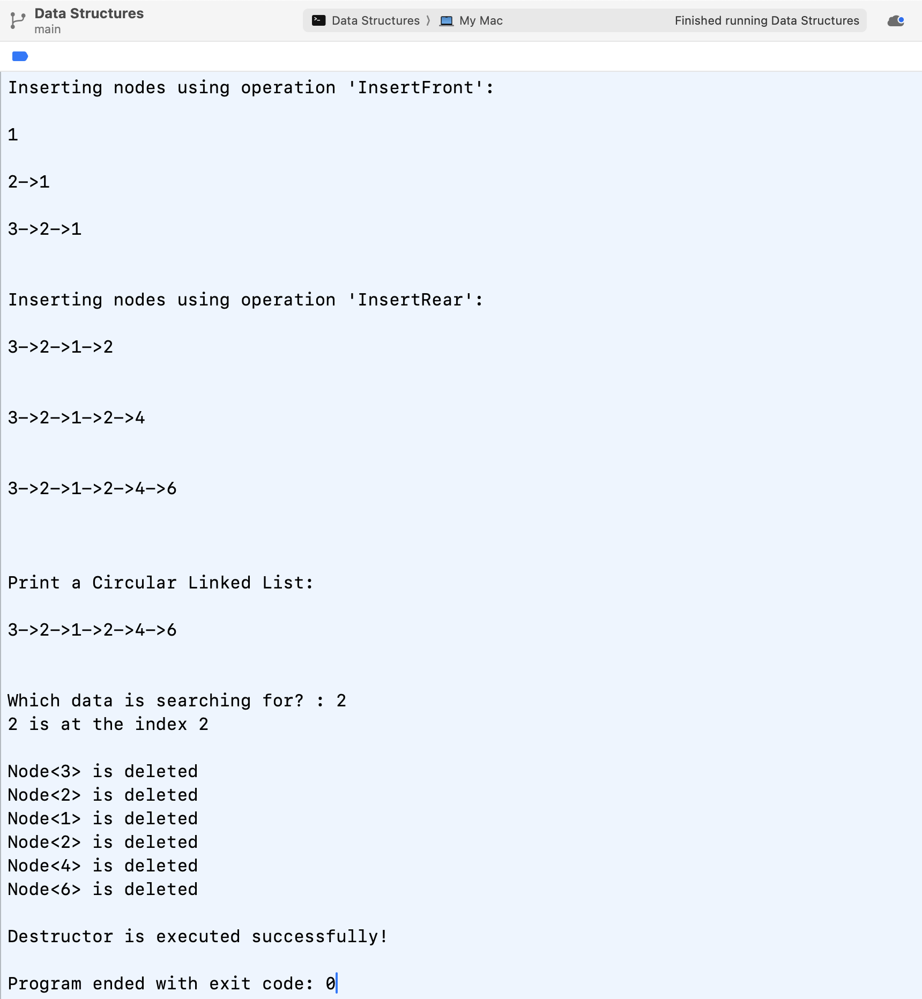
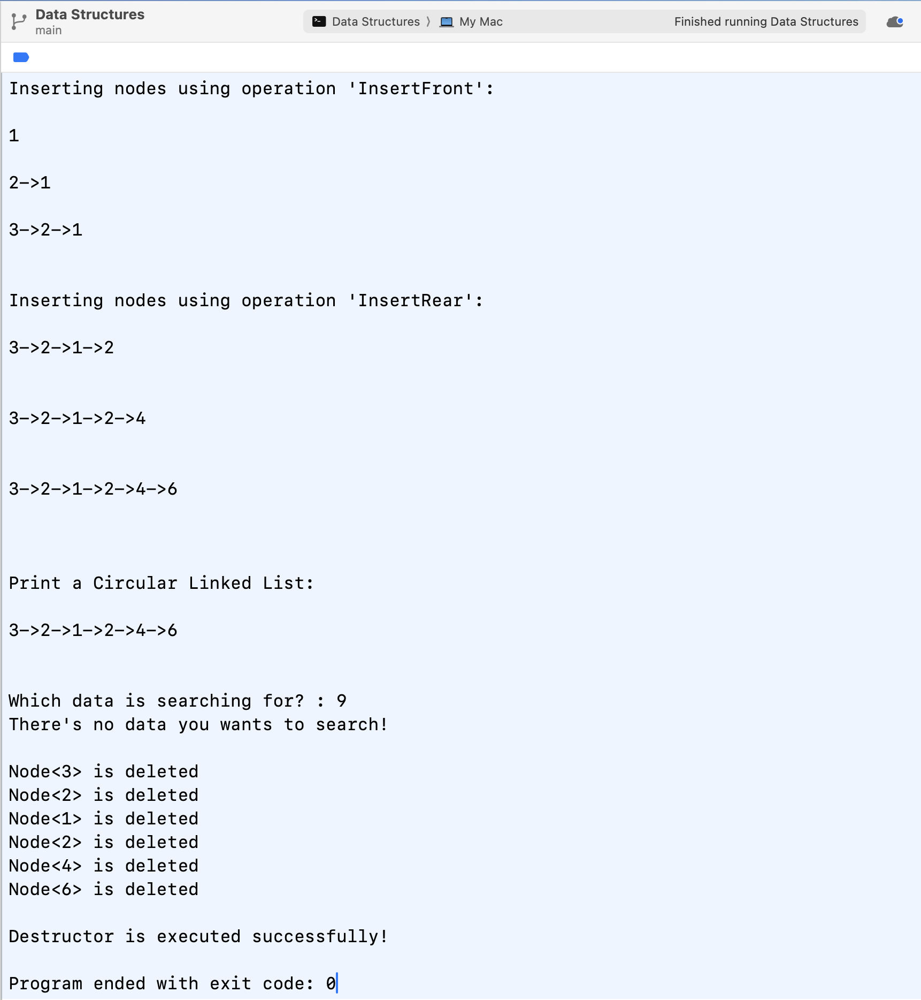

# HW1 Assignment Explanation — Circular Linked List with Head Node

[Repository Guide](../../README.md) | [English](Assignment-Explanation.md) | [한국어](Assignment-Explanation.ko.md)

> **Last Updated:** 2026-10-27

> **Learning Objectives:**
> 1. Describe the structure of a circular linked list with a head node and the shape of the empty list
> 2. Explain the two links that `InsertFront` changes and why their order matters
> 3. Trace the termination condition of the loop with which `InsertRear` finds the last node, and its behavior on the empty list
> 4. Compare the advantages of a head node and the costs of front and rear insertion depending on where the head node is placed

---

## Table of Contents

- [1. Homework Layout and How to Run](#1-homework-layout-and-how-to-run)
- [2. Requirements](#2-requirements)
  - [2.1 Structure of the List](#21-structure-of-the-list)
  - [2.2 Problems and Points](#22-problems-and-points)
- [3. Design and Solution](#3-design-and-solution)
  - [3.1 InsertFront](#31-insertfront)
  - [3.2 InsertRear](#32-insertrear)
  - [3.3 Counting Search Positions from 1](#33-counting-search-positions-from-1)
- [4. Testing](#4-testing)
  - [4.1 Screenshots](#41-screenshots)
  - [4.2 Results with the Test Driver](#42-results-with-the-test-driver)
- [5. Questions about the Head Node](#5-questions-about-the-head-node)
  - [5.1 Advantages of a Head Node](#51-advantages-of-a-head-node)
  - [5.2 Head Node at the Front and at the Rear](#52-head-node-at-the-front-and-at-the-rear)
- [Summary](#summary)
- [Self-Check Questions](#self-check-questions)

---

<br>

## 1. Homework Layout and How to Run

The homework asks for the bodies of the member functions `InsertFront` and `InsertRear` of a circular linked list with a head node, a screenshot of the completed program, and answers to two questions about the head node. It uses the head node (Section 4.4) and circular lists (Section 6) of Lecture 3 directly. The handout is in [`Original/Assignment.md`](Original/Assignment.md).

```text
Coursework/HW01_Circular-Linked-List-with-Head-Node/
├── Original/
│   ├── Assignment.md                   # handout (English)
│   └── Assignment.ko.md                # handout (Korean)
└── Solution/
    ├── InsertFront-and-InsertRear.cpp  # solution of InsertFront and InsertRear
    └── Test-Driver.cpp                 # test driver that runs the two functions
```

*Figure 1. Directory layout of HW1*

```bash
cd Coursework/HW01_Circular-Linked-List-with-Head-Node/Solution
g++ -std=c++17 -Wall -Wextra -pedantic -o hw1 Test-Driver.cpp
./hw1
```

> **Note:** `Test-Driver.cpp` is a test driver that compiles and runs the two functions, and its output format follows the screenshots in Section 4.1. The two functions enter the class definition through `#include`. The driver is described in the [HW1 Code Walkthrough](Code-Walkthrough.md).

---

<br>

## 2. Requirements

### 2.1 Structure of the List

A node is a `ChainNode<T>` with a data field `data` and a link field `link`. The list keeps one **head node** that holds no data, and the pointer `head` always points to it. The link of the head node points to the first data node, and the link of the last data node points not to `NULL` but back to the head node. The empty list, which has no data node, is the state in which the link of the head node points to the head node itself. The structure is the one in Figure 9 of Lecture 3, Section 6.3, and the pointer `first` of Lecture 3 corresponds to `head` in this homework.

```text
List with six data nodes (3, 2, 1, 2, 4, 6)
head --> [H] --> [3] --> [2] --> [1] --> [2] --> [4] --> [6] --+
          ^                                                    |
          +----------------------------------------------------+

Empty list
head --> [H] --+
          ^    |
          +----+
```

*Figure 2. A circular linked list with a head node and the empty list (H is the head node)*

### 2.2 Problems and Points

| Problem | Content | Points |
|:-----|:-----|-----:|
| 1 | `InsertFront`: (1-1) make the link of the new node point to the original first node (10 points), (1-2) make the new node the new first node (10 points) | 20 |
| 2 | `InsertRear`: (2-1) store the first node in `cur` (10 points), (2-2) find the last node with a while loop and store it in `cur` (20 points), (2-3) insert the new node after the last node (10 points), (2-4) make the last node always point to the head node (10 points) | 50 |
| 3 | Run the program with the completed code and capture screenshots of the results | 20 |
| 4 | Explain the advantages of a head node and the difference between placing it at the front and at the rear | 10 |

*Table 1. Problems and points of HW1*

---

<br>

## 3. Design and Solution

### 3.1 InsertFront

Inserting at the front means placing the new node between the head node and the first data node. The solution does this with two statements.

```cpp
newNode->link = head->link;   // (1-1) the new node points to the original first node
head->link = newNode;         // (1-2) the head node points to the new node
```

The order of the two statements matters. If (1-2) runs first, it overwrites `head->link`, which held the address of the original first node, so the following (1-1) makes the new node point to itself and the original data nodes can no longer be reached. On the empty list, `head->link` is `head`, so (1-1) sets the link of the new node to the head node, and after (1-2) the head node and the new node form one circle. The empty list therefore needs no separate check, and the link of the last node does not have to change either, because the last node points to the head node, not to the first data node. The time complexity is $O(1)$.

```text
Before           head --> [H] --> [2] --> [1] --> (back to H)
After (1-1)             [3] ----> [2]
After (1-2)      head --> [H] --> [3] --> [2] --> [1] --> (back to H)
```

*Figure 3. Inserting 3 at the front of the list 2, 1*

### 3.2 InsertRear

Inserting at the rear requires finding the last data node. Since the links go in one direction only, the code starts at the first node and follows the links until it reaches the node whose link points to the head node.

```cpp
ChainNode<T>* cur = head->link;   // (2-1) start at the first node
while (cur->link != head) {       // (2-2) the node whose link is the head node is the last node
    cur = cur->link;
}
cur->link = newNode;              // (2-3) link the new node after the last node
newNode->link = head;             // (2-4) the new last node points to the head node
```

With $n$ data nodes $(n \ge 1)$, the loop runs $n - 1$ times and `cur` stops at the last node. On the empty list, `cur` is `head` from the start and `head->link` is also `head`, so the loop never runs and the new node is inserted after the head node. In this case rear insertion gives the same result as front insertion, and again no separate check for the empty list is needed. (2-3) and (2-4) may be swapped, because the value `head` stored in the link of the new node does not depend on `cur->link`. Because of the loop that finds the last node, the time complexity is $O(n)$.

### 3.3 Counting Search Positions from 1

In the example screenshots of the handout, searching for 4 in the list 3, 2, 1, 2, 4, 6 prints "4 is at the index 5". 4 is the fifth node, at position 4 counted from 0 and at position 5 counted from 1, so the example program counts positions from 1. The solution program follows it and also prints positions counted from 1. `CircularList<T>::Search` in Lecture 3, Section 6.6 uses the same rule (positions from 1, 0 when not found), and it is a sentinel search that stores the target in the `data` of the head node so that each iteration makes only one comparison. When a value appears more than once, the search returns the first position met from the first node, so searching for 2 prints 2, not 4.

---

<br>

## 4. Testing

### 4.1 Screenshots

The program inserts 1, 2, and 3 in turn with `InsertFront`, inserts 2, 4, and 6 in turn with `InsertRear`, prints the list, and searches for the value entered. When the program ends, the destructor deletes the six data nodes in turn from the first node. Figure 4 shows a search for 2, and Figure 5 a search for 9, which is not in the list.



*Figure 4. Run that searches for 2*



*Figure 5. Run that searches for 9*

After the three calls to `InsertFront`, the list changes to `1`, `2->1`, `3->2->1`, so each new element is attached at the front, and after the three calls to `InsertRear` it changes to `3->2->1->2`, `3->2->1->2->4`, `3->2->1->2->4->6`, so each new element is attached at the rear. The deletion order 3, 2, 1, 2, 4, 6 also matches the list order, which confirms that the link of the last node points to the head node and the circle is not broken. If the circle were broken, the printing loop and the destructor loop could not return to the head node.

### 4.2 Results with the Test Driver

When `Test-Driver.cpp` is compiled with the commands above and 2 is entered, the output matches Figure 4 line by line, apart from the IDE's exit message on the last line. Entering 4 prints "4 is at the index 5", the same as the handout example, and entering 9 prints the message that the value is absent. Other cases give the following results.

| Case | Result |
|:-----|:-----|
| Insert 7 and 8 into an empty list with `InsertRear` | It changes to `7`, `7->8` (the empty-list case of Section 3.2) |
| `InsertFront` 5, `InsertRear` 6, `InsertFront` 4 | It becomes `4->5->6` |
| AddressSanitizer and UndefinedBehaviorSanitizer (`-fsanitize=address,undefined`) | No errors |
| macOS `leaks --atExit` | 0 bytes leaked |

*Table 2. Results with the test driver*

---

<br>

## 5. Questions about the Head Node

### 5.1 Advantages of a Head Node

The answer is as follows. Introducing a head node makes insert and delete operations uniform whether the list is empty or non-empty. You never have to check separately if the list has zero elements; you always insert a new node after head or remove the node immediately following head. This consistency greatly simplifies boundary cases. Combined with the circular linkage, you can traverse all data nodes without special null-checks via a simple loop such as `for (p = head->link; p != head; p = p->link)`, making search routines straightforward.

In short, the answer makes three points.

- Insertion and deletion are handled the same way whether the list is empty or not, so the processing is simple.
- Since all work happens after the head node, there is no need to check whether the list is empty.
- Thanks to the circular structure, a simple loop can traverse all nodes.

The two functions of Section 3 confirm this answer directly: neither `InsertFront` nor `InsertRear` has a branch for the empty list. In addition, the node that `head` points to never changes, so no operation has to update the list pointer, and since the last node points to the head node rather than to the first data node, front insertion does not have to find the last node (Lecture 3, Section 6.3). The data field of the head node can also serve as the sentinel slot that reduces the comparisons of a search to one per iteration (Section 3.3).

### 5.2 Head Node at the Front and at the Rear

The answer is as follows. When you place the head node at the front, `head->link` always points to the first data node, making front-insert operations straightforward; only tail-find operations require traversal. Conversely, if you place the head node at the rear, the head itself acts as the last node. Rear insertion then becomes an $O(1)$ operation, simply `head->link = newNode; head = newNode;`, but front insertion requires linking the new node before the current first node and then updating the head's link to maintain the tail position. In practice, if front insertions dominate, it is more efficient to keep the head at the front; if rear insertions dominate, place the head at the rear.

In short, the answer makes two points.

- At the front: `head->link` points to the first node, so front insertion is very intuitive, and only finding the tail needs a traversal.
- At the rear: `head` becomes the last node, so rear insertion takes $O(1)$, but front insertion must link the new node before the first node and then set `head` again to point to the last node.

The answer takes placing the head node at the rear to mean the arrangement in which the list pointer points to the last node (Lecture 3, Section 6.5). Two points can be added for this arrangement. First, rear insertion takes three statements, `newNode->link = head->link; head->link = newNode; head = newNode;`. The code in the answer lacks the first statement, which makes the new node point to the first node, so running it as written leaves the link of the new node disconnected from the first node and breaks the circle. Second, in this arrangement front insertion also ends with two statements, `newNode->link = head->link; head->link = newNode;`, and `head` keeps pointing to the last node, so it takes $O(1)$ without any traversal. The difference between the two arrangements therefore lies in the cost of rear insertion.

| Arrangement | Node the list pointer points to | Front insertion | Rear insertion |
|:-----|:-----|:-----|:-----|
| Head node at the front (this homework) | Head node (its link is the first node) | $O(1)$ | $O(n)$, the last node must be found |
| Head node at the rear (the answer's reading) | Last node (its link is the first node) | $O(1)$ | $O(1)$ |

*Table 3. Insertion costs depending on where the list pointer points*

---

<br>

## Summary

| Concept | Key Summary |
|:-----|:-----|
| Structure of the list | `head` points to a head node that holds no data, the link of the last node points to the head node, and in the empty list the head node points to itself. |
| `InsertFront` | It makes the new node point to the original first node and then makes the head node point to the new node; swapping the order loses the list. |
| `InsertRear` | It follows the links from the first node to the node whose link is the head node, links the new node after it, and makes the new node point to the head node. |
| Empty list | Both functions insert the new node after the head node on the empty list, so neither checks for it separately. |
| Complexity | `InsertFront` takes $O(1)$, and `InsertRear` takes $O(n)$ because of the loop that finds the last node. |
| Search position | Like the example screenshots and `Search` in Lecture 3, Section 6.6, positions are counted from 1, and for a repeated value the first position met is returned. |
| Advantages of a head node | The empty-list branches disappear, the list pointer never changes, and sentinel search and traversal without `NULL` checks become possible. |
| Position of the head node | If the list pointer points to the head node, rear insertion takes $O(n)$; if it points to the last node, both front and rear insertion take $O(1)$. |

---

<br>

## Self-Check Questions

1. **Order of the links:** What happens to the list if `head->link = newNode;` runs before `newNode->link = head->link;` in `InsertFront`?

   <details>
   <summary>Answer</summary>

   Since `newNode->link = head->link;` runs after `head->link` has become the new node, the new node points to itself. Starting from the head node, only the new node is visited over and over, and the original data nodes can no longer be reached, so they disappear from printing and search and their memory is never freed.

   </details>

2. **InsertRear on the empty list:** When `InsertRear(7)` runs on the empty list, give the value of `cur`, the number of loop iterations, and the links afterward.

   <details>
   <summary>Answer</summary>

   On the empty list `head->link` is `head`, so `cur` is `head`. Since `cur->link` is also `head`, the loop condition is false from the start and the loop runs 0 times. Then `head->link` points to the new node and the link of the new node points to `head`, so the head node and node 7 form one circle.

   </details>

3. **Iteration count:** In the run of Section 4.1, how many times in total does the while loop run during the three calls to `InsertRear`?

   <details>
   <summary>Answer</summary>

   With $n$ data nodes the loop runs $n - 1$ times. The node counts just before the three calls are 3, 4, and 5, so it runs 2 + 3 + 4 = 9 times.

   </details>

4. **Search result:** Why does searching for 2 in the list 3, 2, 1, 2, 4, 6 print position 2, and what does searching for 6 print?

   <details>
   <summary>Answer</summary>

   The search compares nodes in turn from the first node and stops at the first 2 it meets, and since positions are counted from 1, it prints 2 for the second node. It never reaches the later 2 (the fourth node). 6 is the sixth node, so the program prints "6 is at the index 6".

   </details>

5. **Pointer to the last node:** In a non-empty circular list whose list pointer `last` points to the last node, write the code for front insertion and rear insertion and explain the difference between them.

   <details>
   <summary>Answer</summary>

   Front insertion is `newNode->link = last->link; last->link = newNode;`, and rear insertion is the same plus `last = newNode;`, three statements in all. In both cases the new node goes between the last node and the first node; the only difference is whether the new node becomes the last node (whether `last` moves). Neither has a traversal, so both take $O(1)$.

   </details>
