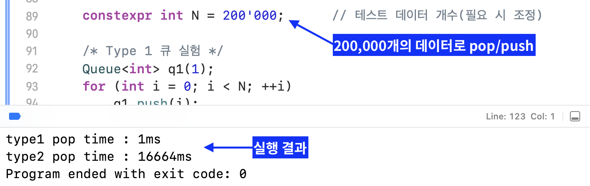

# HW2 과제 해설 — 연결 큐의 push와 pop

[레포지토리 안내](../../README.ko.md) | [English](Assignment-Explanation.md) | [한국어](Assignment-Explanation.ko.md)

> **최종 수정일:** 2026-10-19

> **학습 목표:**
> 1. 연결 큐의 두 표현(type 1, type 2)에서 링크의 방향과 `front`, `rear`의 위치를 설명할 수 있다
> 2. 두 표현의 push가 모두 $O(1)$인 이유를 설명할 수 있다
> 3. type 2의 pop이 새 전단을 찾느라 $O(n)$이 걸리는 이유와 원소 $n$개를 모두 pop하는 비용을 설명할 수 있다
> 4. 빈 큐와 원소가 하나인 큐의 경계 경우를 push와 pop에서 처리할 수 있다
> 5. 실행 시간의 측정 결과를 시간 복잡도로 해석할 수 있다

---

## 목차

- [1. 과제 구성과 실행 방법](#1-과제-구성과-실행-방법)
- [2. 요구사항](#2-요구사항)
  - [2.1 연결 큐의 두 가지 표현](#21-연결-큐의-두-가지-표현)
  - [2.2 문제와 배점](#22-문제와-배점)
- [3. 설계와 해결 방법](#3-설계와-해결-방법)
  - [3.1 push](#31-push)
  - [3.2 type 1의 pop](#32-type-1의-pop)
  - [3.3 type 2의 pop](#33-type-2의-pop)
  - [3.4 빈 큐의 pop](#34-빈-큐의-pop)
- [4. 테스트](#4-테스트)
  - [4.1 제출한 실행 화면](#41-제출한-실행-화면)
  - [4.2 테스트용 드라이버로 다시 실행한 결과](#42-테스트용-드라이버로-다시-실행한-결과)
- [5. 실행 시간의 해석](#5-실행-시간의-해석)
- [요약](#요약)
- [점검 문제](#점검-문제)

---

<br>

## 1. 과제 구성과 실행 방법

연결 큐 클래스 `Queue<T>`의 멤버 함수 `push`와 `pop`을 두 가지 표현(type 1, type 2)에 대해 작성하고, 완성한 프로그램으로 두 표현의 pop 시간을 재어 실행 화면을 캡처하는 과제이다. 6강의 연결 큐(4절)를 그대로 쓴다. 과제 안내문은 [`Original/Assignment.ko.md`](Original/Assignment.ko.md)에 옮겨 두었다.

```text
Coursework/HW02_Linked-Queue-Push-and-Pop/
├── Original/
│   ├── Assignment.md       # 과제 안내문 (영어)
│   └── Assignment.ko.md    # 과제 안내문 (한국어)
└── Solution/
    ├── Push-and-Pop.cpp    # 제출한 push와 pop
    └── Test-Driver.cpp     # 두 함수를 실행하기 위한 테스트용 드라이버
```

*그림 1. HW2 과제의 디렉토리 구성*

```bash
cd Coursework/HW02_Linked-Queue-Push-and-Pop/Solution
g++ -std=c++17 -Wall -Wextra -pedantic -o hw2 Test-Driver.cpp
./hw2           # 원소 200,000개로 측정한다 (20초 안팎 걸린다)
./hw2 20000     # 원소 수를 인자로 바꿀 수 있다
```

> **참고:** 제출에 쓴 전체 프로그램(`Queue` 클래스의 나머지 부분, 시간 측정, `main`)은 남아 있지 않다. `Test-Driver.cpp`는 제출한 두 함수를 컴파일하고 실행하기 위해 Claude Code로 작성한 테스트용 드라이버이며, 측정 방법과 원소 수(200,000개)는 제출한 실행 화면(4.1절)을 따른다. 두 함수는 `#include`로 클래스 정의 안에 들어가며 고치지 않았다. 드라이버의 구성은 [HW2 코드 총정리](Code-Walkthrough.ko.md)에 정리하였다.

---

<br>

## 2. 요구사항

### 2.1 연결 큐의 두 가지 표현

큐는 노드 클래스 `Node<T>`(데이터 필드 `data`, 링크 필드 `link`)를 이은 체인이며, 맨 먼저 들어와 다음에 pop될 노드를 `front`가, 맨 나중에 push된 노드를 `rear`가 가리킨다. 빈 큐는 `front`와 `rear`가 모두 `nullptr`인 상태이다. 두 표현은 링크의 방향이 다르다.

- **type 1:** 각 노드가 자기 다음에 push된 노드를 가리킨다. 링크는 `front`에서 `rear` 쪽을 향하고, `rear`의 링크가 `NULL`이다.
- **type 2:** 각 노드가 자기 직전에 push된 노드를 가리킨다. 링크는 `rear`에서 `front` 쪽을 향하고, `front`의 링크가 `NULL`이다.

```text
(a) type 1: 링크가 전단에서 후단 쪽을 향한다
 front                                         rear
   |                                             |
   v                                             v
 [ 1 ] ---> [ 2 ] ---> [ 3 ] ---> [ 4 ] ---> [ 5 ] ---> NULL

(b) type 2: 링크가 후단에서 전단 쪽을 향한다
          front                                         rear
            |                                             |
            v                                             v
NULL <--- [ 1 ] <--- [ 2 ] <--- [ 3 ] <--- [ 4 ] <--- [ 5 ]
```

*그림 2. 1, 2, 3, 4, 5를 차례로 push한 type 1과 type 2의 큐*

두 표현은 6강 4.1절에서 체인의 머리와 꼬리를 큐의 두 끝에 배정하는 두 방법과 같다. type 1은 머리를 전단, 꼬리를 후단으로 두는 방법 (a)이고, type 2는 머리를 후단, 꼬리를 전단으로 두는 방법 (b)이다. 6강은 (b)의 pop이 $\Theta(n)$이므로 (a)가 낫다고 결론짓는데, 이 과제는 그 차이를 구현과 실행 시간으로 확인한다.

### 2.2 문제와 배점

| 문제 | 내용 | 배점 |
|:-----|:-----|-----:|
| 1 | `push`: (1-1) type 1의 push(20점), (1-2) type 2의 push(10점) | 30 |
| 2 | `pop`: (2-1) type 1의 pop(20점), (2-2) type 2의 pop(30점) | 50 |
| 3 | 완성한 코드로 프로그램을 실행하고 결과 화면을 캡처한다 | 20 |

*표 1. HW2의 문제와 배점*

뼈대 코드는 `push`의 끝에서 `queueSize`를 하나 늘리고, `pop`의 끝에서 하나 줄인 뒤 지역 변수 `popData`를 반환한다. 표현은 생성할 때 정하는 멤버 `type`이 1인지 아닌지로 나뉜다.

---

<br>

## 3. 설계와 해결 방법

### 3.1 push

```cpp
if (type == 1) {
    if (rear == nullptr) {
        front = rear = newNode;       // 빈 큐: 새 노드가 전단이자 후단이다
    } else {
        rear->link = newNode;         // 현재 후단이 새 노드를 가리킨다
        rear       = newNode;
    }
}
else {
    if (rear == nullptr) {
        front = rear = newNode;
    } else {
        newNode->link = rear;         // 새 노드가 현재 후단을 가리킨다
        rear          = newNode;
    }
}
```

두 표현 모두 빈 큐에 push하면 새 노드가 전단이자 후단이 된다. `Node<T>`의 생성자가 링크를 `nullptr`로 두므로 노드가 하나뿐인 큐는 두 표현에서 같은 모양이다. 비어 있지 않으면 type 1은 현재 후단의 링크를 새 노드로 바꾸고, type 2는 새 노드의 링크를 현재 후단으로 정한다. 어느 쪽이든 링크 하나와 `rear`만 바꾸므로 $O(1)$이다. 빈 큐인지는 `rear`로 판단하는데, 3.2절과 3.3절의 pop이 마지막 원소를 꺼낼 때 `front`와 `rear`를 함께 `nullptr`로 되돌리므로 이 판단이 언제나 맞다.

### 3.2 type 1의 pop

```cpp
if (front == nullptr) return T();

Node<T>* popNode = front;
popData          = popNode->data;

front = front->link;                  // 다음 노드가 새 전단이 된다
if (front == nullptr)
    rear = nullptr;                   // 마지막 원소를 꺼냈으면 후단도 비운다

delete popNode;
```

type 1에서는 전단의 링크가 바로 다음 전단이므로 `front`를 한 칸 옮긴 뒤 원래 전단을 삭제하면 된다. $O(1)$이며 6강 4.2절의 `pop`과 같은 방법이다. 마지막 원소를 꺼냈을 때 `rear`를 `nullptr`로 바꾸지 않으면 `rear`가 해제된 노드를 가리킨 채 남고, 다음 push가 빈 큐가 아니라고 판단하여 해제된 노드의 링크에 값을 쓰게 된다.

### 3.3 type 2의 pop

```cpp
if (front == nullptr) return T();

popData = front->data;

if (front == rear) {                  // 원소가 하나뿐이다
    delete front;
    front = rear = nullptr;
} else {
    Node<T>* prev = rear;
    while (prev->link != front)       // 링크가 전단인 노드를 후단부터 찾는다
        prev = prev->link;

    delete front;
    front      = prev;                // 그 노드가 새 전단이 된다
    front->link = nullptr;            // 새 전단이 체인의 끝이다
}
```

type 2에서는 링크가 전단 쪽을 향하므로 전단에서 다음 전단(전단 직후에 push된 노드)으로 갈 수 없다. 그 노드는 링크가 현재 전단을 가리키는 노드이므로, `rear`에서 출발하여 링크를 따라가며 찾는다. 원소가 $k$개 $(k \ge 2)$이면 `prev`는 후단에서 출발하여 전단에서 두 번째 노드에서 멈추므로 반복은 $k - 2$번이고, pop 한 번이 $\Theta(k)$이다. 새 전단을 찾은 뒤에는 원래 전단을 삭제하고, 새 전단의 링크를 `nullptr`로 바꾸어 해제된 노드를 가리키지 않게 한다.

원소가 하나뿐인 경우를 따로 처리하는 것도 필요하다. 이때 `front`와 `rear`가 같은 노드이고 그 링크가 `nullptr`이므로, 반복을 그대로 실행하면 `prev`가 `nullptr`이 된 뒤 `prev->link`를 읽어 널 포인터를 역참조한다. 제출한 코드는 `front == rear`일 때 노드를 삭제하고 두 포인터를 비워 이 경우를 피한다.

### 3.4 빈 큐의 pop

두 표현 모두 빈 큐에서 pop하면 `queueSize--`에 이르기 전에 `T()`를 반환하므로, 원소 수가 음수가 되지 않고 큐의 상태도 바뀌지 않는다.

> **주의:** `T()`는 `int`에서 0이므로, 호출한 쪽은 빈 큐의 반환값과 실제로 꺼낸 원소 0을 구별할 수 없다. 6강 4.2절의 `pop`은 빈 큐에서 `std::underflow_error` 예외를 던진다. 반환값으로 알리려면 호출하기 전에 원소 수를 확인해야 하며, 테스트용 드라이버도 `size()`가 0보다 클 때만 pop한다.

---

<br>

## 4. 테스트

### 4.1 제출한 실행 화면

제출한 프로그램은 원소 200,000개를 type 1 큐와 type 2 큐에 각각 push한 뒤 모두 pop하는 시간을 재어 출력한다. 화면 위쪽은 원소 수 `N`을 정하고 type 1 큐 `q1`에 push하는 코드이고, 아래쪽은 실행 결과이다.



*그림 3. 원소 200,000개로 type 1과 type 2의 pop 시간을 잰 실행 화면*

type 1의 pop 시간은 1ms, type 2의 pop 시간은 16,664ms로 1만 배가 넘게 차이가 난다. 안내문의 예시 화면(type 1 2ms, type 2 313ms)도 같은 경향을 보인다. 두 결과의 차이가 어디에서 오는지는 5절에서 해석한다.

### 4.2 테스트용 드라이버로 다시 실행한 결과

`Test-Driver.cpp`는 먼저 두 표현에 0~4를 push하고 pop되는 순서를 출력한 뒤, 원소 200,000개로 pop 시간을 잰다. 시간을 재는 동안에도 $i$번째 pop이 $i$를 반환하는지 확인하여 선입선출 순서가 어긋나면 그 위치를 출력한다. Apple M2 Pro에서 Apple clang 21로 최적화 옵션 없이 컴파일하여 실행한 결과는 다음과 같다.

```text
type1 pop order : 0 1 2 3 4
type2 pop order : 0 1 2 3 4
type1 pop time : 2ms
type2 pop time : 21651ms
```

두 표현 모두 넣은 순서대로 꺼내고, 200,000번의 pop에서도 순서가 어긋나지 않았다. 시간의 차이는 제출한 화면과 같은 규모이다. 이 밖에 다음을 확인하였다.

| 확인 항목 | 결과 |
|:-----|:-----|
| 빈 큐에서 pop | 두 표현 모두 0을 반환하고 원소 수는 0 그대로이다 |
| push 1, 2, pop, push 3, pop, pop, push 4, 5, pop | 두 표현 모두 1, 2, 3, 4를 차례로 반환하고 원소 수는 1이 된다 |
| AddressSanitizer와 UndefinedBehaviorSanitizer (원소 2,000개) | 오류 없음 |
| macOS `leaks --atExit` (원소 3,000개) | 누수 0바이트 |

*표 2. 테스트용 드라이버로 확인한 항목*

---

<br>

## 5. 실행 시간의 해석

type 1은 pop 한 번이 $O(1)$이므로 원소 $n$개를 모두 꺼내는 데 $O(n)$이 걸린다. type 2는 원소가 $k$개일 때 pop 한 번에 반복을 $k - 2$번 하므로, 가득 찬 큐에서 $n$개를 모두 꺼내는 동안의 반복 횟수는 다음과 같다.

$$
\sum_{k=2}^{n} (k - 2) = \frac{(n-1)(n-2)}{2} \approx \frac{n^2}{2}
$$

$n = 200{,}000$이면 19,999,700,001번, 약 $2.0 \times 10^{10}$번이다. 제출한 화면의 16,664ms를 이 횟수로 나누면 반복 한 번에 약 0.83ns가 걸렸다. 반복마다 `prev = prev->link`로 다음 노드의 주소를 읽어야 다음 비교를 할 수 있으므로, 반복들을 겹쳐 실행할 수 없다. 원소 수를 바꾸어 재면 type 2의 시간이 제곱에 비례함을 확인할 수 있다.

| 원소 수 $n$ | type 1 | type 2 | type 2의 반복 횟수 $(n-1)(n-2)/2$ |
|-----:|-----:|-----:|-----:|
| 25,000 | 0ms | 353ms | 312,462,501 |
| 50,000 | 0ms | 1,365ms | 1,249,925,001 |
| 100,000 | 1ms | 5,466ms | 4,999,850,001 |
| 200,000 | 2ms | 21,651ms | 19,999,700,001 |

*표 3. 원소 수에 따른 pop 시간 (테스트용 드라이버, 표 2와 같은 환경)*

원소 수가 두 배가 될 때마다 type 2의 시간은 3.87배, 4.00배, 3.96배로 늘어 약 4배씩 커지고, type 1은 ms 단위에서 거의 0에 머문다. 같은 큐 연산이라도 링크의 방향 하나가 pop의 비용을 $O(1)$에서 $\Theta(n)$으로 바꾸며, 연산을 $n$번 반복하는 프로그램에서는 $O(n)$과 $O(n^2)$의 차이가 된다. 따라서 연결 큐는 6강의 결론대로 링크가 전단에서 후단 쪽을 향하는 type 1로 구현한다.

---

<br>

## 요약

| 개념 | 핵심 요약 |
|:-----|:-----|
| type 1 | 링크가 전단에서 후단 쪽을 향하며, push는 후단의 링크를 새 노드로, pop은 `front`를 다음 노드로 옮겨 둘 다 $O(1)$이다. |
| type 2 | 링크가 후단에서 전단 쪽을 향하며, push는 새 노드가 후단을 가리키게 하여 $O(1)$이지만 pop은 새 전단을 후단부터 찾아야 해 $\Theta(n)$이다. |
| 빈 큐로 돌아가기 | 마지막 원소를 pop하면 `front`와 `rear`를 모두 `nullptr`로 바꾸어야 다음 push가 빈 큐로 올바르게 판단한다. |
| type 2의 경계 경우 | 원소가 하나이면 반복 없이 삭제하고, 그 밖에는 새 전단의 링크를 `nullptr`로 바꾸어 해제된 노드를 가리키지 않게 한다. |
| 빈 큐의 pop | `T()`를 반환하고 원소 수를 바꾸지 않지만, 반환값만으로는 실제 원소와 구별할 수 없다. |
| 실행 시간 | 원소 $n$개를 모두 pop하는 데 type 1은 $O(n)$, type 2는 반복 $(n-1)(n-2)/2$번으로 $O(n^2)$이며, 200,000개에서 1ms와 16,664ms로 나타났다. |

---

<br>

## 점검 문제

1. **반복 횟수:** type 2 큐에 1, 2, 3, 4, 5가 들어 있을 때 pop 한 번에서 while 반복은 몇 번 실행되며, 반복이 끝났을 때 `prev`는 어느 노드를 가리키는가?

   <details>
   <summary>정답</summary>

   `prev`는 후단의 노드 5에서 출발하여 4, 3, 2로 옮겨 가고, 노드 2의 링크가 전단인 노드 1이므로 멈춘다. 반복은 $k - 2 = 3$번이며, `prev`가 가리키는 노드 2가 새 전단이 된다.

   </details>

2. **후단 비우기:** type 1의 pop에서 `if (front == nullptr) rear = nullptr;`를 빼고 원소가 하나인 큐에서 pop한 뒤 다시 push하면 무슨 일이 생기는가?

   <details>
   <summary>정답</summary>

   pop 뒤에 `front`는 `nullptr`이지만 `rear`는 해제된 노드를 가리킨다. 다음 push는 `rear`가 `nullptr`이 아니므로 비어 있지 않은 큐로 판단하고 해제된 노드의 링크에 새 노드를 쓴다(해제 후 사용). `front`는 여전히 `nullptr`이므로 새 노드는 pop할 수 없다.

   </details>

3. **원소가 하나인 type 2 큐:** type 2의 pop에서 `front == rear` 분기 없이 `else` 부분만 실행하면 원소가 하나일 때 어떻게 되는가?

   <details>
   <summary>정답</summary>

   `prev`가 `rear`, 곧 전단과 같은 노드에서 출발한다. 그 링크는 `nullptr`이어서 `front`와 다르므로 `prev`가 `nullptr`로 옮겨 가고, 다음 조건 검사에서 `prev->link`를 읽어 널 포인터를 역참조한다.

   </details>

4. **새 전단의 링크:** type 2의 pop에서 `front->link = nullptr;`을 빼면 어떤 문제가 생기는가?

   <details>
   <summary>정답</summary>

   새 전단의 링크가 방금 해제한 노드를 가리킨 채 남는다. 다음 pop의 반복은 링크가 전단인 노드를 찾을 뿐 전단의 링크를 읽지 않으므로 바로 드러나지 않지만, 링크를 `nullptr`까지 따라가는 코드(예: 테스트용 드라이버의 소멸자)는 해제된 노드를 읽고 다시 해제하게 된다.

   </details>

5. **시간 예측:** 제출한 화면과 같은 환경에서 원소 수를 400,000개로 늘리면 type 2의 pop 시간은 얼마쯤으로 예상되는가?

   <details>
   <summary>정답</summary>

   반복 횟수가 $(n-1)(n-2)/2$로 $n$의 제곱에 비례하므로 원소 수가 두 배이면 시간은 약 4배가 된다. 16,664ms의 약 4배인 66,000ms 안팎, 곧 1분 남짓으로 예상된다. type 1은 원소 수에 비례하므로 2ms 안팎이다.

   </details>
