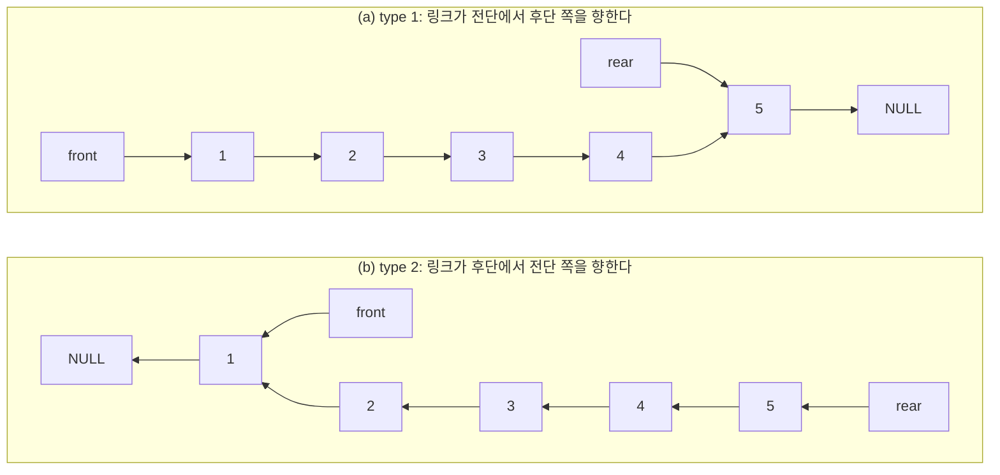

# HW2 과제 안내문 — 연결 큐의 push와 pop

[레포지토리 안내](../../../README.ko.md) | [English](Assignment.md) | [한국어](Assignment.ko.md)

> **최종 수정일:** 2026-11-17

자료구조 2차 프로그래밍 과제(Programming Homework #2), 연결 큐의 pop과 push 연산(Linked Queue Pop and Push Operation)이다. 과제는 세 문제로 이루어지며 모두 100점이다. 문제 1과 2는 연결 큐의 두 가지 표현인 type 1과 type 2에 대해 `Queue` 클래스의 멤버 함수 `push`와 `pop`의 빈 부분을 채운다.

큐는 노드 `Node<T>`(데이터 필드 `data`, 링크 필드 `link`)를 이은 체인이며, 포인터 `front`는 다음에 pop할 노드를, `rear`는 마지막에 push한 노드를 가리킨다. 두 표현은 링크의 방향이 다르다. type 1에서는 각 노드의 링크가 자기 다음에 push된 노드를 가리키므로 `rear`의 링크가 `NULL`이고, type 2에서는 각 노드의 링크가 자기 직전에 push된 노드를 가리키므로 `front`의 링크가 `NULL`이다.



*그림 1. 1, 2, 3, 4, 5를 차례로 push한 type 1과 type 2의 큐*

---

<br>

## 문제 1. push (30점)

`Queue` 클래스의 연산 `push`를 프로그래밍하라.

```cpp
void push(const T& item)
{
    Node<T>* newNode = new Node<T>(item);

    // (1-1) Program an operation push for type1 (20 Points)
    if (type == 1) {

    }

    // (1-2) Program an operation push for type2 (10 Points)
    else {

    }

    queueSize++;
}
```

---

<br>

## 문제 2. pop (50점)

`Queue` 클래스의 연산 `pop`을 프로그래밍하라.

```cpp
T pop()
{
    T popData;

    // (2-1) Program an operation pop for type1 (20 Points)
    if (type == 1) {

    }

    // (2-2) Program an operation pop for type2 (30 Points)
    else {

    }

    queueSize--;
    return popData;
}
```

---

<br>

## 문제 3. 실행 화면 (20점)

완성한 코드로 프로그램을 실행하고 결과 화면을 캡처하라. 안내문은 다음 출력을 예시로 든다.

```text
type1 pop time : 2ms
type2 pop time : 313ms
```

---

<br>

문제를 풀어 본 뒤 [과제 해설](../Assignment-Explanation.ko.md)에서 정답과 풀이를, [코드 총정리](../Code-Walkthrough.ko.md)에서 작성한 코드 전체를 볼 수 있다.
