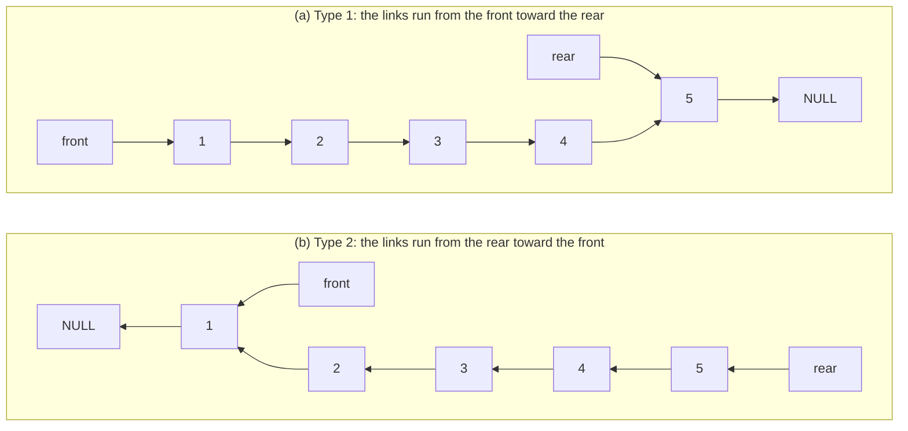

# HW2 Assignment Handout — Linked Queue Push and Pop

[Repository Guide](../../../README.md) | [English](Assignment.md) | [한국어](Assignment.ko.md)

> **Last Updated:** 2026-11-17

Data Structures Programming Homework #2, Linked Queue Pop and Push Operation. The homework has three problems worth 100 points in total. Problems 1 and 2 fill in the parts of the member functions `push` and `pop` of the class `Queue` for the two representations of a linked queue, type 1 and type 2.

The queue is a chain of nodes `Node<T>` (data field `data`, link field `link`); the pointer `front` points to the node to be popped next, and `rear` points to the node pushed last. The two representations differ in the direction of the links. In type 1 each node links to the node pushed right after it, so the link of `rear` is `NULL`; in type 2 each node links to the node pushed right before it, so the link of `front` is `NULL`.



*Figure 1. Type 1 and type 2 queues after pushing 1, 2, 3, 4, 5 in turn*

---

<br>

## Problem 1. push (30 points)

Program the operation `push` of the class `Queue`.

```cpp
void push(const T& item)
{
    Node<T>* newNode = new Node<T>(item);

    // (1-1) Program an operation push for type1 (20 Points)
    if (type == 1) {

    }

    // (1-2) Program an operation push for type2 (10 Points)
    else {

    }

    queueSize++;
}
```

---

<br>

## Problem 2. pop (50 points)

Program the operation `pop` of the class `Queue`.

```cpp
T pop()
{
    T popData;

    // (2-1) Program an operation pop for type1 (20 Points)
    if (type == 1) {

    }

    // (2-2) Program an operation pop for type2 (30 Points)
    else {

    }

    queueSize--;
    return popData;
}
```

---

<br>

## Problem 3. Execution Screenshots (20 points)

Run the program with the completed code and capture screenshots of the results. The handout gives the following output as an example.

```text
type1 pop time : 2ms
type2 pop time : 313ms
```

---

<br>

After solving the problems, see the [assignment explanation](../Assignment-Explanation.md) for the answers and solutions and the [code walkthrough](../Code-Walkthrough.md) for the complete code.
