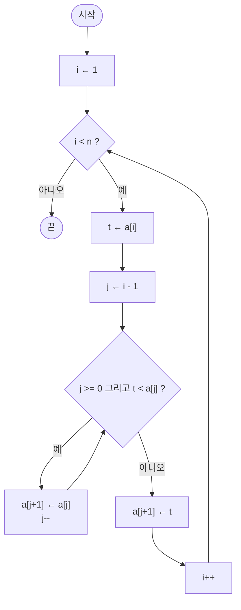

# 1강 — 성능 분석

[레포지토리 안내](../../README.ko.md) | [English](Concepts_Lecture.md) | [한국어](Concepts_Lecture.ko.md)

> **최종 수정일:** 2026-10-18

> **학습 목표:**
> 1. 단계 수(step count)를 사용하여 알고리즘 성능을 분석할 수 있다
> 2. 최선, 최악, 평균 경우 복잡도를 구분할 수 있다
> 3. 점근 표기법(Big-O, Omega, Theta)을 적용할 수 있다
> 4. 프로그램 공간을 명령어 공간, 데이터 공간, 환경 스택 공간으로 나누어 설명할 수 있다
> 5. 경과 시간과 CPU 시간을 구분하여 실행 시간을 측정할 수 있다

---

## 목차

- [1. 성능 분석 개요](#1-성능-분석-개요)
  - [1.1 성능이란?](#11-성능이란)
  - [1.2 왜 성능을 분석하는가?](#12-왜-성능을-분석하는가)
- [2. 공간 복잡도](#2-공간-복잡도)
  - [2.1 공간의 구성 요소](#21-공간의-구성-요소)
  - [2.2 고정 공간 vs. 가변 공간](#22-고정-공간-vs-가변-공간)
  - [2.3 데이터 공간과 자료형의 크기](#23-데이터-공간과-자료형의-크기)
  - [2.4 환경 스택 공간](#24-환경-스택-공간)
  - [2.5 예제: 배열 합계](#25-예제-배열-합계)
  - [2.6 재귀적 공간](#26-재귀적-공간)
  - [2.7 재귀 함수의 장단점](#27-재귀-함수의-장단점)
  - [2.8 공간 효율을 높이는 방법](#28-공간-효율을-높이는-방법)
- [3. 시간 복잡도](#3-시간-복잡도)
  - [3.1 연산 횟수](#31-연산-횟수)
  - [3.2 예제: 삽입 정렬](#32-예제-삽입-정렬)
  - [3.3 삽입 정렬의 비교 횟수](#33-삽입-정렬의-비교-횟수)
  - [3.4 단계 계수법](#34-단계-계수법)
  - [3.5 최선, 최악, 평균 경우](#35-최선-최악-평균-경우)
- [4. 점근 복잡도](#4-점근-복잡도)
  - [4.1 점근 복잡도가 필요한 이유](#41-점근-복잡도가-필요한-이유)
  - [4.2 상한과 Big O 표기법](#42-상한과-big-o-표기법)
  - [4.3 하한과 Omega 표기법](#43-하한과-omega-표기법)
  - [4.4 Theta 표기법과 최적 알고리즘](#44-theta-표기법과-최적-알고리즘)
  - [4.5 Little o 표기법과 성장률 계층](#45-little-o-표기법과-성장률-계층)
- [5. 성능 측정](#5-성능-측정)
  - [5.1 경과 시간 측정](#51-경과-시간-측정)
  - [5.2 CPU 시간 vs. 경과 시간](#52-cpu-시간-vs-경과-시간)
  - [5.3 측정 모범 사례](#53-측정-모범-사례)
- [6. 실용적인 프로파일링 기법](#6-실용적인-프로파일링-기법)
  - [6.1 `clock()`을 이용한 CPU 시간 측정](#61-clock을-이용한-cpu-시간-측정)
  - [6.2 경험적 복잡도 결정](#62-경험적-복잡도-결정)
- [7. 부록](#7-부록)
  - [7.1 성능 분석 시 흔한 실수](#71-성능-분석-시-흔한-실수)
- [요약](#요약)
- [점검 문제](#점검-문제)

---

<br>

## 1. 성능 분석 개요

### 1.1 성능이란?

프로그램의 **성능(performance)** 은 프로그램을 실행하는 데 필요한 컴퓨터 메모리와 시간의 양이다. 프로그램의 성능은 두 가지 핵심 자원으로 측정된다:

- **공간**(메모리): 프로그램이 사용하는 메모리의 양이며, 보통 바이트, KB, MB, GB, TB 단위로 잰다.
- **시간**(CPU 사이클 / 경과 시간): 실행 중 소비되는 시간이며, 보통 실행 횟수나 초 단위로 잰다.

성능은 분석적인 방법인 **성능 분석(performance analysis)** 과 실험적인 방법인 **성능 측정(performance measurement)** 으로 구한다. 성능 분석은 프로그램을 실행하기 **이전에** 그 동작을 예측하는 데 도움을 주며, 성능 측정은 실제 실행으로부터 **경험적** 데이터를 제공한다.

### 1.2 왜 성능을 분석하는가?

- 알고리즘이 실제로 쓸 만한지 판단한다.
- 동일한 문제를 푸는 대안 알고리즘을 비교한다. 예를 들어 점근 복잡도가 $O(n)$인 알고리즘과 $O(n^2)$인 알고리즘을 비교한다.
- 입력 크기 증가에 따른 확장성을 예측하고, 큰 인스턴스에서의 실행 시간을 예측한다.
- 배포 전에 병목 지점을 식별한다.
- 정보에 기반하여 설계를 결정한다.

> **핵심:** 성능 분석은 *사전적(a priori)* 추정이며, 성능 측정은 *사후적(a posteriori)* 검증이다.

---

<br>

## 2. 공간 복잡도

### 2.1 공간의 구성 요소

**공간 복잡도(space complexity)** 는 프로그램이 실행을 마칠 때까지 필요한 메모리의 양이다. 공간 복잡도가 중요한 이유는 다음과 같다.

- 다중 사용자 시스템에서는 프로그램마다 정해진 양의 공간만 할당될 수 있다.
- 컴퓨터의 메모리가 충분하지 않을 수 있다.
- 한 문제에 여러 해법이 있고, 해법마다 필요한 공간이 다를 수 있다.
- 공간 복잡도가 프로그램이 처리할 수 있는 데이터 양의 상한을 정할 수 있다.

프로그램 공간은 **명령어 공간(instruction space)**, **데이터 공간(data space)**, **환경 스택 공간(environment stack space)** 을 더한 것이다. 명령어 공간은 컴파일된 기계어 코드가 차지하는 공간으로, 기계어 코드를 만드는 컴파일러, 컴파일할 때 설정한 컴파일러 옵션, 대상 컴퓨터에 따라 달라진다. 데이터 공간은 상수와 변수가 차지하는 공간이고(2.3절), 환경 스택 공간은 함수 호출 정보를 저장하는 공간이다(2.4절).

프로그램 $P$에 필요한 총 공간 $S(P)$는 다음과 같다:

$$S(P) = c + S_p(\text{instance characteristics})$$

여기서:
- $c$ = **고정 부분**: 코드 공간, 단순 변수, 상수
- $S_p$ = **가변 부분**: 특정 문제 인스턴스에 따라 달라짐(입력 크기, 재귀 깊이, 동적 할당)

**인스턴스 특성(instance characteristic)** 은 입력의 크기처럼 문제 인스턴스마다 달라지며 필요한 공간과 시간에 영향을 주는 특성이다.

### 2.2 고정 공간 vs. 가변 공간

| 구성 요소 | 고정 | 가변 |
|-----------|------|------|
| 명령어 공간 | 예 | 아니오 |
| 단순 변수 | 예 | 아니오 |
| 동적 할당 메모리 | 아니오 | 예 |
| 재귀 스택 공간 | 아니오 | 예 |

*표 1. 공간 구성 요소의 고정 부분과 가변 부분*

### 2.3 데이터 공간과 자료형의 크기

데이터 공간의 크기는 컴퓨터 구조와 컴파일러에 크게 의존하며, 프로그램이 다루는 데이터의 양에도 의존한다. 같은 자료형이라도 환경에 따라 크기가 다르다.

| 자료형 | 16비트 컴파일러의 예 | x86-64 Linux의 g++ |
|--------|------|------|
| `char` | 1 | 1 |
| `short` | 2 | 2 |
| `int` | 2 | 4 |
| `long` | 4 | 8 |
| `float` | 4 | 4 |
| `double` | 8 | 8 |
| `long double` | 10 | 16 |
| 포인터 | 2 | 8 |

*표 2. 환경에 따른 자료형의 크기(바이트)*

Apple Silicon(arm64) macOS의 g++에서는 `long double`이 8바이트이고 나머지는 x86-64 Linux와 같다. 필요한 범위를 담는 가장 작은 자료형을 고르면 프로그램 전체의 공간 사용량이 줄어든다. 배열이 차지하는 공간은 원소 수와 원소 하나의 크기를 곱한 값이므로, 배열을 다룰 때는 알맞은 자료형을 고르는 일이 특히 중요하다.

### 2.4 환경 스택 공간

함수가 호출될 때마다 다음 데이터가 스택(임시 메모리)에 저장된다.

1. 복귀 주소(return address)
2. 모든 지역 변수와 값 형식 매개변수(value formal parameter)의 값
3. 모든 참조 매개변수와 `const` 참조 매개변수의 바인딩(binding)

재귀 함수는 호출할 때마다 이 데이터가 새로 쌓이므로 재귀 깊이에 비례하는 환경 스택 공간이 필요하다. 재귀 함수는 작성하기는 쉽지만 디버깅하기는 더 어렵고, 현명하게 쓰지 않으면 **스택 오버플로(stack overflow)** 를 일으킬 수 있다.

### 2.5 예제: 배열 합계

```cpp
// 공간 복잡도 분석
int sum(int a[], int n) {
    int total = 0;          // 1 int
    for (int i = 0; i < n; i++)  // 1 int (i)
        total += a[i];
    return total;
}
// S_p = 0 (n에 비례하는 추가 공간 없음)
// 총합: O(1) 추가 공간 (입력 배열 제외)
```

### 2.6 재귀적 공간

```cpp
int recursiveSum(int a[], int n) {
    if (n == 0) return 0;
    return a[n-1] + recursiveSum(a, n-1);
}
// 각 재귀 호출이 스택 공간을 사용
// 재귀 깊이 = n
// S_p = O(n)
```

> **핵심:** 재귀 알고리즘은 호출 스택으로 인해 공간 복잡도가 상당히 높아질 수 있다.

### 2.7 재귀 함수의 장단점

재귀 함수는 강력하고 간결한 해법을 만들 수 있지만, 다음과 같은 이유로 특정 상황에서는 좋지 않은 선택일 수 있다.

| 측면 | 설명 |
|------|------|
| 성능 | 재귀 함수는 호출 스택으로 함수 호출을 추적하므로 재귀 깊이가 너무 깊으면 스택 오버플로 오류가 발생한다. 단순한 피보나치 수 계산처럼 지수 시간 복잡도를 갖는 재귀 해법도 있어 반복 해법보다 비효율적일 수 있다. |
| 메모리 사용 | 재귀 호출마다 호출 스택의 메모리를 쓰므로 재귀가 깊으면 메모리 사용량이 커지고, 자원이 제한된 환경에서 문제가 된다. |
| 디버깅 | 실행 흐름과 각 재귀 호출의 상태를 파악하기 어려워 반복 해법보다 디버깅이 까다롭다. |
| 가독성과 유지 보수 | 재귀는 코드를 간결하게 만들지만 재귀에 익숙하지 않은 사람에게는 이해하기 어렵다. 반복 해법이 더 직관적인 경우가 많다. |
| 꼬리 호출 최적화 | 일부 언어는 재귀의 성능 문제를 줄이는 **꼬리 호출 최적화(tail call optimization, TCO)** 를 지원하지만, 모든 언어가 지원하지는 않으므로 이 기능에 의존하면 이식성이 떨어진다. |
| 대안 | 재귀로 풀 수 있는 문제는 대부분 반복문으로도 풀 수 있으며, 반복 해법이 더 효율적이고 이해하기 쉬울 수 있다. |

*표 3. 재귀 함수를 쓸 때 고려할 점*

재귀는 우아한 해법을 주는 유용한 도구이지만 성능, 가독성, 유지 보수 측면의 절충을 따져야 한다. 재귀 깊이가 깊은 문제나 성능이 중요한 경우에는 반복 방식이 나은 경우가 많다.

### 2.8 공간 효율을 높이는 방법

- 항상 필요한 범위를 담는 가장 작은 자료형을 고른다.
- 사용하는 컴파일러를 공부한다.
- 컴파일 설정이 공간에 주는 영향을 익힌다.
- 적절한 경우 비재귀 알고리즘을 고른다.

---

<br>

## 3. 시간 복잡도

### 3.1 연산 횟수

**시간 복잡도(time complexity)** 는 프로그램을 실행하는 데 필요한 컴퓨터 시간의 양이다. 어떤 컴퓨터는 프로그램 실행 시간의 상한을 요구하고, 어떤 프로그램은 실시간 응답을 요구하며, 한 문제에 해법이 여러 개이면 보통 가장 빠른 것을 고르려 하므로 시간 복잡도가 중요하다.

시간 복잡도를 재는 방법은 세 가지이다.

1. 특정 연산의 횟수를 센다(**연산 횟수**, operation count).
2. 단계의 수를 센다(**단계 수**, step count, 3.4절).
3. 근사치인 **점근 복잡도**(asymptotic complexity)를 구한다(4절).

시간 복잡도는 입력 크기 $n$의 함수로서 **핵심 연산**의 횟수를 계수하여 추정한다.

핵심 연산의 예:
- 비교
- 산술 연산
- 데이터 이동(대입)
- 함수 호출

### 3.2 예제: 삽입 정렬

**정렬(sorting)** 은 `a[0]`, `a[1]`, ..., `a[n-1]`을 오름차순으로 재배열하여 `a[0] <= a[1] <= ... <= a[n-1]`이 되게 하는 문제이다. 예를 들어 8, 6, 9, 4, 3을 정렬하면 3, 4, 6, 8, 9가 된다. 정렬 방법에는 삽입 정렬(insertion sort), 버블 정렬(bubble sort), 선택 정렬(selection sort), 카운트 정렬(count sort), 셰이커 정렬(shaker sort), 셸 정렬(shell sort), 힙 정렬(heap sort), 병합 정렬(merge sort), 퀵 정렬(quick sort) 등이 있다. 이 절은 삽입 정렬을 예로 연산 횟수와 단계 수를 구한다.

**원소 하나의 삽입.** 정렬된 수열에 새 원소를 삽입하는 연산이 삽입 정렬의 기본 단계이다. 3, 6, 9, 14에 5를 삽입하면 3, 5, 6, 9, 14가 된다. 새 원소를 마지막 원소부터 차례로 비교하면서 새 원소보다 큰 원소를 오른쪽으로 한 칸씩 옮기고, 새 원소보다 크지 않은 원소를 만나면 그 바로 뒤의 빈자리에 새 원소를 넣는다.

```text
3   6   9   14  _       (1) 5와 14를 비교한다: 5 < 14
3   6   9   _   14      (2) 14를 오른쪽으로 옮긴다
3   6   _   9   14      (3) 9를 오른쪽으로 옮긴다 (5 < 9)
3   _   6   9   14      (4) 6을 오른쪽으로 옮긴다 (5 < 6), 5 < 3은 거짓이므로 멈춘다
3   5   6   9   14      (5) 빈자리에 5를 넣는다
```

*그림 1. 정렬된 수열 3, 6, 9, 14에 5를 삽입하는 과정*

다음 코드는 새 값 `t`를 정렬된 `a[0:i-1]`(인덱스 0부터 i-1까지)에 삽입한다.

```cpp
// t를 a[0:i-1]에 삽입한다 (t는 새 값)
int j;
for (j = i - 1; j >= 0 && t < a[j]; j--)
    a[j + 1] = a[j];   // a[j]가 t보다 크면 오른쪽으로 한 칸 옮긴다
a[j + 1] = t;          // 조건이 거짓이 되면 빈자리 a[j + 1]에 t를 넣는다
```

그림 1의 예에서는 `i = 4`, `t = 5`이다. `j = 3, 2, 1`에서 `t < a[j]`가 참이므로 14, 9, 6을 옮기고, `j = 0`에서 `5 < 3`이 거짓이므로 반복을 끝내고 `a[1]`에 5를 넣는다.

**삽입 정렬.** 크기 1인 수열(첫 원소)에서 시작하여 나머지 원소를 하나씩 삽입한다. 7, 3, 5, 6, 1을 정렬하면 7에서 시작하여 3을 삽입하면 3, 7이, 5를 삽입하면 3, 5, 7이, 6을 삽입하면 3, 5, 6, 7이, 1을 삽입하면 1, 3, 5, 6, 7이 된다.

```cpp
for (int i = 1; i < n; i++)   // n은 배열의 원소 수
{
    // a[i]를 a[0:i-1]에 삽입한다
    int t = a[i];
    int j;
    for (j = i - 1; j >= 0 && t < a[j]; j--)
        a[j + 1] = a[j];
    a[j + 1] = t;
}
```



*그림 2. 삽입 정렬의 흐름도*

| i | t = a[i] | 비교 t < a[j] | 옮긴 원소 | 반복이 끝난 j | 결과 |
|---|---|---|---|---|---|
| 1 | 3 | 3 < 7 (참) | 7 | -1 | 3, 7, 5, 6, 1 |
| 2 | 5 | 5 < 7 (참), 5 < 3 (거짓) | 7 | 0 | 3, 5, 7, 6, 1 |
| 3 | 6 | 6 < 7 (참), 6 < 5 (거짓) | 7 | 1 | 3, 5, 6, 7, 1 |
| 4 | 1 | 1 < 7, 1 < 6, 1 < 5, 1 < 3 (모두 참) | 7, 6, 5, 3 | -1 | 1, 3, 5, 6, 7 |

*표 4. 7, 3, 5, 6, 1에 대한 삽입 정렬의 실행 과정*

`i = 2`에서 `j = 0`일 때 `5 < 3`이 거짓이 되면 반복문이 끝나며, 이때 `j--`는 실행되지 않는다. 따라서 `j = 0`인 채로 `a[j + 1] = a[1]`에 5가 들어간다. 반면 `i = 1`과 `i = 4`에서는 `t`가 앞의 모든 원소보다 작아 `j`가 -1까지 줄어든다. 그러면 `j >= 0`이 거짓이므로 `&&` 연산자의 단락 평가(short-circuit evaluation)에 따라 `t < a[j]`는 평가되지 않고, 존재하지 않는 `a[-1]`에 접근하지 않는다.

### 3.3 삽입 정렬의 비교 횟수

연산 횟수 방법을 삽입 정렬에 적용한다. 먼저 인스턴스 특성을 고른다. 삽입 정렬에서는 원소의 수 $n$이다. 그다음 세려는 연산의 횟수를 이 인스턴스 특성의 함수로 구한다. 여기서는 `t < a[j]` 비교의 횟수를 센다.

```cpp
for (int i = 1; i < n; i++)
    for (j = i - 1; j >= 0 && t < a[j]; j--)
        a[j + 1] = a[j];
```

비교 횟수는 $n$뿐 아니라 `a[]`의 값과 `t`에 따라서도 달라진다. 그래서 횟수를 세 가지로 나누어 생각한다.

1. 최악 경우 횟수: 최대 횟수
2. 최선 경우 횟수: 최소 횟수
3. 평균 횟수

**최악 경우.** 한 번의 삽입에서 `t`가 `a[0:i-1]`의 모든 원소보다 작을 때 비교가 가장 많다. 예를 들어 `a = [1, 2, 3, 4]`이고 `t = 0`이면 4번, 일반적으로 `a = [1, 2, ..., i]`이고 `t = 0`이면 $i$번 비교한다. 첫 원소는 크기 1인 정렬된 수열로 시작하므로 삽입할 원소는 $n-1$개이고, 바깥 반복문의 $i$는 1부터 $n-1$까지 변한다. 따라서 최악 경우의 총 비교 횟수는 다음과 같다.

$$1 + 2 + 3 + \cdots + (n-1) = \frac{(n-1)n}{2}$$

입력이 역순(예: 5, 4, 3, 2, 1)이면 모든 삽입이 최악 경우가 된다.

**최선 경우.** 입력이 이미 오름차순이면 매 삽입에서 첫 비교가 거짓이므로 $i$마다 1번, 총 $n-1$번 비교한다.

표 4의 입력 7, 3, 5, 6, 1에서는 1 + 2 + 2 + 4 = 9번 비교하며, 이는 $n = 5$일 때의 최선 4번과 최악 10번 사이이다.

**평균.** 평균 횟수를 구하려면 입력의 확률 분포를 가정해야 한다(3.5절). 모든 순서가 같은 확률로 나타난다고 가정하면 평균 비교 횟수도 $n^2$에 비례한다.

### 3.4 단계 계수법

연산 횟수 방법은 선택한 연산 외의 모든 부분에서 쓰인 시간을 무시한다. 단계 수 방법은 프로그램의 모든 부분에서 쓰인 시간을 센다.

**프로그램 단계(program step)** 란 인스턴스 특성에 독립적인 실행 시간을 가지는 프로그램의 구문적 또는 의미적으로 유의미한 단위이다.

예를 들어 덧셈 100번, 뺄셈 100번, 곱셈 1000번처럼 횟수가 인스턴스 특성과 관계없이 정해진 계산은 한 단계로 셀 수 있다. 그러나 $n$번의 덧셈은 $n$에 따라 시간이 달라지므로 한 단계로 셀 수 없다.

```cpp
// 단계 계수 예제: 행렬 덧셈
void matrixAdd(int A[][MAX], int B[][MAX], int C[][MAX], int n) {
    for (int i = 0; i < n; i++)         // n+1 회
        for (int j = 0; j < n; j++)     // n(n+1) 회
            C[i][j] = A[i][j] + B[i][j]; // n^2 회
}
// 총 단계 수: n+1 + n(n+1) + n^2 = 2n^2 + 2n + 1
// 시간 복잡도: O(n^2)
```

이 예제는 반복문 머리의 조건이 거짓이 되는 마지막 검사까지 센다. 바깥 `for`의 검사는 $n+1$회이고, 안쪽 `for`의 검사는 바깥 반복마다 $n+1$회씩 모두 $n(n+1)$회이다.

**s/e와 빈도.** 각 문장의 **실행당 단계 수(steps per execution, s/e)** 와 실행 횟수인 **빈도(frequency)** 를 곱하여 모두 더하면 총 단계 수가 된다. 주석, 선언, 중괄호처럼 실행 시간이 없는 줄의 s/e는 0이다. 삽입 정렬의 최악 경우는 다음과 같다.

| 문장 | s/e | 빈도 | 단계 수 |
|------|-----|------|---------|
| `for (int i = 1; i < n; i++)` | 1 | $n-1$ | $n-1$ |
| `{` | 0 | $n-1$ | 0 |
| `// a[i]를 a[0:i-1]에 삽입한다` | 0 | 0 | 0 |
| `int t = a[i];` | 1 | $n-1$ | $n-1$ |
| `int j;` | 0 | $n-1$ | 0 |
| `for (j = i - 1; j >= 0 && t < a[j]; j--)` | 1 | $(n-1)n/2$ | $(n-1)n/2$ |
| `a[j + 1] = a[j];` | 1 | $(n-1)n/2$ | $(n-1)n/2$ |
| `a[j + 1] = t;` | 1 | $n-1$ | $n-1$ |
| `}` | 0 | $n-1$ | 0 |

*표 5. 삽입 정렬의 최악 경우 단계 수*

$$(n-1) + (n-1) + \frac{(n-1)n}{2} + \frac{(n-1)n}{2} + (n-1) = n^2 + 2n - 3 = (n-1)(n+3)$$

> **주의:** 총 단계 수는 s/e와 빈도의 곱을 더한 값이다. s/e가 0인 줄(`{`, `int j;`, `}`)의 빈도를 단계 수로 더하면 안 된다. 예를 들어 `}` 줄의 빈도 $n-1$만 더해도 $n^2 + 3n - 4$라는 잘못된 값이 나온다.

> **참고:** **반복문 검사의 계수 방식.** 표 5의 빈도는 반복문 머리의 검사 중 조건이 참인 검사만 센다. 행렬 덧셈 예제처럼 조건이 거짓이 되는 마지막 검사까지 세면 바깥 `for`는 $n$회, 안쪽 `for`는 최악 경우 $(n-1)n/2 + (n-1)$회가 되어 총 단계 수는 $n^2 + 3n - 3$이다. 어느 방식으로 세든 최고차항은 $n^2$이다.

### 3.5 최선, 최악, 평균 경우

주어진 입력 크기 $n$에 대해:
- **최선 경우(Best case)**: 크기 $n$의 모든 가능한 입력에 대한 최소 단계 수
- **최악 경우(Worst case)**: 최대 단계 수 (가장 일반적으로 사용됨)
- **평균 경우(Average case)**: 기대 단계 수 (확률 분포 필요)

```cpp
// 순차 검색 예제
int sequentialSearch(int a[], int n, int x) {
    for (int i = 0; i < n; i++)
        if (a[i] == x) return i;
    return -1;
}
// 최선 경우:  O(1)    (첫 번째 위치에서 발견)
// 최악 경우:  O(n)    (찾지 못하거나 마지막 위치)
// 평균 경우:  O(n/2) = O(n)
```

---

<br>

## 4. 점근 복잡도

### 4.1 점근 복잡도가 필요한 이유

연산 횟수와 단계 수를 구하는 중요한 이유는 두 가지이다.

1. 같은 함수를 계산하는 두 프로그램의 시간 복잡도를 비교한다.
2. 인스턴스 특성(입력 데이터의 수)이 변할 때 실행 시간이 얼마나 늘어나는지 예측한다.

그러나 두 방법 모두 매우 정확한 척도는 아니다. 연산 횟수는 핵심 연산에만 집중하고 나머지 연산을 모두 무시하며, 단계 수는 단계라는 개념 자체가 엄밀하지 않다. **점근 복잡도(asymptotic complexity)** 는 프로그램의 시간 복잡도와 공간 복잡도에 대해 의미 있는 서술을 제공한다. 점근 복잡도는 정확한 시간을 재지는 않지만 실행 시간의 근사치를 보여 준다.

**예.** 두 프로그램의 복잡도가 각각 $c_1n^2 + c_2n$과 $c_3n$이라 하자. $n$이 충분히 크면 복잡도가 $c_3n$인 프로그램이 $c_1n^2 + c_2n$인 프로그램보다 빠르다. $n$이 작으면 상수 $c_1$, $c_2$, $c_3$의 값에 따라 어느 쪽이든 더 빠를 수 있다. $c_1 = 1$, $c_2 = 2$, $c_3 = 100$이면 $n^2 + 2n \le 100n$은 $n \le 98$과 같으므로, $n \le 98$에서는 $c_1n^2 + c_2n \le c_3n$이고 $n > 98$에서는 $c_1n^2 + c_2n > c_3n$이다.

### 4.2 상한과 Big O 표기법

**점근 표기법(asymptotic notation)** 은 인스턴스 특성이 클 때 시간 복잡도나 공간 복잡도가 어떻게 행동하는지 기술한다.

1. **Big O ($O$)** 표기법은 함수 $f$의 상한(upper bound)을 제공한다.
2. **Omega ($\Omega$)** 표기법은 하한(lower bound)을 제공한다.
3. **Theta ($\Theta$)** 표기법은 같은 함수로 위와 아래를 모두 한정할 수 있을 때 쓴다(정확한 차수를 나타내는 표기라고도 한다).
4. **Little o ($o$)** 표기법은 엄격한 상한(strict upper bound)을 정의한다. 꼭 맞지 않는 상한이라는 뜻에서 느슨한 상한(loose upper bound)이라고도 한다.

시간 복잡도 $T(n)$은 문제 크기 $n$의 함수이다. 보통 $T(n)$은 최악 경우의 실행 시간, 곧 임의의 입력에 대해 필요한 단계 수의 최댓값을 뜻하고, 평균 경우는 많은 무작위 입력에 대해 필요한 단계 수의 평균이다. 예를 들어 버블 정렬은 $n$개의 데이터를 정렬하는 데 $T(n) = n(n-1)/2$번의 비교 교환 단계가 필요하다. $T(n)$의 정확한 값을 알 필요 없이 상한만 추정해도 충분한 경우가 많다. 모든 $n$에서 $T(n) \le f(n) = n^2/2$이므로 $f(n)$은 버블 정렬의 시간 복잡도 $T(n)$의 상한이며, 버블 정렬은 많아야 $f(n)$의 시간이 걸린다.

점근 복잡도는 큰 $n$에 대해 $T(n)$의 상한이 되는 함수 $f(n)$이다. 일반적으로 점근 복잡도의 **차수(order)**, 곧 선형 함수, 이차 함수, 지수 함수 중 어느 것인지만 관심을 둔다. 차수는 Big O 표기법을 써서 **복잡도 클래스(complexity class)** 로 나타낸다.

> **용어 정의:** 양의 상수 $c$와 $n_0$이 존재하여 $n \ge n_0$인 모든 $n$에 대해 $f(n) \le c \cdot g(n)$이면 $f(n) = O(g(n))$이다("f(n)은 g(n)의 Big O"라고 읽는다). 곧 $O(g)$는 어떤 상수 $c$와 수 $n_0$이 있어서 $n \ge n_0$인 모든 $n$에서 $f(n)$이 $c \cdot g(n)$ 이하인 함수 $f$를 모두 모은 집합이다.

- 버블 정렬의 시간 복잡도 $T(n)$은 복잡도 클래스 $O(n^2)$에 속한다. $O(n^2)$은 많아야 이차로 증가하는 모든 함수의 클래스이며, 예를 들어 많아야 이차로 증가하는 $n^2 + 2n + 1$도 $O(n^2)$에 속한다.
- $O(n)$은 많아야 선형으로 증가하는 모든 함수의 집합이다.
- $O(1)$은 상수를 상한으로 가지는 모든 함수의 집합이다.
- 상수 $k$에 대해 $O(n^k)$은 많아야 $n^k$의 차수로 증가하는 함수의 집합이며, 모든 $k$에 대한 이 클래스들을 합친 것이 다항식으로 증가하는 함수들이다.

### 4.3 하한과 Omega 표기법

어떤 문제를 푸는 알고리즘을 찾으면 더 빠른 알고리즘을 설계할 수 있는지가 문제가 된다. 더 빠른 알고리즘을 실제로 찾지 않고도 그런 알고리즘이 있을 수 있는지 판단하려면 문제의 **하한(lower bound)**, 곧 그 문제를 푸는 모든 알고리즘이 적어도 실행해야 하는 단계 수가 필요하며, 대부분의 경우 하한을 제시할 수 있다. 예를 들어 $n$개의 수를 정렬하려면 어떤 알고리즘이든 적어도 모든 수를 한 번씩 보아야 하므로 적어도 $n$단계가 필요하다. 따라서 $f(n) = n$은 정렬 문제의 하한이며, 정렬 문제의 복잡도는 $\Omega(n)$이다.

하한도 차수, 곧 선형, 이차, 지수 함수 중 어느 것인지만 고려하며, 이 차수를 Omega 표기법의 함수 클래스로 나타낸다.

> **용어 정의:** 양의 상수 $c$와 $n_0$이 존재하여 $n \ge n_0$인 모든 $n$에 대해 $f(n) \ge c \cdot g(n)$이면 $f(n) = \Omega(g(n))$이다("f(n)은 g(n)의 Omega"라고 읽는다).

### 4.4 Theta 표기법과 최적 알고리즘

$f(n) = n^2 + 2n + 1$, $g(n) = n^2$이라 하자. $c = 1$, $n_0 = 2$로 잡으면 $n \ge n_0$에서 $n^2 + 2n + 1 \ge c \cdot n^2$이므로 $f(n) = \Omega(n^2)$이다(실제로는 모든 $n \ge 0$에서 성립한다). 이 함수는 $O(n^2)$에도 속하므로 적어도 이차로 증가하면서 많아야 이차로 증가한다. 함수의 정확한 차수를 나타내기 위해 클래스 $\Theta$를 쓴다.

> **용어 정의:** 양의 상수 $c_1$, $c_2$, $n_0$이 존재하여 $n \ge n_0$인 모든 $n$에 대해 $c_1 \cdot g(n) \le f(n) \le c_2 \cdot g(n)$이면 $f(n) = \Theta(g(n))$이다("f(n)은 g(n)의 Theta"라고 읽는다). 곧 $f$는 $n$이 $n_0$보다 작은 경우를 제외하면 $g$의 $c_1$배와 $c_2$배 사이에 놓인다.

정렬 문제의 하한은 $\Omega(n)$이고, 버블 정렬로 얻는 상한은 $O(n^2)$이다. 이 간격은 좁힐 수 있다. 힙 정렬은 $O(n \log n)$ 시간에 정렬하고, 하한도 $\Omega(n \log n)$으로 높일 수 있다. 상한과 하한이 일치하므로 정렬 문제의 복잡도는 $\Theta(n \log n)$이고, 힙 정렬은 상한이 문제의 하한과 같은 **최적(optimal)** 정렬 알고리즘이다.

> **주의:** $\Omega(n \log n)$ 하한은 원소끼리 비교하여 순서를 정하는 **비교 기반 정렬(comparison sort)** 에 적용된다. 키가 좁은 범위의 정수일 때 쓰는 계수 정렬(counting sort)처럼 비교를 쓰지 않는 방법은 이 하한의 대상이 아니다.

### 4.5 Little o 표기법과 성장률 계층

$f(n) = o(g(n))$("f(n)은 g(n)의 little o"라고 읽는다)은 $f$가 $g$보다 엄격히 낮은 성장률을 가진다는 뜻이다. 같은 성장률은 허용하지 않으므로 little o는 **엄격한 상한(strict upper bound)** 이며, 꼭 맞지 않는 상한이라는 뜻에서 느슨한 상한(loose upper bound)이라고도 한다. 정확한 정의와 극한을 이용한 증명은 2강에서 다룬다.

성장률 함수의 계층은 다음과 같다.

$$1 < \log n < n < n \log n < n^2 < n^3 < 2^n < 3^n < n! < n^n$$

자주 쓰는 성장률 함수는 다음과 같다.

- $1$ (상수): 증가가 문제 크기 $n$과 무관하다.
- $\log_2 n$ (로그): 문제 크기에 비해 느리게 증가한다(이진 탐색).
- $n$ (선형): 문제 크기에 정비례한다.
- $n \log_2 n$: 일부 분할 정복 방법에서 나타난다(병합 정렬).
- $n^2$ (이차): 이중 반복문에서 나타난다.
- $n^3$ (삼차): 삼중 반복문에서 나타난다.
- $2^n$ (지수): 증가가 극도로 빨라 실용적이지 않을 수 있다.

| $\log n$ | $n$ | $n \log n$ | $n^2$ | $n^3$ | $2^n$ |
|---|---|---|---|---|---|
| 0 | 1 | 0 | 1 | 1 | 2 |
| 1 | 2 | 2 | 4 | 8 | 4 |
| 2 | 4 | 8 | 16 | 64 | 16 |
| 3 | 8 | 24 | 64 | 512 | 256 |
| 4 | 16 | 64 | 256 | 4096 | 65536 |
| 5 | 32 | 160 | 1024 | 32768 | 4294967296 |

*표 6. 입력 크기에 따른 성장률 함수의 값($\log$의 밑은 2)*

$n$이 32일 때 $n^3$은 32768에 그치지만 $2^n$은 40억이 넘는다. 지수 시간 복잡도는 입력이 조금만 커져도 감당할 수 없는 큰 문제가 된다.

---

<br>

## 5. 성능 측정

### 5.1 경과 시간 측정

```cpp
#include <chrono>

auto start = std::chrono::high_resolution_clock::now();
// ... 측정할 코드 ...
auto end = std::chrono::high_resolution_clock::now();

auto duration = std::chrono::duration_cast<std::chrono::microseconds>(end - start);
std::cout << "Time: " << duration.count() << " microseconds" << std::endl;
```

### 5.2 CPU 시간 vs. 경과 시간

| 지표 | 설명 | 사용 사례 |
|------|------|-----------|
| 경과 시간(Wall-clock time) | 실제 경과된 총 시간 | 최종 사용자 경험 |
| CPU 시간 | 해당 프로세스에 CPU가 소비한 시간 | 알고리즘 비교 |
| 사용자 시간(User time) | 사용자 모드에서의 CPU 시간 | 순수 계산 |
| 시스템 시간(System time) | 커널 모드에서의 CPU 시간 | I/O 연산 |

*표 7. 실행 시간 지표의 비교*

### 5.3 측정 모범 사례

1. 분산을 줄이기 위해 **여러 번 반복**하여 실행한다.
2. 타이밍 전에 캐시를 **워밍업**한다.
3. 일관되게 **최적화를 비활성화**한다(또는 활성화한 상태에서 일관되게 측정한다).
4. 유의미한 측정을 위해 **충분히 큰 입력**을 사용한다.
5. **시스템 부하**와 백그라운드 프로세스를 고려한다.

---

<br>

## 6. 실용적인 프로파일링 기법

### 6.1 `clock()`을 이용한 CPU 시간 측정

```cpp
#include <ctime>

clock_t start = clock();
// ... 측정할 코드 ...
clock_t end = clock();
double cpu_time = (double)(end - start) / CLOCKS_PER_SEC;
```

### 6.2 경험적 복잡도 결정

서로 다른 입력 크기에서 실행 시간을 측정함으로써 성장률을 경험적으로 결정할 수 있다. 다음 표는 가상의 측정값으로 각 비율을 계산한 예이다($\ln$은 자연로그).

| n | T(n) | T(n)/n | T(n)/n^2 | T(n)/(n ln n) |
|---|------|--------|----------|---------------|
| 1000 | 0.01s | 1e-5 | 1e-8 | 1.4e-6 |
| 2000 | 0.04s | 2e-5 | 1e-8 | 2.6e-6 |
| 4000 | 0.16s | 4e-5 | 1e-8 | 4.8e-6 |

*표 8. 입력 크기별 측정 시간과 성장률 함수에 대한 비율*

$T(n)/n$과 $T(n)/(n \ln n)$은 $n$이 커질수록 계속 증가하므로 이 함수들은 실행 시간의 성장을 따라가지 못한다. $T(n)/n^2$이 대략 일정하게 유지되면, 해당 알고리즘의 실행 시간은 $n^2$에 비례하여 증가한다고 추정할 수 있다(경험적으로 $O(n^2)$, 더 정확히는 $\Theta(n^2)$의 성장률). 측정은 유한한 몇 개의 $n$에서만 하므로 점근적인 성장률을 증명하지는 못한다.

---

<br>

## 7. 부록

### 7.1 성능 분석 시 흔한 실수

1. **상수 무시**: $O$-표기법은 상수를 숨기지만, 중간 크기의 $n$에서는 상수가 실제로 중요하다.
2. **분할 상환과 최악 경우 혼동**: 일부 연산은 가끔 비용이 크지만 평균적으로는 저렴하다.
3. **캐시 효과**: 메모리 접근 패턴이 실세계 성능에 상당한 영향을 미친다.
4. **컴파일러 최적화**: 컴파일러가 죽은 코드를 제거하거나 연산 순서를 바꿀 수 있다.

---

<br>

## 요약

| 개념 | 핵심 요약 |
|------|------------|
| 성능 | 프로그램 실행에 필요한 메모리와 시간의 양이며, 성능 분석으로 예측하고 성능 측정으로 확인한다. |
| 공간 복잡도 | 프로그램 공간은 명령어, 데이터, 환경 스택 공간으로 이루어지며, $S(P) = c + S_p$로 고정 부분과 가변 부분을 나눈다. |
| 재귀와 공간 | 재귀 호출마다 복귀 주소, 지역 변수, 매개변수가 스택에 쌓이므로 재귀 깊이에 비례하는 공간이 필요하다. |
| 시간 복잡도 | 입력 크기 $n$의 함수로서 핵심 연산의 횟수를 세어 추정한다. |
| 삽입 정렬 | 정렬된 앞부분에 원소를 하나씩 삽입하며, 최악 경우 $(n-1)n/2$번, 최선 경우 $n-1$번 비교한다. |
| 단계 계수 | 각 문장의 s/e와 빈도를 곱해 합산하며, 삽입 정렬의 최악 경우 총 단계 수는 $n^2 + 2n - 3$이다. |
| 최선/최악/평균 | 같은 입력 크기에서도 입력에 따라 단계 수가 달라지므로 최소, 최대, 기댓값의 한계를 따로 구한다. |
| 점근 표기법 | $O$는 상한, $\Omega$는 하한, $\Theta$는 같은 차수의 상한과 하한, $o$는 엄격한 상한을 나타낸다. |
| 성능 측정 | 경험적 타이밍을 위해 `chrono`로 경과 시간을, `clock()`으로 CPU 시간을 잰다. |
| 프로파일링 | 여러 번 반복 실행하고 충분히 큰 입력을 쓰며 일관된 방법론으로 측정한다. |

---

<br>

## 점검 문제

1. **시간 복잡도와 공간 복잡도:** 시간 복잡도와 공간 복잡도의 차이는 무엇인가?

   <details>
   <summary>정답</summary>

   시간 복잡도는 입력 크기의 함수로서 연산 횟수를 측정하고, 공간 복잡도는 필요한 메모리를 측정한다.

   </details>

2. **최악 경우 분석:** 왜 일반적으로 최악 경우 분석에 초점을 맞추는가?

   <details>
   <summary>정답</summary>

   최악 경우 분석은 필요한 최대 자원에 대한 보장을 제공하며, 이는 실시간 시스템과 신뢰성에 매우 중요하다.

   </details>

3. **복잡도와 실제 속도:** 시간 복잡도가 더 높은 알고리즘이 실제로 더 빠를 수 있는가?

   <details>
   <summary>정답</summary>

   그렇다. 작은 입력의 경우, 상수가 작은 $O(n^2)$ 알고리즘이 상수가 큰 $O(n \log n)$ 알고리즘보다 빠를 수 있다. 4.1절의 예에서도 $n \le 98$이면 $n^2 + 2n$이 $100n$ 이하이다.

   </details>

4. **손익분기점:** 두 프로그램의 복잡도가 $c_1n^2 + c_2n$과 $c_3n$이고 $c_1 = 1$, $c_2 = 2$, $c_3 = 3$일 때, $c_1n^2 + c_2n \le c_3n$이 성립하는 양의 정수 $n$의 범위를 구하라.

   <details>
   <summary>정답</summary>

   $n^2 + 2n \le 3n$은 $n^2 \le n$, 곧 $n \le 1$과 같다. 따라서 $n = 1$에서만 성립하며, 이때 두 값은 모두 3이다. $n \ge 2$이면 $c_3n$ 프로그램이 항상 더 빠르다(예: $n = 2$에서 $8 > 6$). 상수 $c_3$이 작아지면 손익분기점이 $n = 98$에서 $n = 1$로 줄어든다.

   </details>

5. **배열의 데이터 공간:** `double a[100];`과 `int maze[rows][cols];`는 각각 몇 바이트를 차지하는가? 표 2의 두 환경에 대해 답하라.

   <details>
   <summary>정답</summary>

   `double`은 두 환경 모두 8바이트이므로 `a`는 100 × 8 = 800바이트이다. `maze`는 `int`가 rows × cols개이므로 `int`가 2바이트인 16비트 컴파일러에서는 2 × rows × cols바이트, `int`가 4바이트인 x86-64 Linux의 g++에서는 4 × rows × cols바이트이다.

   </details>
