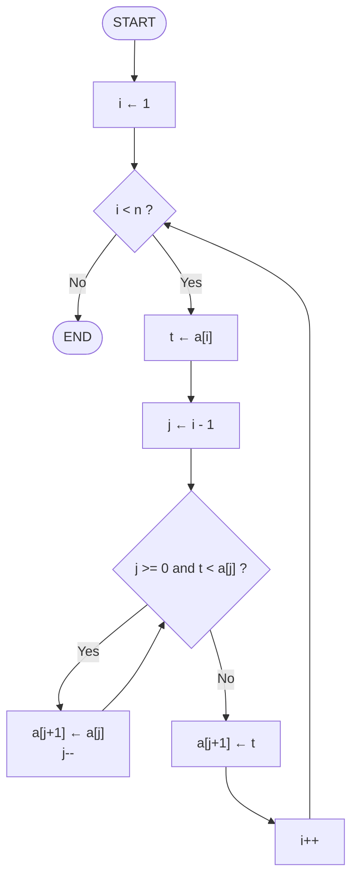

# Lecture 1 — Performance Analysis

[Repository Guide](../../README.md) | [English](Concepts_Lecture.md) | [한국어](Concepts_Lecture.ko.md)

> **Last Updated:** 2026-10-18

> **Learning Objectives:**
> 1. Analyze algorithm performance using step counts
> 2. Distinguish best, worst, and average case complexity
> 3. Apply asymptotic notation (Big-O, Omega, Theta)
> 4. Explain program space as instruction space, data space, and environment stack space
> 5. Measure running time while distinguishing wall-clock time from CPU time

---

## Table of Contents

- [1. Introduction to Performance Analysis](#1-introduction-to-performance-analysis)
  - [1.1 What is Performance?](#11-what-is-performance)
  - [1.2 Why Analyze Performance?](#12-why-analyze-performance)
- [2. Space Complexity](#2-space-complexity)
  - [2.1 Components of Space](#21-components-of-space)
  - [2.2 Fixed vs. Variable Space](#22-fixed-vs-variable-space)
  - [2.3 Data Space and Data Type Sizes](#23-data-space-and-data-type-sizes)
  - [2.4 Environment Stack Space](#24-environment-stack-space)
  - [2.5 Example: Array Sum](#25-example-array-sum)
  - [2.6 Recursive Space](#26-recursive-space)
  - [2.7 Pros and Cons of Recursive Functions](#27-pros-and-cons-of-recursive-functions)
  - [2.8 Making Programs More Space Efficient](#28-making-programs-more-space-efficient)
- [3. Time Complexity](#3-time-complexity)
  - [3.1 Operation Counts](#31-operation-counts)
  - [3.2 Example: Insertion Sort](#32-example-insertion-sort)
  - [3.3 Comparison Count of Insertion Sort](#33-comparison-count-of-insertion-sort)
  - [3.4 Step Count Method](#34-step-count-method)
  - [3.5 Best, Worst, and Average Cases](#35-best-worst-and-average-cases)
- [4. Asymptotic Complexity](#4-asymptotic-complexity)
  - [4.1 Why Asymptotic Complexity Is Needed](#41-why-asymptotic-complexity-is-needed)
  - [4.2 Upper Bounds and Big O Notation](#42-upper-bounds-and-big-o-notation)
  - [4.3 Lower Bounds and Omega Notation](#43-lower-bounds-and-omega-notation)
  - [4.4 Theta Notation and Optimal Algorithms](#44-theta-notation-and-optimal-algorithms)
  - [4.5 Little o Notation and the Growth Rate Hierarchy](#45-little-o-notation-and-the-growth-rate-hierarchy)
- [5. Performance Measurement](#5-performance-measurement)
  - [5.1 Wall-Clock Timing](#51-wall-clock-timing)
  - [5.2 CPU Time vs. Wall-Clock Time](#52-cpu-time-vs-wall-clock-time)
  - [5.3 Measurement Best Practices](#53-measurement-best-practices)
- [6. Practical Profiling Techniques](#6-practical-profiling-techniques)
  - [6.1 Using `clock()` for CPU Time](#61-using-clock-for-cpu-time)
  - [6.2 Empirical Complexity Determination](#62-empirical-complexity-determination)
- [7. Appendix](#7-appendix)
  - [7.1 Common Pitfalls in Performance Analysis](#71-common-pitfalls-in-performance-analysis)
- [Summary](#summary)
- [Self-Check Questions](#self-check-questions)

---

<br>

## 1. Introduction to Performance Analysis

### 1.1 What is Performance?

The **performance** of a program is the amount of computer memory and time needed to run it. Performance of a program is measured by two key resources:

- **Space** (memory): the amount of memory the program occupies, usually measured in bytes, KB, MB, GB, or TB.
- **Time** (CPU cycles / wall-clock time): the time consumed during execution, usually measured by the number of executions or in seconds.

Performance is determined analytically by **performance analysis** and experimentally by **performance measurement**. Performance analysis helps us predict the behavior of a program **before** running it, while performance measurement gives us **empirical** data from actual execution.

### 1.2 Why Analyze Performance?

- Determine whether an algorithm is practical.
- Compare alternative algorithms for the same problem. For example, compare an algorithm of asymptotic complexity $O(n)$ with one of $O(n^2)$.
- Predict scalability as input size grows, and predict the run time on large instances.
- Identify bottlenecks before deployment.
- Make informed design decisions.

> **Key Point:** Performance analysis is an *a priori* estimate; performance measurement is an *a posteriori* test.

---

<br>

## 2. Space Complexity

### 2.1 Components of Space

**Space complexity** is the amount of memory a program needs to run to completion. Space complexity matters for the following reasons.

- On a multi-user system, each program may be allocated only a specific amount of space.
- The computer may not have sufficient memory.
- A problem may have several solutions, each with different space requirements.
- The space complexity may define an upper bound on the amount of data the program can handle.

Program space is the sum of **instruction space**, **data space**, and **environment stack space**. Instruction space holds the compiled machine code and depends on the compiler that generates the machine code, the compiler options set at compilation time, and the target computer. Data space holds constants and variables (Section 2.3), and environment stack space stores function call information (Section 2.4).

The total space $S(P)$ needed by a program $P$ consists of:

$$S(P) = c + S_p(\text{instance characteristics})$$

Where:
- $c$ = **fixed part**: code space, simple variables, constants
- $S_p$ = **variable part**: depends on the particular problem instance (input size, recursion depth, dynamic allocations)

An **instance characteristic** is a property of a problem instance, such as the input size, that varies from instance to instance and affects the space and time required.

### 2.2 Fixed vs. Variable Space

| Component | Fixed | Variable |
|-----------|-------|----------|
| Instruction space | Yes | No |
| Simple variables | Yes | No |
| Dynamically allocated memory | No | Yes |
| Recursion stack space | No | Yes |

*Table 1. Fixed and variable parts of the space components*

### 2.3 Data Space and Data Type Sizes

The size of data space depends heavily on the computer architecture and the compiler, and also on the magnitude of the data the program works with. The same data type can have different sizes in different environments.

| Data Type | Example 16-bit Compiler | g++ on x86-64 Linux |
|-----------|------|------|
| `char` | 1 | 1 |
| `short` | 2 | 2 |
| `int` | 2 | 4 |
| `long` | 4 | 8 |
| `float` | 4 | 4 |
| `double` | 8 | 8 |
| `long double` | 10 | 16 |
| Pointer | 2 | 8 |

*Table 2. Data type sizes in bytes by environment*

With g++ on Apple Silicon (arm64) macOS, `long double` is 8 bytes and the other sizes match x86-64 Linux. Choosing the smallest data type that holds the required range reduces the overall space usage of the program. Since an array occupies the number of elements times the size of one element, choosing the correct type is especially important when working with arrays.

### 2.4 Environment Stack Space

Every time a function is called, the following data are saved on the stack (temporary memory).

1. The return address
2. The values of all local variables and value formal parameters
3. The binding of all reference and `const` reference parameters

A recursive function pushes these data again on every call, so it needs environment stack space proportional to the recursion depth. Recursive functions are easy to write but harder to debug, and if not used wisely they can cause a **stack overflow**.

### 2.5 Example: Array Sum

```cpp
// Space complexity analysis
int sum(int a[], int n) {
    int total = 0;          // 1 int
    for (int i = 0; i < n; i++)  // 1 int (i)
        total += a[i];
    return total;
}
// S_p = 0 (no extra space proportional to n)
// Total: O(1) extra space (ignoring input array)
```

### 2.6 Recursive Space

```cpp
int recursiveSum(int a[], int n) {
    if (n == 0) return 0;
    return a[n-1] + recursiveSum(a, n-1);
}
// Each recursive call uses stack space
// Depth of recursion = n
// S_p = O(n)
```

> **Key Point:** Recursive algorithms can have significantly higher space complexity due to the call stack.

### 2.7 Pros and Cons of Recursive Functions

Recursive functions can produce powerful and elegant solutions, but in certain situations they can be a poor choice for the following reasons.

| Aspect | Description |
|--------|-------------|
| Performance | A recursive function tracks calls on the call stack, so a recursion depth that is too high leads to a stack overflow error. Some recursive solutions, such as naive Fibonacci calculation, have exponential time complexity and can be inefficient compared to iterative solutions. |
| Memory usage | Each recursive call consumes memory on the call stack, so deep recursion leads to high memory usage, which is a problem in environments with limited resources. |
| Debugging | The flow of execution and the state of each recursive call are hard to follow, so debugging is more challenging than for iterative solutions. |
| Readability and maintainability | Recursion makes code concise but harder to understand for those unfamiliar with the concept. Iterative solutions are often more straightforward. |
| Tail call optimization | Some languages support **tail call optimization (TCO)**, which mitigates the performance issues of recursion, but not all languages support it, so relying on this feature reduces portability. |
| Alternatives | Most problems that can be solved with recursion can also be solved with loops, and the iterative solution may be more efficient and easier to understand. |

*Table 3. Considerations when using recursive functions*

Recursion is a valuable tool that leads to elegant solutions, but its trade-offs in performance, readability, and maintainability must be weighed. For problems with high recursion depth or when performance is critical, an iterative approach is often preferable.

### 2.8 Making Programs More Space Efficient

- Always choose the smallest data type that holds the required range.
- Study the compiler in use.
- Learn the effects of different compilation settings on space.
- Choose non-recursive algorithms when appropriate.

---

<br>

## 3. Time Complexity

### 3.1 Operation Counts

**Time complexity** is the amount of computer time a program needs to run. It matters because some computers require upper limits on program execution times, some programs require a real-time response, and when a problem has many solutions we typically want to choose the quickest.

There are three ways to measure time complexity.

1. Count a particular operation (**operation count**).
2. Count the number of steps (**step count**, Section 3.4).
3. Determine the approximate **asymptotic complexity** (Section 4).

Time complexity is estimated by counting the number of **key operations** as a function of input size $n$.

Key operations include:
- Comparisons
- Arithmetic operations
- Data movements (assignments)
- Function calls

### 3.2 Example: Insertion Sort

**Sorting** rearranges `a[0]`, `a[1]`, ..., `a[n-1]` into ascending order so that `a[0] <= a[1] <= ... <= a[n-1]`. For example, sorting 8, 6, 9, 4, 3 gives 3, 4, 6, 8, 9. Sort methods include insertion sort, bubble sort, selection sort, count sort, shaker sort, shell sort, heap sort, merge sort, and quick sort. This section uses insertion sort as the example for operation counts and step counts.

**Inserting one element.** Inserting a new element into a sorted sequence is the basic step of insertion sort. Inserting 5 into 3, 6, 9, 14 gives 3, 5, 6, 9, 14. The new element is compared with the elements from the last one backward; each element larger than the new element is shifted one position to the right, and when an element not larger than the new element is found, the new element goes into the empty slot right after it.

```text
3   6   9   14  _       (1) Compare 5 with 14: 5 < 14
3   6   9   _   14      (2) Shift 14 right
3   6   _   9   14      (3) Shift 9 right (5 < 9)
3   _   6   9   14      (4) Shift 6 right (5 < 6); 5 < 3 is false, so stop
3   5   6   9   14      (5) Insert 5 into the empty slot
```

*Figure 1. Inserting 5 into the sorted sequence 3, 6, 9, 14*

The following code inserts a new value `t` into the sorted `a[0:i-1]` (indices 0 through i-1).

```cpp
// insert t into a[0:i-1] (t is the new value)
int j;
for (j = i - 1; j >= 0 && t < a[j]; j--)
    a[j + 1] = a[j];   // if a[j] is larger than t, shift it one position right
a[j + 1] = t;          // when the condition becomes false, put t into the empty slot a[j + 1]
```

In the example of Figure 1, `i = 4` and `t = 5`. For `j = 3, 2, 1`, `t < a[j]` is true, so 14, 9, and 6 are shifted; at `j = 0`, `5 < 3` is false, so the loop ends and 5 goes into `a[1]`.

**Insertion sort.** Start with a sequence of size 1 (the first element) and repeatedly insert the remaining elements. To sort 7, 3, 5, 6, 1, start with 7 and insert 3 to get 3, 7; insert 5 to get 3, 5, 7; insert 6 to get 3, 5, 6, 7; insert 1 to get 1, 3, 5, 6, 7.

```cpp
for (int i = 1; i < n; i++)   // n is the number of elements in array
{
    // insert a[i] into a[0:i-1]
    int t = a[i];
    int j;
    for (j = i - 1; j >= 0 && t < a[j]; j--)
        a[j + 1] = a[j];
    a[j + 1] = t;
}
```



*Figure 2. Flow chart of insertion sort*

| i | t = a[i] | Comparisons t < a[j] | Shifted Elements | j When Loop Ends | Result |
|---|---|---|---|---|---|
| 1 | 3 | 3 < 7 (true) | 7 | -1 | 3, 7, 5, 6, 1 |
| 2 | 5 | 5 < 7 (true), 5 < 3 (false) | 7 | 0 | 3, 5, 7, 6, 1 |
| 3 | 6 | 6 < 7 (true), 6 < 5 (false) | 7 | 1 | 3, 5, 6, 7, 1 |
| 4 | 1 | 1 < 7, 1 < 6, 1 < 5, 1 < 3 (all true) | 7, 6, 5, 3 | -1 | 1, 3, 5, 6, 7 |

*Table 4. Execution of insertion sort on 7, 3, 5, 6, 1*

At `i = 2`, when `5 < 3` becomes false at `j = 0`, the loop ends and `j--` is not executed. So `j` stays 0 and 5 goes into `a[j + 1] = a[1]`. At `i = 1` and `i = 4`, on the other hand, `t` is smaller than all preceding elements, so `j` decreases to -1. Then `j >= 0` is false, so by the short-circuit evaluation of the `&&` operator `t < a[j]` is not evaluated, and the nonexistent `a[-1]` is never accessed.

### 3.3 Comparison Count of Insertion Sort

Let us apply the operation count method to insertion sort. First, pick an instance characteristic. For insertion sort, it is the number of elements $n$. Then determine the count of the chosen operation as a function of this instance characteristic. Here we count the comparisons `t < a[j]`.

```cpp
for (int i = 1; i < n; i++)
    for (j = i - 1; j >= 0 && t < a[j]; j--)
        a[j + 1] = a[j];
```

The number of comparisons depends on the values in `a[]` and on `t` as well as on $n$. So we consider three kinds of counts.

1. Worst case count: the maximum count
2. Best case count: the minimum count
3. Average count

**Worst case.** One insertion makes the most comparisons when `t` is smaller than every element of `a[0:i-1]`. For example, with `a = [1, 2, 3, 4]` and `t = 0` there are 4 comparisons, and in general with `a = [1, 2, ..., i]` and `t = 0` there are $i$ comparisons. Since the first element starts as a sorted sequence of size 1, $n-1$ elements are inserted, and $i$ in the outer loop runs from 1 to $n-1$. The total number of comparisons in the worst case is therefore:

$$1 + 2 + 3 + \cdots + (n-1) = \frac{(n-1)n}{2}$$

If the input is in reverse order (e.g., 5, 4, 3, 2, 1), every insertion is a worst case.

**Best case.** If the input is already in ascending order, the first comparison of every insertion is false, so there is 1 comparison per $i$ and $n-1$ comparisons in total.

For the input 7, 3, 5, 6, 1 of Table 4, there are 1 + 2 + 2 + 4 = 9 comparisons, between the best case of 4 and the worst case of 10 for $n = 5$.

**Average.** The average count requires an assumption about the probability distribution of the input (Section 3.5). If every ordering is equally likely, the average number of comparisons is also proportional to $n^2$.

### 3.4 Step Count Method

The operation count method omits the time spent on all but the chosen operation. The step count method accounts for the time spent in all parts of the program.

A **program step** is a syntactically or semantically meaningful segment of a program that has an execution time independent of the instance characteristics.

For example, a computation whose amount is fixed regardless of the instance characteristics, such as 100 additions, 100 subtractions, and 1000 multiplications, can be counted as one step. However, $n$ additions cannot be counted as one step, because their time depends on $n$.

```cpp
// Step count example: Matrix Addition
void matrixAdd(int A[][MAX], int B[][MAX], int C[][MAX], int n) {
    for (int i = 0; i < n; i++)         // n+1 times
        for (int j = 0; j < n; j++)     // n(n+1) times
            C[i][j] = A[i][j] + B[i][j]; // n^2 times
}
// Total steps: n+1 + n(n+1) + n^2 = 2n^2 + 2n + 1
// Time complexity: O(n^2)
```

This example also counts the last test of each loop header, the one in which the condition becomes false. The outer `for` is tested $n+1$ times, and the inner `for` is tested $n+1$ times per outer iteration, $n(n+1)$ times in total.

**s/e and frequency.** Multiplying the **steps per execution (s/e)** of each statement by its number of executions, the **frequency**, and summing gives the total step count. Lines with no execution time, such as comments, declarations, and braces, have s/e 0. The worst case of insertion sort is as follows.

| Statement | s/e | Frequency | Steps |
|-----------|-----|-----------|-------|
| `for (int i = 1; i < n; i++)` | 1 | $n-1$ | $n-1$ |
| `{` | 0 | $n-1$ | 0 |
| `// insert a[i] into a[0:i-1]` | 0 | 0 | 0 |
| `int t = a[i];` | 1 | $n-1$ | $n-1$ |
| `int j;` | 0 | $n-1$ | 0 |
| `for (j = i - 1; j >= 0 && t < a[j]; j--)` | 1 | $(n-1)n/2$ | $(n-1)n/2$ |
| `a[j + 1] = a[j];` | 1 | $(n-1)n/2$ | $(n-1)n/2$ |
| `a[j + 1] = t;` | 1 | $n-1$ | $n-1$ |
| `}` | 0 | $n-1$ | 0 |

*Table 5. Worst-case step count of insertion sort*

$$(n-1) + (n-1) + \frac{(n-1)n}{2} + \frac{(n-1)n}{2} + (n-1) = n^2 + 2n - 3 = (n-1)(n+3)$$

> **Caution:** The total step count is the sum of the products of s/e and frequency. The frequencies of lines whose s/e is 0 (`{`, `int j;`, `}`) must not be added as steps. For example, adding just the frequency $n-1$ of the `}` line gives the wrong value $n^2 + 3n - 4$.

> **Note:** **How loop tests are counted.** The frequencies in Table 5 count only the loop-header tests in which the condition is true. Counting the last test in which the condition becomes false, as in the matrix addition example, gives $n$ for the outer `for` and $(n-1)n/2 + (n-1)$ for the inner `for` in the worst case, so the total step count is $n^2 + 3n - 3$. Either way, the leading term is $n^2$.

### 3.5 Best, Worst, and Average Cases

For a given input size $n$:
- **Best case**: minimum number of steps over all possible inputs of size $n$
- **Worst case**: maximum number of steps (most commonly used)
- **Average case**: expected number of steps (requires probability distribution)

```cpp
// Sequential search example
int sequentialSearch(int a[], int n, int x) {
    for (int i = 0; i < n; i++)
        if (a[i] == x) return i;
    return -1;
}
// Best case:   O(1)    (found at first position)
// Worst case:  O(n)    (not found or at last position)
// Average case: O(n/2) = O(n)
```

---

<br>

## 4. Asymptotic Complexity

### 4.1 Why Asymptotic Complexity Is Needed

There are two important reasons to determine operation counts and step counts.

1. To compare the time complexities of two programs that compute the same function.
2. To predict the growth in run time as the instance characteristic (the number of input data) changes.

Neither of the two yields a very accurate measure. Operation counts focus on key operations and ignore all others, and the notion of a step is itself inexact. **Asymptotic complexity** provides meaningful statements about the time and space complexities of a program. Although it is not an exact time measurement, it shows an approximate run time.

**Example.** Suppose two programs have complexities $c_1n^2 + c_2n$ and $c_3n$, respectively. For sufficiently large values of $n$, the program with complexity $c_3n$ is faster than the one with complexity $c_1n^2 + c_2n$. For small values of $n$, either program could be faster, depending on the values of $c_1$, $c_2$, and $c_3$. If $c_1 = 1$, $c_2 = 2$, and $c_3 = 100$, then $n^2 + 2n \le 100n$ is equivalent to $n \le 98$, so $c_1n^2 + c_2n \le c_3n$ for $n \le 98$ and $c_1n^2 + c_2n > c_3n$ for $n > 98$.

### 4.2 Upper Bounds and Big O Notation

**Asymptotic notation** describes the behavior of the time or space complexity for large instance characteristics.

1. **Big O ($O$)** notation provides an upper bound for the function $f$.
2. **Omega ($\Omega$)** notation provides a lower bound.
3. **Theta ($\Theta$)** notation is used when the function can be bounded both from above and below by the same function (it is sometimes called the exact notation).
4. **Little o ($o$)** notation defines a strict upper bound. It is also called a loose upper bound, meaning a bound that is not tight.

The time complexity $T(n)$ is a function of the problem size $n$. Usually $T(n)$ is the running time in the worst case, that is, the maximum number of steps required for an arbitrary input, while the average case is the mean number of steps required over a large number of random inputs. For example, bubble sort needs $T(n) = n(n-1)/2$ comparison-exchange steps to sort a sequence of $n$ data elements. Often it is not necessary to know the exact value of $T(n)$; an upper bound as an estimate is enough. Since $T(n) \le f(n) = n^2/2$ for all $n$, $f(n)$ is an upper bound for the time complexity $T(n)$ of bubble sort, and bubble sort requires at most $f(n)$ time.

The asymptotic complexity is a function $f(n)$ that forms an upper bound for $T(n)$ for large $n$. In general, only the **order** of the asymptotic complexity is of interest, that is, whether it is a linear, quadratic, or exponential function. The order is denoted by a **complexity class** using Big O notation.

> **Definition:** $f(n) = O(g(n))$ (read as "f(n) is Big Oh of g(n)") if positive constants $c$ and $n_0$ exist such that $f(n) \le c \cdot g(n)$ for all $n \ge n_0$. That is, $O(g)$ comprises all functions $f$ for which there exist a constant $c$ and a number $n_0$ such that $f(n)$ is smaller than or equal to $c \cdot g(n)$ for all $n \ge n_0$.

- The time complexity $T(n)$ of bubble sort lies in the complexity class $O(n^2)$. $O(n^2)$ is the class of all functions that grow at most quadratically; for example, $n^2 + 2n + 1$, which grows at most quadratically, is also in $O(n^2)$.
- $O(n)$ is the set of all functions that grow at most linearly.
- $O(1)$ is the set of all functions that have a constant as an upper bound.
- For a constant $k$, $O(n^k)$ is the set of functions that grow at most with order $n^k$, and the union of these classes over all $k$ is the set of polynomially growing functions.

### 4.3 Lower Bounds and Omega Notation

Once an algorithm for solving a specific problem is found, the question arises whether a faster algorithm can be designed. To decide whether a faster algorithm can exist without actually finding one, we need a **lower bound** for the problem, that is, a number of steps that every algorithm has to execute at least in order to solve the problem, and in most cases one can be given. For example, to sort $n$ numbers, every algorithm has to look at every number at least once, so it needs at least $n$ steps. Thus $f(n) = n$ is a lower bound for sorting, and the complexity of the sorting problem is $\Omega(n)$.

Again, only the order of the lower bound is considered, namely whether it is linear, quadratic, exponential, or some other function, and this order is given by a function class using Omega notation.

> **Definition:** $f(n) = \Omega(g(n))$ (read as "f(n) is Omega of g(n)") if positive constants $c$ and $n_0$ exist such that $f(n) \ge c \cdot g(n)$ for all $n \ge n_0$.

### 4.4 Theta Notation and Optimal Algorithms

Let $f(n) = n^2 + 2n + 1$ and $g(n) = n^2$. With $c = 1$ and $n_0 = 2$ we have $n^2 + 2n + 1 \ge c \cdot n^2$ for $n \ge n_0$, so $f(n) = \Omega(n^2)$ (in fact, the inequality holds for all $n \ge 0$). This function also lies in $O(n^2)$, so it grows at least quadratically and also at most quadratically. To express the exact order of a function, the class $\Theta$ is used.

> **Definition:** $f(n) = \Theta(g(n))$ (read as "f(n) is Theta of g(n)") if positive constants $c_1$, $c_2$, and $n_0$ exist such that $c_1 \cdot g(n) \le f(n) \le c_2 \cdot g(n)$ for all $n \ge n_0$. That is, $f$ lies between $c_1$ times $g$ and $c_2$ times $g$, except possibly when $n$ is smaller than $n_0$.

The lower bound for the sorting problem lies in $\Omega(n)$, and the upper bound obtained with bubble sort lies in $O(n^2)$. This gap can be bridged. Heap sort sorts in $O(n \log n)$ time, and the lower bound can also be improved to $\Omega(n \log n)$. Since the upper and lower bounds match, the complexity of sorting is $\Theta(n \log n)$, and heap sort is an **optimal** sorting algorithm whose upper bound matches the lower bound for the problem.

> **Caution:** The $\Omega(n \log n)$ lower bound applies to **comparison sorts**, which determine the order only by comparing elements. Methods that do not use comparisons, such as counting sort for integer keys in a small range, are not subject to this bound.

### 4.5 Little o Notation and the Growth Rate Hierarchy

$f(n) = o(g(n))$ (read as "f(n) is little oh of g(n)") means that $f$ has a strictly lower growth rate than $g$. Since an equal growth rate is not allowed, little o is a **strict upper bound**, and it is also called a loose upper bound, meaning a bound that is not tight. The precise definition and proofs using limits are covered in Lecture 2.

The hierarchy of growth rate functions is:

$$1 < \log n < n < n \log n < n^2 < n^3 < 2^n < 3^n < n! < n^n$$

Common growth rate functions are:

- $1$ (constant): growth is independent of the problem size $n$.
- $\log_2 n$ (logarithmic): growth increases slowly compared to the problem size (binary search).
- $n$ (linear): directly proportional to the size of the problem.
- $n \log_2 n$: typical of some divide and conquer approaches (merge sort).
- $n^2$ (quadratic): typical of nested loops.
- $n^3$ (cubic): typical of triply nested loops.
- $2^n$ (exponential): growth is extremely rapid and possibly impractical.

| $\log n$ | $n$ | $n \log n$ | $n^2$ | $n^3$ | $2^n$ |
|---|---|---|---|---|---|
| 0 | 1 | 0 | 1 | 1 | 2 |
| 1 | 2 | 2 | 4 | 8 | 4 |
| 2 | 4 | 8 | 16 | 64 | 16 |
| 3 | 8 | 24 | 64 | 512 | 256 |
| 4 | 16 | 64 | 256 | 4096 | 65536 |
| 5 | 32 | 160 | 1024 | 32768 | 4294967296 |

*Table 6. Values of growth rate functions by input size (logarithms base 2)*

When $n$ is 32, $n^3$ is only 32768, but $2^n$ exceeds four billion. Exponential time complexity becomes an unmanageable problem even for slightly larger inputs.

---

<br>

## 5. Performance Measurement

### 5.1 Wall-Clock Timing

```cpp
#include <chrono>

auto start = std::chrono::high_resolution_clock::now();
// ... code to measure ...
auto end = std::chrono::high_resolution_clock::now();

auto duration = std::chrono::duration_cast<std::chrono::microseconds>(end - start);
std::cout << "Time: " << duration.count() << " microseconds" << std::endl;
```

### 5.2 CPU Time vs. Wall-Clock Time

| Metric | Description | Use Case |
|--------|-------------|----------|
| Wall-clock time | Total elapsed real time | End-user experience |
| CPU time | Time spent by CPU on the process | Algorithm comparison |
| User time | CPU time in user mode | Pure computation |
| System time | CPU time in kernel mode | I/O operations |

*Table 7. Comparison of running time metrics*

### 5.3 Measurement Best Practices

1. **Run multiple iterations** to reduce variance.
2. **Warm up** the cache before timing.
3. **Disable optimizations** consistently (or measure with them enabled, consistently).
4. **Use large enough inputs** to get meaningful measurements.
5. **Account for system load** and background processes.

---

<br>

## 6. Practical Profiling Techniques

### 6.1 Using `clock()` for CPU Time

```cpp
#include <ctime>

clock_t start = clock();
// ... code to measure ...
clock_t end = clock();
double cpu_time = (double)(end - start) / CLOCKS_PER_SEC;
```

### 6.2 Empirical Complexity Determination

By measuring runtime at different input sizes, you can empirically determine the growth rate. The following table computes each ratio from hypothetical measurements ($\ln$ is the natural logarithm).

| n | T(n) | T(n)/n | T(n)/n^2 | T(n)/(n ln n) |
|---|------|--------|----------|---------------|
| 1000 | 0.01s | 1e-5 | 1e-8 | 1.4e-6 |
| 2000 | 0.04s | 2e-5 | 1e-8 | 2.6e-6 |
| 4000 | 0.16s | 4e-5 | 1e-8 | 4.8e-6 |

*Table 8. Measured times by input size and their ratios to growth rate functions*

$T(n)/n$ and $T(n)/(n \ln n)$ keep increasing as $n$ grows, so these functions do not keep up with the growth of the running time. If $T(n)/n^2$ remains roughly constant, the running time of the algorithm can be estimated to grow in proportion to $n^2$ (empirically $O(n^2)$, more precisely a $\Theta(n^2)$ growth rate). Measurements are taken only at finitely many values of $n$, so they cannot prove an asymptotic growth rate.

---

<br>

## 7. Appendix

### 7.1 Common Pitfalls in Performance Analysis

1. **Ignoring constants**: While $O$-notation hides constants, they matter in practice for moderate $n$.
2. **Confusing amortized and worst-case**: Some operations are expensive occasionally but cheap on average.
3. **Cache effects**: Memory access patterns significantly affect real-world performance.
4. **Compiler optimizations**: The compiler may eliminate dead code or reorder operations.

---

<br>

## Summary

| Concept | Key Summary |
|---------|-------------|
| Performance | It is the amount of memory and time needed to run a program, predicted by performance analysis and checked by performance measurement. |
| Space complexity | Program space consists of instruction, data, and environment stack space, and $S(P) = c + S_p$ separates the fixed part from the variable part. |
| Recursion and space | Each recursive call pushes the return address, local variables, and parameters on the stack, so space proportional to the recursion depth is needed. |
| Time complexity | It is estimated by counting key operations as a function of input size $n$. |
| Insertion sort | It inserts elements one by one into the sorted front part and makes $(n-1)n/2$ comparisons in the worst case and $n-1$ in the best case. |
| Step count | Assign s/e and frequency to each statement and sum their products; the worst-case total for insertion sort is $n^2 + 2n - 3$. |
| Best/Worst/Average | Even for the same input size the step count varies with the particular input, so the minimum, maximum, and expected bounds are found separately. |
| Asymptotic notation | $O$ gives an upper bound, $\Omega$ a lower bound, $\Theta$ matching upper and lower bounds of the same order, and $o$ a strict upper bound. |
| Performance measurement | For empirical timing, `chrono` measures wall-clock time and `clock()` measures CPU time. |
| Profiling | Measurements use multiple runs, large enough inputs, and a consistent methodology. |

---

<br>

## Self-Check Questions

1. **Time and space complexity:** What is the difference between time complexity and space complexity?

   <details>
   <summary>Answer</summary>

   Time complexity measures the number of operations as a function of input size; space complexity measures the memory required.

   </details>

2. **Worst-case analysis:** Why do we typically focus on worst-case analysis?

   <details>
   <summary>Answer</summary>

   Worst-case analysis provides a guarantee on the maximum resources needed, which is critical for real-time systems and reliability.

   </details>

3. **Complexity and actual speed:** Can an algorithm with higher time complexity be faster in practice?

   <details>
   <summary>Answer</summary>

   Yes. For small inputs, an $O(n^2)$ algorithm with small constants can outperform an $O(n \log n)$ algorithm with large constants. In the example of Section 4.1 as well, $n^2 + 2n$ is at most $100n$ for $n \le 98$.

   </details>

4. **Break-even point:** Two programs have complexities $c_1n^2 + c_2n$ and $c_3n$ with $c_1 = 1$, $c_2 = 2$, and $c_3 = 3$. Find the range of positive integers $n$ for which $c_1n^2 + c_2n \le c_3n$.

   <details>
   <summary>Answer</summary>

   $n^2 + 2n \le 3n$ is equivalent to $n^2 \le n$, that is, $n \le 1$. So it holds only at $n = 1$, where both values are 3. For $n \ge 2$, the $c_3n$ program is always faster (e.g., $8 > 6$ at $n = 2$). With a smaller constant $c_3$, the break-even point drops from $n = 98$ to $n = 1$.

   </details>

5. **Data space of arrays:** How many bytes do `double a[100];` and `int maze[rows][cols];` occupy? Answer for both environments of Table 2.

   <details>
   <summary>Answer</summary>

   A `double` is 8 bytes in both environments, so `a` occupies 100 × 8 = 800 bytes. `maze` holds rows × cols `int` values, so it occupies 2 × rows × cols bytes with the 16-bit compiler, where `int` is 2 bytes, and 4 × rows × cols bytes with g++ on x86-64 Linux, where `int` is 4 bytes.

   </details>
