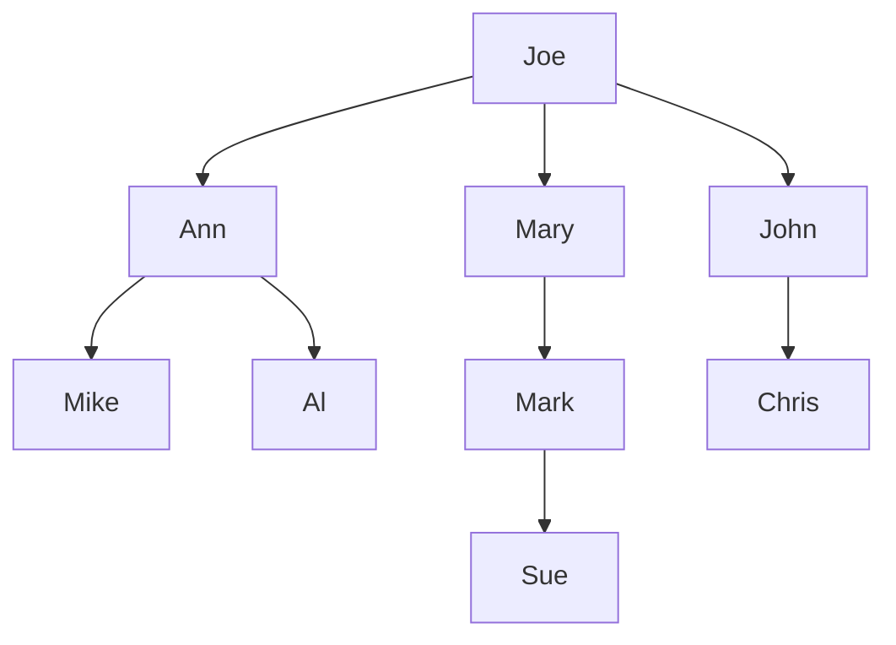
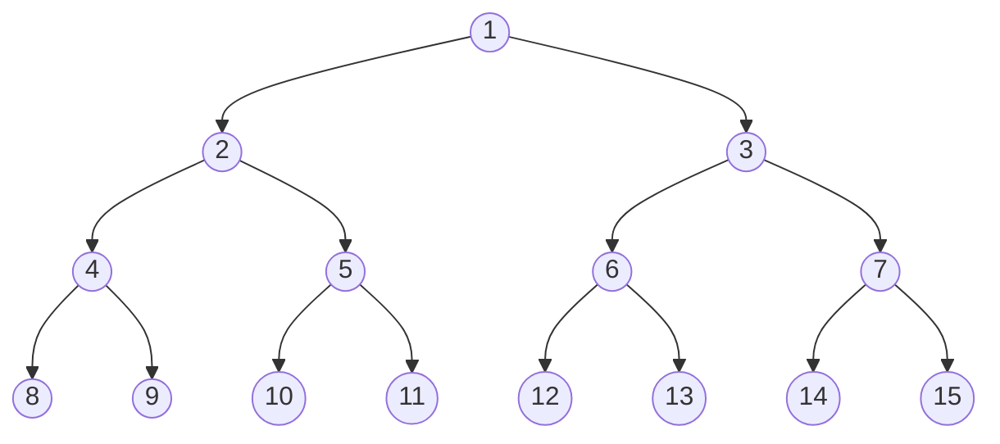

# 8강 — 이진 트리

[레포지토리 안내](../../README.ko.md) | [English](Concepts_Lecture.md) | [한국어](Concepts_Lecture.ko.md)

> **최종 수정일:** 2026-10-18

> **학습 목표:**
> 1. 루트, 리프, 레벨, 높이, 차수 같은 트리 용어를 주어진 트리에 적용할 수 있다
> 2. 이진 트리와 트리 순회 알고리즘을 구현할 수 있다
> 3. 전위, 중위, 후위, 레벨 순서 순회를 적용할 수 있다
> 4. 완전 이진 트리와 포화 이진 트리의 성질을 분석할 수 있다
> 5. 이진 트리의 배열 표현과 연결 표현을 공간 요구량으로 비교할 수 있다

---

## 목차

- [1. 트리와 이진 트리](#1-트리와-이진-트리)
  - [1.1 선형 리스트와 트리](#11-선형-리스트와-트리)
  - [1.2 트리의 정의](#12-트리의-정의)
  - [1.3 트리 용어](#13-트리-용어)
  - [1.4 레벨과 높이](#14-레벨과-높이)
  - [1.5 이진 트리 정의](#15-이진-트리-정의)
  - [1.6 트리와 이진 트리의 차이](#16-트리와-이진-트리의-차이)
- [2. 이진 트리 성질](#2-이진-트리-성질)
  - [2.1 기본 성질](#21-기본-성질)
  - [2.2 포화 이진 트리](#22-포화-이진-트리)
  - [2.3 완전 이진 트리](#23-완전-이진-트리)
  - [2.4 노드 번호 성질](#24-노드-번호-성질)
- [3. 이진 트리 표현](#3-이진-트리-표현)
  - [3.1 배열 표현](#31-배열-표현)
  - [3.2 연결 표현](#32-연결-표현)
- [4. 이진 트리 순회](#4-이진-트리-순회)
  - [4.1 전위 순회](#41-전위-순회)
  - [4.2 중위 순회](#42-중위-순회)
  - [4.3 후위 순회](#43-후위-순회)
  - [4.4 레벨 순서 순회](#44-레벨-순서-순회)
- [5. 수식 트리](#5-수식-트리)
  - [5.1 정의](#51-정의)
  - [5.2 순회와 수식 형태](#52-순회와-수식-형태)
- [6. 부록](#6-부록)
  - [6.1 순회 시간 복잡도](#61-순회-시간-복잡도)
  - [6.2 일반적인 이진 트리 연산](#62-일반적인-이진-트리-연산)
  - [6.3 면접 팁](#63-면접-팁)
- [요약](#요약)
- [점검 문제](#점검-문제)

---

<br>

## 1. 트리와 이진 트리

### 1.1 선형 리스트와 트리

선형 리스트 $(e_1, e_2, e_3, \ldots, e_n)$는 요일, 한 해의 달, 한 반의 학생처럼 **순서대로 늘어선 데이터(serially ordered data)** 에 알맞다. 반면 **트리(tree)** 는 한 사람의 자손, 회사의 조직 구조, 행정 구역, 소프트웨어의 구조처럼 **계층적으로 정렬된 데이터(hierarchically ordered data)** 에 알맞다. 그림 1은 Joe의 자손을 트리로 나타낸 것이다.



*그림 1. Joe의 자손을 나타낸 트리*

### 1.2 트리의 정의

**트리** $t$는 원소들의 유한하고 비어 있지 않은 집합이다.

- 원소 중 하나를 **루트(root)** 라 한다.
- 나머지 원소들(있는 경우)은 여러 트리로 분할되며, 이 트리들을 $t$의 **서브트리(subtree)** 라 한다.

그림 1에서 루트는 Joe이고, Joe의 서브트리는 Ann을 루트로 하는 트리(Ann, Mike, Al), Mary를 루트로 하는 트리(Mary, Mark, Sue), John을 루트로 하는 트리(John, Chris)의 세 개이다. 정의가 재귀적이므로 각 서브트리도 다시 루트와 서브트리로 나뉜다.

### 1.3 트리 용어

계층의 맨 위에 있는 원소가 루트이다. 그다음 계층의 원소들은 루트의 **자식(children)** 이고, 그다음 계층의 원소들은 루트의 **손자(grandchildren)** 이며, 이런 식으로 이어진다. 자식이 없는 원소가 **리프(leaves)** 이다. 리프는 각 경로의 맨 아래에 있지만 모두 같은 레벨에 있지는 않다. 그림 1에서 Mike는 레벨 3, Sue는 레벨 4의 리프이다.

| 용어 | 정의 | 그림 1의 예 |
|:-----|:-----|:-----|
| **루트(Root)** | 부모가 없는 최상위 노드 | Joe |
| **리프(Leaf)** | 자식이 없는 노드 (차수 0) | Mike, Al, Sue, Chris |
| **부모(Parent)** | 주어진 노드 바로 위의 노드 | Mary의 부모는 Joe |
| **자식(Child)** | 주어진 노드 바로 아래의 노드 | Ann의 자식은 Mike, Al |
| **조부모(Grandparent)** | 부모의 부모 | Sue의 조부모는 Mary |
| **형제(Sibling)** | 같은 부모를 공유하는 노드들 | Mary의 형제는 Ann, John |
| **조상(Ancestor)** | 노드에서 루트까지의 경로에 있는 노드 (자신 제외) | Mike의 조상은 Ann, Joe |
| **자손(Descendant)** | 노드를 루트로 하는 서브트리의 노드 (자신 제외) | Mary의 자손은 Mark, Sue |
| **노드 차수(Node degree)** | 해당 노드의 자식 수 | Joe는 3, Ann은 2, Mary, John, Mark는 1 |
| **트리 차수(Tree degree)** | 트리 내 모든 노드 차수의 최댓값 | 3 |
| **레벨(Level)** | 루트는 레벨 1이고, 레벨 $i$ 노드의 자식은 레벨 $i+1$ | Sue는 레벨 4 |
| **높이(Height) / 깊이(Depth)** | 트리의 레벨 수 (1.4절) | 4 |

*표 1. 트리 용어와 그림 1의 예*

> **핵심:** 노드의 **차수**는 자식의 수이다. 트리의 **차수**는 최대 노드 차수이다. 루트 Joe가 3개의 자식을 가진 트리의 트리 차수는 3이다.

### 1.4 레벨과 높이

> **용어 정의:** 이 강의에서 루트는 **레벨 1**에 있고, 레벨 $i$ 노드의 자식은 레벨 $i+1$에 있다. 트리의 **높이(height)** 는 트리의 레벨 수이며, **깊이(depth)** 라고도 한다. 즉 높이는 가장 깊은 노드의 레벨과 같고, 루트에서 가장 먼 리프까지의 경로에 있는 노드의 수와 같다.

그림 1의 트리는 Joe(레벨 1), Ann, Mary, John(레벨 2), Mike, Al, Mark, Chris(레벨 3), Sue(레벨 4)로 레벨이 4개이므로 높이가 4이다. 노드가 하나뿐인 트리의 높이는 1이고, 빈 이진 트리의 높이는 0이다.

> **주의:** 다른 자료에서는 루트를 레벨 0으로 두거나, 높이를 루트에서 가장 먼 리프까지의 경로에 있는 간선의 수로 정의하기도 한다. 간선 수로 정의하면 높이가 이 강의의 값보다 1 작아서(노드 하나인 트리의 높이 0, 빈 트리의 높이 -1) 2절의 공식도 달라진다. 예를 들어 높이 $h$인 이진 트리의 최대 노드 수는 $2^{h+1} - 1$이 되고, 노드 $n$개인 이진 트리의 최소 높이는 $\lceil \log_2(n+1) \rceil - 1$이 된다. 그런 자료에서 노드의 깊이는 루트에서 그 노드까지의 간선 수를 뜻하므로, 트리의 높이를 깊이라고도 부르는 이 강의의 용법과 구별해야 한다. 이 노트의 공식은 모두 레벨 수로 센 높이를 쓴다.

### 1.5 이진 트리 정의

**이진 트리(binary tree)** 는 유한한(비어 있을 수 있는) 원소들의 모음이다.

- 비어 있지 않은 이진 트리는 **루트** 원소를 가진다.
- 나머지 원소들(있는 경우)은 **왼쪽 서브트리**와 **오른쪽 서브트리**라 불리는 **두 개의 이진 트리**로 분할된다.

### 1.6 트리와 이진 트리의 차이

| 속성 | 트리 | 이진 트리 |
|:-----|:-----|:----------|
| 비어 있을 수 있는가? | 비어 있을 수 없음 | 비어 있을 수 있음 |
| 최대 차수 | 제한 없음 | 최대 2 |
| 서브트리 순서 | 순서 없음 | 순서 있음 (왼쪽과 오른쪽 구분) |

*표 2. 트리와 이진 트리의 차이*

```text
    a           a
   / \         / \
  b   c       c   b
```

*그림 2. 왼쪽 자식과 오른쪽 자식을 바꾼 두 트리*

그림 2처럼 같은 노드를 가졌지만 왼쪽과 오른쪽 자식이 바뀐 두 이진 트리는 **다른** 이진 트리이지만, 일반 트리로 보면 같은 트리가 된다. 일반 트리는 서브트리의 순서를 구분하지 않기 때문이다.

---

<br>

## 2. 이진 트리 성질

### 2.1 기본 성질

이 절의 높이는 1.4절의 정의(레벨 수)를 따른다.

1. **간선 수:** $n$개 원소($n > 0$)를 가진 이진 트리를 그리면 정확히 $n - 1$개의 간선이 있다. 루트를 제외한 모든 원소는 부모가 정확히 하나이고, 부모와 잇는 간선이 하나씩 있기 때문이다.

2. **높이에 따른 원소 수 범위:** 높이 $h$($h \geq 0$)인 이진 트리는 다음과 같은 수의 원소를 가진다.
   - 최소 $h$개이다. 레벨마다 원소가 적어도 하나 있어야 하기 때문이다.
   - 최대 $2^h - 1$개이다. 레벨 $i$에는 원소가 최대 $2^{i-1}$개 있으므로 $1 + 2 + \cdots + 2^{h-1} = 2^h - 1$이다.

   예를 들어 높이가 3인 이진 트리의 원소 수는 3 이상 $2^3 - 1 = 7$ 이하이다.

3. **원소 수에 따른 높이 범위:** $n$개 원소($n \geq 0$)를 가진 이진 트리의 높이는 다음과 같다.
   - 최소 $\lceil \log_2(n+1) \rceil$이다. 성질 2에서 $n \le 2^h - 1$, 즉 $h \ge \log_2(n+1)$이고 $h$는 정수이기 때문이다.
   - 최대 $n$이다. 레벨마다 원소가 하나씩만 있는 경우이다.

   예를 들어 원소 4개를 한 줄로 이으면 높이가 최대 4이고, 원소 15개를 담는 이진 트리의 높이는 최소 $\lceil \log_2 16 \rceil = 4$이다.

> **핵심:** 최소 높이 $\lceil \log_2(n+1) \rceil$은 **완전 이진 트리**에서 달성된다. 최대 높이 $n$은 퇴화(편향) 트리에서 발생한다.

리프를 제외한 모든 노드가 자식을 하나씩만 가져 한 줄로 늘어선 트리를 **퇴화 트리** 또는 **편향 트리(skewed tree)** 라 한다. 모든 자식이 오른쪽 자식이면 오른쪽 편향 트리, 모든 자식이 왼쪽 자식이면 왼쪽 편향 트리이다.

> **[이산수학]** 성질 1은 트리의 일반적인 성질로, 연결되어 있고 사이클이 없는 그래프에서 노드가 $n$개이면 간선은 $n-1$개이다. 성질 2의 합은 등비수열의 합 $\sum_{i=1}^{h} 2^{i-1} = 2^h - 1$이다.

### 2.2 포화 이진 트리

높이 $h$인 **포화 이진 트리(full binary tree)** 는 정확히 $2^h - 1$개의 노드를 가진다. 모든 레벨이 완전히 채워져 있고, 모든 비리프 노드는 정확히 두 개의 자식을 가진다.

**번호 매기기 방식:** 노드에 1부터 $2^h - 1$까지 번호를 매기되, 위에서 아래로 레벨별로, 각 레벨 내에서는 왼쪽에서 오른쪽으로 매긴다. 그림 3은 높이 4인 포화 이진 트리로, 노드가 $2^4 - 1 = 15$개이다.



*그림 3. 높이 4인 포화 이진 트리의 노드 번호*

> **주의:** full binary tree라는 이름은 자료마다 뜻이 다르다. 위의 정의($2^h - 1$개 노드)는 모든 레벨이 꽉 찬 트리로, perfect binary tree라고도 한다. 다른 정의에서는 리프가 아닌 모든 노드가 자식을 정확히 둘 가지는 트리를 full binary tree라 하며, proper binary tree 또는 2-tree라고도 부른다(한국어로는 정 이진 트리). 이 정의에서는 모든 레벨이 채워질 필요가 없다. 예를 들어 루트와 그 두 자식, 그리고 왼쪽 자식의 두 자식으로 이루어진 노드 5개짜리 트리는 두 번째 정의로는 full binary tree이지만, 높이 3의 노드 수 7에 못 미치므로 첫 번째 정의로는 full binary tree가 아니다. 이 노트의 포화 이진 트리는 첫 번째 정의를 뜻한다.

### 2.3 완전 이진 트리

$n$개 노드를 가진 **완전 이진 트리(complete binary tree)** 는 다음과 같이 정의한다.

1. 노드가 $n$개 이상인 포화 이진 트리에서 시작한다.
2. 2.2절의 방식으로 위에서 아래로, 왼쪽에서 오른쪽으로 노드에 번호를 매긴다.
3. 번호 1부터 $n$까지의 노드로 이루어진 이진 트리가 $n$개 노드의 완전 이진 트리이다.

같은 트리를 레벨로 설명하면, 완전 이진 트리는 다음 조건을 만족하는 이진 트리이다.

1. 마지막 레벨을 제외한 모든 레벨이 **완전히 채워져** 있다.
2. 마지막 레벨의 모든 노드가 **가능한 한 왼쪽에** 위치한다.

포화 이진 트리는 완전 이진 트리의 특수한 경우이다($n = 2^h - 1$). 완전 이진 트리는 포화 이진 트리와 동일한 노드 번호 매기기(위치 1부터 $n$까지)를 사용하므로, 2.4절의 노드 번호 성질이 그대로 성립한다.

예를 들어 그림 3에서 번호 1\~10의 노드만 남기면 노드 10개의 완전 이진 트리가 되고(3.1절의 그림 4), 높이 5인 포화 이진 트리에서 번호 1\~21의 노드만 남기면 노드 21개의 완전 이진 트리가 된다. 반면 노드 1, 2, 4로 이루어진 왼쪽 편향 트리는 번호 3이 빠져 있으므로 완전 이진 트리가 아니다. 이처럼 번호 1부터 $n$까지 중 빠진 번호가 있는 이진 트리를 **불완전 이진 트리(incomplete binary tree)** 라 한다(3.1절의 그림 5).

### 2.4 노드 번호 성질

$n$개 노드를 가진 포화 또는 완전 이진 트리에서 번호 $x$인 노드에 대해 다음이 성립한다.

| 관계 | 공식 | 조건 |
|:-----|:-----|:-----|
| $x$의 부모 | $\lfloor x / 2 \rfloor$ | $x \neq 1$ |
| $x$의 왼쪽 자식 | $2x$ | $2x \leq n$ |
| $x$의 오른쪽 자식 | $2x + 1$ | $2x + 1 \leq n$ |
| 노드가 리프임 | $2x > n$ | |

*표 3. 노드 번호 $x$로 구하는 부모, 자식, 리프 여부*

그림 3의 포화 이진 트리($n = 15$)에서 확인하면 다음과 같다.

- 노드 7의 부모는 $\lfloor 7/2 \rfloor = \lfloor 3.5 \rfloor = 3$이다. 노드 1은 루트이므로 부모가 없다.
- 노드 5의 왼쪽 자식은 $2 \times 5 = 10$이다. 노드 8은 $2 \times 8 = 16 > 15$이므로 왼쪽 자식이 없고, 따라서 자식이 전혀 없다.
- 노드 4의 오른쪽 자식은 $2 \times 4 + 1 = 9$이다. 노드 8은 $2 \times 8 + 1 = 17 > 15$이므로 오른쪽 자식이 없다.

> **핵심:** 이러한 성질은 완전 이진 트리의 효율적인 **배열 표현**을 가능하게 한다. 인덱스 $x$에 있는 노드 $x$의 부모는 $\lfloor x/2 \rfloor$에, 자식은 $2x$와 $2x+1$에 있다.

---

<br>

## 3. 이진 트리 표현

### 3.1 배열 표현

이진 트리의 각 원소를 그 원소에 매긴 번호(완전 이진 트리에서의 노드 번호)에 해당하는 배열 위치에 저장한다. 위치 0은 쓰지 않는다.

```text
                 a(1)
           /             \
        b(2)             c(3)
       /    \           /    \
    d(4)    e(5)     f(6)    g(7)
    /  \    /
 h(8) i(9) j(10)

tree[] = [ _, a, b, c, d, e, f, g, h, i, j ]
           0  1  2  3  4  5  6  7  8  9  10
```

*그림 4. 노드 10개인 완전 이진 트리의 배열 표현*

**불완전 이진 트리.** 일부 원소가 빠진 완전 이진 트리로 볼 수 있으며, 빠진 원소의 자리는 배열에서 비워 둔다(그림 5의 `-`).

```text
(a)  A(1)
        \
        B(3)
           \
           C(7)

     tree[] = [ _, A, -, B, -, -, -, C ]
                0  1  2  3  4  5  6  7

(b)      A(1)
        /    \
     B(2)    C(3)
        \       \
        D(5)    E(7)

     tree[] = [ _, A, B, C, -, D, -, E ]
                0  1  2  3  4  5  6  7
```

*그림 5. 불완전 이진 트리 두 개의 배열 표현*

**오른쪽 편향 이진 트리.** 노드가 오른쪽 자식만 가지므로 번호가 $1, 3, 7, 15, \ldots$로 빠르게 커진다.

```text
a(1)
   \
   b(3)
      \
      c(7)
         \
         d(15)

tree[] = [ _, a, -, b, -, -, -, c, -, -, -, -, -, -, -, d ]
           0  1  2  3  4  5  6  7  8  9  10 11 12 13 14 15
```

*그림 6. 노드 4개인 오른쪽 편향 이진 트리의 배열 표현*

**공간 요구량:**
- 완전 이진 트리는 위치 0을 포함하여 정확히 $n + 1$개의 슬롯이 필요하다.
- 오른쪽 편향 트리(높이 $h$)는 $2^h$개의 슬롯이 필요하며, 공간을 가장 많이 낭비한다. 그림 6은 $h = 4$이므로 $2^4 = 16$개이다.
- $n$개 노드의 이진 트리는 $n + 1$개에서 $2^n$개의 슬롯이 필요하다. 최소는 완전 이진 트리일 때이고, 최대는 오른쪽 편향 트리($h = n$)일 때이다.
- 왼쪽 편향 트리는 노드가 위치 $1, 2, 4, \ldots, 2^{n-1}$에 놓이므로 $2^{n-1} + 1$개의 슬롯이 필요하다. 오른쪽 편향 트리의 약 절반이지만 여전히 노드 수에 대해 지수적으로 늘어난다.

### 3.2 연결 표현

연결 표현은 이진 트리를 표현하는 **가장 널리 쓰이는** 방법이다. 각 원소는 링크 필드 두 개와 원소 필드 하나를 가진 노드로 나타내며, 각 노드는 데이터 타입이 `BinaryTreeNode`인 객체이다.

- `leftChild` 포인터
- `element` (데이터)
- `rightChild` 포인터

```cpp
struct BinaryTreeNode {
    T element;
    BinaryTreeNode* leftChild;
    BinaryTreeNode* rightChild;
};
```

`T`는 원소의 타입이며, C++에서는 구조체 앞에 `template <class T>`를 붙여 템플릿으로 선언한다. 자식이 없으면 해당 포인터는 널 포인터이다. 그림 7에서 각 노드는 `[leftChild | element | rightChild]`이고, `*`는 자식을 가리키는 포인터, `-`는 널 포인터이다.

```text
root
  │
  ▼
[ * | a | * ]
  │       └─────────────────┐
  ▼                         ▼
[ * | b | - ]             [ - | c | * ]
  │                                 └───────┐
  ▼                                         ▼
[ * | d | - ]                             [ * | e | - ]
  │                                         │
  ▼                                         ▼
[ - | f | - ]                             [ - | g | * ]
                                                    └───────┐
                                                            ▼
                                                          [ - | h | - ]
```

*그림 7. 이진 트리의 연결 표현*

필요 공간: $n$개 노드에 대해 $n \times \text{sizeof(BinaryTreeNode)}$.

> **핵심:** 연결 표현은 모든 형태의 동적 트리를 효율적으로 처리할 수 있어 이진 트리를 표현하는 **가장 일반적인** 방법이다. 배열 표현은 **완전 이진 트리**(특히 9강의 힙)에 가장 적합하다.

---

<br>

## 4. 이진 트리 순회

많은 이진 트리 연산은 이진 트리를 **순회(traversal)** 하여 수행한다. 순회는 이진 트리의 각 원소를 **정확히 한 번** 방문하며, 원소를 방문할 때 그 원소에 대한 모든 작업(복사, 출력, 연산자 평가 등)을 수행한다. 네 가지 순회 방법은 루트를 몇 번째로 처리하느냐에 따라 구분된다.

- **전위(preorder):** 서브트리의 루트를 먼저 처리한 뒤 왼쪽, 오른쪽 서브트리를 처리한다(루트, 왼쪽, 오른쪽).
- **중위(inorder):** 왼쪽 서브트리를 모두 처리한 뒤 루트를 처리하고, 이어서 오른쪽 서브트리를 모두 처리한다(왼쪽, 루트, 오른쪽).
- **후위(postorder):** 왼쪽과 오른쪽 서브트리를 모두 처리한 뒤에야 루트를 처리한다(왼쪽, 오른쪽, 루트).
- **레벨 순서(level order):** 레벨별로 처리한다. 레벨 $i$의 모든 노드를 왼쪽에서 오른쪽으로 처리한 뒤에 레벨 $i+1$의 첫 노드를 방문한다.

이 절의 예시는 방문을 출력으로 보고 그림 8의 이진 트리를 순회한다.

```text
              a
           /     \
         b         c
       /   \      /
      d     e    f
     / \     \    \
    g   h     i    j
```

*그림 8. 순회 예시에 쓰는 이진 트리*

### 4.1 전위 순회

**순서:** 루트, 왼쪽, 오른쪽

```text
Preorder(node):
    if node is null: return
    visit(node)
    Preorder(node.left)
    Preorder(node.right)
```

**예시:** 그림 8의 트리를 전위 순회하면 `a b d g h e i c f j` 순서로 방문한다. 루트 a를 먼저 방문한 뒤 왼쪽 서브트리(b, d, g, h, e, i)를 모두 방문하고, 마지막으로 오른쪽 서브트리(c, f, j)를 방문한다.

```text
              /
          /       \
        *           +
      /   \        / \
     +     -      e   f
    / \   / \
   a   b c   d
```

*그림 9. 수식 ((a + b) * (c - d)) / (e + f)의 수식 트리*

**수식 트리의 예:** 그림 9의 수식 트리에서 전위 순회는 **전위(prefix)** 형태를 제공한다: `/ * + a b - c d + e f`

### 4.2 중위 순회

**순서:** 왼쪽, 루트, 오른쪽

```text
Inorder(node):
    if node is null: return
    Inorder(node.left)
    visit(node)
    Inorder(node.right)
```

**예시:** 그림 8의 트리를 중위 순회하면 `g d h b e i a f j c` 순서로 방문한다. 루트 a는 왼쪽 서브트리의 노드 6개를 모두 방문한 뒤 일곱 번째로 방문한다.

수식 트리의 중위 순회는 **중위(infix)** 형태를 제공한다: `a + b * c - d / e + f`. 이는 수식을 평소에 쓰는 방식이지만 괄호가 없으므로 원래 수식과 계산 순서가 다르게 읽힌다. 그림 9의 트리를 완전 괄호화하여 출력하면 `(((a + b) * (c - d)) / (e + f))`이다(5.2절).

### 4.3 후위 순회

**순서:** 왼쪽, 오른쪽, 루트

```text
Postorder(node):
    if node is null: return
    Postorder(node.left)
    Postorder(node.right)
    visit(node)
```

**예시:** 그림 8의 트리를 후위 순회하면 `g h d i e b j f c a` 순서로 방문하며, 루트 a를 마지막에 방문한다.

수식 트리의 후위 순회는 **후위(postfix)** 형태를 제공한다: `a b + c d - * e f + /`

### 4.4 레벨 순서 순회

**순서:** 레벨별로, 각 레벨 내에서 왼쪽에서 오른쪽. **큐**(6강)를 사용한다.

```text
LevelOrder(root):
    if root is null: return
    queue.enqueue(root)
    while queue is not empty:
        node = queue.dequeue()
        visit(node)
        if node.left: queue.enqueue(node.left)
        if node.right: queue.enqueue(node.right)
```

**예시:** 그림 8의 트리를 레벨 순서로 순회하면 `a b c d e f g h i j` 순서로 방문한다. 노드를 큐에서 꺼내 방문할 때마다 그 노드의 자식을 왼쪽부터 큐에 넣으므로, 큐는 표 4와 같이 변한다.

| 단계 | 꺼내어 방문한 노드 | 큐에 넣은 노드 | 큐의 상태 (앞에서 뒤로) |
|:-----|:-----|:-----|:-----|
| 시작 | | a | a |
| 1 | a | b, c | b c |
| 2 | b | d, e | c d e |
| 3 | c | f | d e f |
| 4 | d | g, h | e f g h |
| 5 | e | i | f g h i |
| 6 | f | j | g h i j |
| 7 | g | | h i j |
| 8 | h | | i j |
| 9 | i | | j |
| 10 | j | | (비어 있음) |

*표 4. 그림 8의 트리를 레벨 순서로 순회할 때 큐의 변화*

> **핵심:** 전위, 중위, 후위 순회는 **재귀**(또는 스택)를 사용한다. 레벨 순서 순회는 **큐**를 사용한다. 네 가지 순회 모두 $n$개 노드를 $O(n)$ 시간에 방문한다.

---

<br>

## 5. 수식 트리

### 5.1 정의

**수식 트리(expression tree)** 는 다음과 같은 이진 트리이다.

- 각 **내부 노드**는 **연산자**(+, -, *, /)에 해당한다.
- 각 **리프 노드**는 **피연산자**(변수 또는 숫자)에 해당한다.

이항 연산자 노드는 자식이 둘이고, 부호를 나타내는 단항 연산자(예: -a의 -) 노드는 자식이 하나이다. 그림 10은 세 수식의 수식 트리이다.

```text
(a)       +
        /   \
       *     /
      / \   / \
     a   b c   d

(b)          +
            / \
           +   d
          / \
         +   c
        / \
       a   b

(c)            /
           /       \
         +           *
       /   \       /   \
      -     +     +     *
      |    / \    |    / \
      a   x   y   b   c   a
```

*그림 10. (a) (a * b) + (c / d), (b) ((a + b) + c) + d, (c) ((-a) + (x + y)) / ((+b) * (c * a))의 수식 트리*

**예시:** 수식 `3 + ((5 + 9) * 2)`는 다음과 같이 표현된다.

```text
        +
       / \
      3   *
         / \
        +   2
       / \
      5   9
```

*그림 11. 수식 3 + ((5 + 9) * 2)의 수식 트리*

수식 트리를 평가하려면 후위 순회로 두 서브트리의 값을 먼저 구한 뒤 루트의 연산자를 적용한다. 그림 11에서는 $5 + 9 = 14$, $14 \times 2 = 28$, $3 + 28 = 31$이므로 값은 31이다.

### 5.2 순회와 수식 형태

| 순회 | 수식 형태 | 출력 예시 |
|:-----|:----------|:---------|
| 전위 | **전위(Prefix)** (폴란드 표기법) | `+ 3 * + 5 9 2` |
| 중위 | **중위(Infix)** (표준 표기법) | `3 + 5 + 9 * 2` |
| 후위 | **후위(Postfix)** (역 폴란드 표기법) | `3 5 9 + 2 * +` |
| 완전 괄호화 중위 | 괄호를 모두 넣은 중위 | `(3 + ((5 + 9) * 2))` |

*표 5. 그림 11의 수식 트리를 순회한 결과와 수식 형태*

후위 수식으로 만든 수식 트리를 중위 순회하면 같은 수식의 중위 형태를 얻고, 후위 순회하면 원래의 후위 수식을 다시 얻는다.

> **핵심:** 수식 트리의 중위 순회는 괄호 없이는 모호할 수 있다. 표 5의 `3 + 5 + 9 * 2`는 원래 값 31과 달리 보통의 우선순위로 계산하면 26이 된다. **완전 괄호화** 중위 순회는 각 연산자 노드에서 왼쪽 서브트리 앞에 여는 괄호를 추가하고 오른쪽 서브트리 뒤에 닫는 괄호를 추가한다.

---

<br>

## 6. 부록

### 6.1 순회 시간 복잡도

네 가지 순회(전위, 중위, 후위, 레벨 순서) 모두 각 노드를 정확히 한 번 방문하므로 $O(n)$ 시간 복잡도를 가지며, 정확히는 $\Theta(n)$이다. 공간 복잡도는 $O(n)$이다. 재귀(또는 스택)의 깊이는 높이 $h$에 비례하고 $h$는 최대 $n$이며, 레벨 순서 순회의 큐에는 노드 수에 비례하는 개수(완전 이진 트리의 마지막 레벨이면 약 $n/2$개)의 노드가 들어갈 수 있다.

### 6.2 일반적인 이진 트리 연산

- 높이는 후위 순회로 $O(n)$에 구한다. 두 서브트리의 높이를 먼저 구한 뒤 큰 값에 1을 더한다.
- 노드 수는 임의의 순회로 $O(n)$에 센다.
- 트리 복사는 후위 순회로 $O(n)$에 한다.
- 두 이진 트리가 같은지는 두 트리를 함께 순회하며 비교하여 $O(n)$에 검사한다.
- 트리 출력은 임의의 순회로 $O(n)$에 한다.
- 트리 삭제는 후위 순회로 $O(n)$에 한다. 자식을 먼저 삭제해야 부모를 삭제한 뒤 자식에 접근할 수 없게 되는 문제가 생기지 않는다.
- 수식 트리의 평가는 후위 순회로 $O(n)$에 한다.
- 수식 트리의 괄호를 넣은 형태는 완전 괄호화 중위 순회로 $O(n)$에 얻는다.

### 6.3 면접 팁

- 두 가지 순회(예: 전위와 중위)로부터 이진 트리를 재구성하는 방법을 알아야 한다.
- full, complete, perfect 이진 트리의 차이를 이해해야 한다. 이 노트의 포화 이진 트리는 perfect 이진 트리이며, full 이진 트리를 정 이진 트리의 뜻으로 쓰는 자료도 있다(2.2절).
- 레벨 순서 순회는 트리에서의 너비 우선 탐색(BFS)의 기초이다.

---

<br>

## 요약

| 개념 | 핵심 요약 |
|:-----|:-----|
| 트리 | 루트와 그 서브트리들로 이루어진 유한하고 비어 있지 않은 원소 집합으로, 계층적 데이터를 나타낸다. |
| 이진 트리 | 루트, 왼쪽 서브트리, 오른쪽 서브트리로 구성된 유한 모음으로, 비어 있을 수 있고 최대 차수가 2이다. |
| 노드 차수 | 노드 차수는 해당 노드의 자식 수이다. |
| 트리 차수 | 트리 차수는 모든 노드 차수의 최댓값이다. |
| 레벨과 높이 | 루트가 레벨 1이고, 높이는 트리의 레벨 수이다. |
| $n-1$개 간선 | $n > 0$인 이진 트리는 정확히 $n-1$개의 간선을 가진다. |
| 높이 범위 | 노드 $n$개인 이진 트리의 높이 $h$는 $\lceil \log_2(n+1) \rceil \leq h \leq n$을 만족한다. |
| 포화 이진 트리 | 높이 $h$인 포화 이진 트리는 정확히 $2^h - 1$개의 노드를 가진다. |
| 완전 이진 트리 | 마지막 레벨을 제외한 모든 레벨이 채워지고, 마지막 레벨은 왼쪽부터 채워진다. |
| 배열 표현 | 노드 $x$를 인덱스 $x$에 두며, 부모는 $\lfloor x/2 \rfloor$, 자식은 $2x$와 $2x+1$에 있고, 노드 $n$개에 $n+1$에서 $2^n$개의 슬롯이 필요하다. |
| 연결 표현 | 가장 일반적인 표현으로, 각 노드가 leftChild, element, rightChild를 가진다. |
| 전위 | 루트, 왼쪽, 오른쪽 순서로 방문하며, 수식 트리에서 전위 수식을 낸다. |
| 중위 | 왼쪽, 루트, 오른쪽 순서로 방문하며, 수식 트리에서 중위 수식을 낸다. |
| 후위 | 왼쪽, 오른쪽, 루트 순서로 방문하며, 수식 트리에서 후위 수식을 낸다. |
| 레벨 순서 | 큐를 사용하여 레벨별로 처리한다. |
| 수식 트리 | 내부 노드는 연산자이고 리프는 피연산자이다. |

---

<br>

## 점검 문제

1. **트리 용어:** 그림 1의 트리에서 Chris의 레벨, Mark의 차수, Sue의 조상, Ann의 자손을 쓰라. Sue를 삭제하면 트리의 높이는 얼마가 되는가?

   <details>
   <summary>정답</summary>

   Chris는 John(레벨 2)의 자식이므로 레벨 3이다. Mark는 자식이 Sue 하나이므로 차수가 1이다. Sue의 조상은 루트까지의 경로에 있는 Mark, Mary, Joe이고, Ann의 자손은 Mike와 Al이다. 레벨 4에 있는 노드는 Sue뿐이므로 Sue를 삭제하면 레벨이 3개가 되어 높이가 3이 된다.

   </details>

2. **노드 번호:** 노드 12개의 완전 이진 트리에서 노드 6의 부모, 왼쪽 자식, 오른쪽 자식을 구하고, 노드 7이 리프인지 판정하라.

   <details>
   <summary>정답</summary>

   노드 6의 부모는 $\lfloor 6/2 \rfloor = 3$이고, 왼쪽 자식은 $2 \times 6 = 12 \le 12$이므로 노드 12이다. $2 \times 6 + 1 = 13 > 12$이므로 오른쪽 자식은 없다. 노드 7은 $2 \times 7 = 14 > 12$이므로 리프이다.

   </details>

3. **정의의 차이:** 노드 7개로 이루어진 이진 트리 중, 리프가 아닌 모든 노드가 자식을 둘 가지지만 포화 이진 트리는 아닌 예를 들고, 그 트리가 완전 이진 트리인지 판정하라.

   <details>
   <summary>정답</summary>

   루트(번호 1)의 두 자식이 2와 3이고, 3의 두 자식이 6과 7이며, 7의 두 자식이 14와 15인 트리가 예이다. 리프가 아닌 노드 1, 3, 7이 모두 자식을 둘 가지므로 정 이진 트리(2.2절의 두 번째 정의)이다. 그러나 높이가 4이므로 포화 이진 트리이려면 노드가 $2^4 - 1 = 15$개여야 하고, 노드가 7개뿐이므로 포화 이진 트리가 아니다. 번호 4와 5가 빠져 있으므로 완전 이진 트리도 아니다. 노드 7개로 높이 3을 만들면(번호 1~7) 포화 이진 트리가 된다.

   </details>

4. **높이 정의 비교:** 노드 10개인 완전 이진 트리의 높이를 이 강의의 정의(레벨 수)와 간선 수로 세는 정의로 각각 구하라.

   <details>
   <summary>정답</summary>

   노드 번호로 보면 레벨 1에 1, 레벨 2에 2와 3, 레벨 3에 4부터 7, 레벨 4에 8부터 10이 있으므로 레벨 수로 센 높이는 4이며, $\lceil \log_2(10+1) \rceil = \lceil 3.46 \rceil = 4$와 같다. 간선 수로 세면 루트에서 노드 8까지의 경로에 간선이 3개 있으므로 높이는 3이며, $\lceil \log_2 11 \rceil - 1 = 3$과 같다.

   </details>

5. **순회로 트리 복원:** 전위 순회가 A B D E C F이고 중위 순회가 D B E A F C인 이진 트리를 구하고, 후위 순회를 쓰라.

   <details>
   <summary>정답</summary>

   전위 순회의 첫 원소 A가 루트이다. 중위 순회에서 A의 왼쪽인 D, B, E가 왼쪽 서브트리, 오른쪽인 F, C가 오른쪽 서브트리이다. 왼쪽 서브트리의 전위 순회 B D E에서 B가 루트이고, 중위 순회 D B E에서 D가 B의 왼쪽 자식, E가 오른쪽 자식이다. 오른쪽 서브트리의 전위 순회 C F에서 C가 루트이고, 중위 순회 F C에서 F가 C의 왼쪽 자식이다. 따라서 후위 순회는 D E B F C A이다.

   </details>
