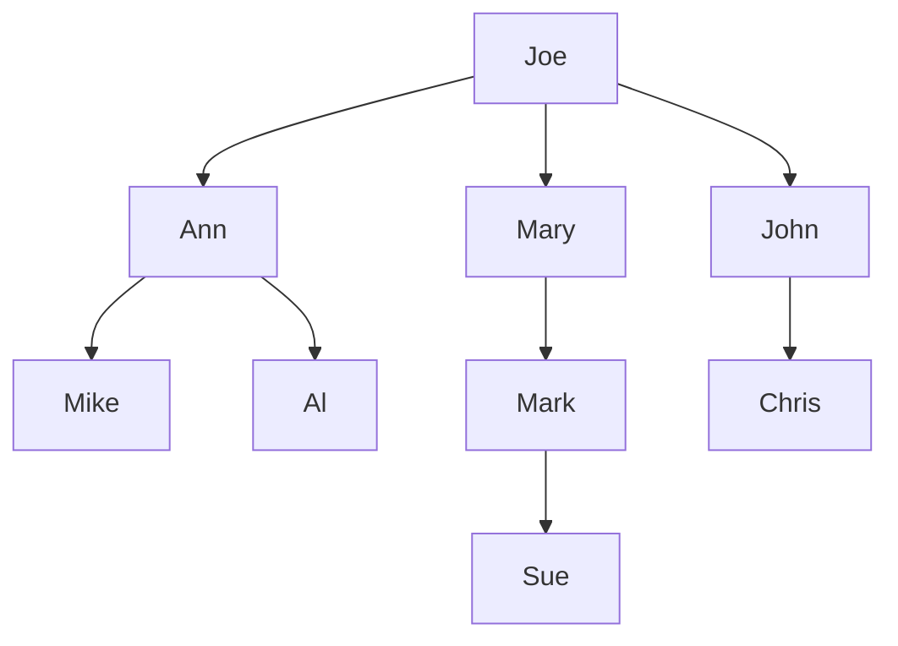
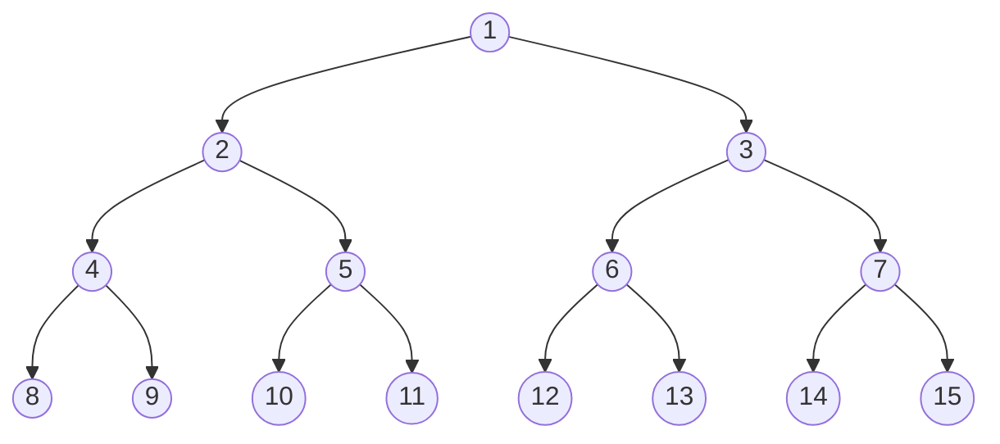

# Lecture 8 — Binary Trees

[Repository Guide](../../README.md) | [English](Concepts_Lecture.md) | [한국어](Concepts_Lecture.ko.md)

> **Last Updated:** 2026-10-26

> **Learning Objectives:**
> 1. Apply tree terms such as root, leaf, level, height, and degree to a given tree
> 2. Implement binary trees and tree traversal algorithms
> 3. Apply preorder, inorder, postorder, and level-order traversals
> 4. Analyze properties of complete and full binary trees
> 5. Compare the array and linked representations of binary trees by space requirement

---

## Table of Contents

- [1. Trees and Binary Trees](#1-trees-and-binary-trees)
  - [1.1 Linear Lists and Trees](#11-linear-lists-and-trees)
  - [1.2 Definition of a Tree](#12-definition-of-a-tree)
  - [1.3 Tree Terminology](#13-tree-terminology)
  - [1.4 Levels and Height](#14-levels-and-height)
  - [1.5 Binary Tree Definition](#15-binary-tree-definition)
  - [1.6 Difference Between a Tree and a Binary Tree](#16-difference-between-a-tree-and-a-binary-tree)
- [2. Binary Tree Properties](#2-binary-tree-properties)
  - [2.1 Fundamental Properties](#21-fundamental-properties)
  - [2.2 Full Binary Tree](#22-full-binary-tree)
  - [2.3 Complete Binary Tree](#23-complete-binary-tree)
  - [2.4 Node Number Properties](#24-node-number-properties)
- [3. Binary Tree Representation](#3-binary-tree-representation)
  - [3.1 Array Representation](#31-array-representation)
  - [3.2 Linked Representation](#32-linked-representation)
- [4. Binary Tree Traversals](#4-binary-tree-traversals)
  - [4.1 Preorder Traversal](#41-preorder-traversal)
  - [4.2 Inorder Traversal](#42-inorder-traversal)
  - [4.3 Postorder Traversal](#43-postorder-traversal)
  - [4.4 Level-Order Traversal](#44-level-order-traversal)
- [5. Expression Trees](#5-expression-trees)
  - [5.1 Definition](#51-definition)
  - [5.2 Traversal and Expression Forms](#52-traversal-and-expression-forms)
- [6. Appendix](#6-appendix)
  - [6.1 Traversal Time Complexity](#61-traversal-time-complexity)
  - [6.2 Common Binary Tree Operations](#62-common-binary-tree-operations)
  - [6.3 Interview Tips](#63-interview-tips)
- [Summary](#summary)
- [Self-Check Questions](#self-check-questions)

---

<br>

## 1. Trees and Binary Trees

### 1.1 Linear Lists and Trees

A linear list $(e_1, e_2, e_3, \ldots, e_n)$ suits **serially ordered data** such as the days of the week, the months in a year, or the students in a class. A **tree**, on the other hand, suits **hierarchically ordered data** such as a person's descendants, a corporate structure, government subdivisions, or software structure. Figure 1 shows Joe's descendants as a tree.



*Figure 1. Tree of Joe's descendants*

### 1.2 Definition of a Tree

A **tree** $t$ is a finite nonempty set of elements.

- One of these elements is called the **root**.
- The remaining elements, if any, are partitioned into trees, which are called the **subtrees** of $t$.

In Figure 1 the root is Joe, and Joe has three subtrees: the tree rooted at Ann (Ann, Mike, Al), the tree rooted at Mary (Mary, Mark, Sue), and the tree rooted at John (John, Chris). Since the definition is recursive, each subtree again splits into a root and its subtrees.

### 1.3 Tree Terminology

The element at the top of the hierarchy is the root. Elements next in the hierarchy are the **children** of the root, elements next in the hierarchy are the **grandchildren** of the root, and so on. Elements with no children are the **leaves**. Leaves are at the bottom of their paths, but they need not all be on the same level: in Figure 1, Mike is a leaf on level 3 and Sue is a leaf on level 4.

| Term | Definition | Example in Figure 1 |
|:-----|:-----------|:-----|
| **Root** | The topmost node with no parent | Joe |
| **Leaf** | A node with no children (degree 0) | Mike, Al, Sue, Chris |
| **Parent** | The node directly above a given node | The parent of Mary is Joe |
| **Child** | A node directly below a given node | The children of Ann are Mike, Al |
| **Grandparent** | The parent of the parent | The grandparent of Sue is Mary |
| **Sibling** | Nodes sharing the same parent | The siblings of Mary are Ann, John |
| **Ancestor** | A node on the path from the node to the root (excluding itself) | The ancestors of Mike are Ann, Joe |
| **Descendant** | A node in the subtree rooted at the node (excluding itself) | The descendants of Mary are Mark, Sue |
| **Node degree** | The number of children a node has | Joe 3, Ann 2, Mary, John, Mark 1 |
| **Tree degree** | The maximum of all node degrees in the tree | 3 |
| **Level** | Root is at level 1; children of a level-$i$ node are at level $i+1$ | Sue is at level 4 |
| **Height (depth)** | The number of levels of the tree (Section 1.4) | 4 |

*Table 1. Tree terms with examples from Figure 1*

> **Key Point:** The **degree** of a node is the number of its children. The **degree** of a tree is the maximum node degree. A tree with root Joe having 3 children has tree degree 3.

### 1.4 Levels and Height

> **Definition:** In this course the root is at **level 1**, and the children of a level-$i$ node are at level $i+1$. The **height** of a tree is the number of levels in the tree, also called its **depth**. Thus the height equals the level of the deepest node and the number of nodes on the path from the root to the farthest leaf.

The tree of Figure 1 has 4 levels, Joe (level 1), Ann, Mary, John (level 2), Mike, Al, Mark, Chris (level 3), and Sue (level 4), so its height is 4. A tree with a single node has height 1, and an empty binary tree has height 0.

> **Caution:** Other materials put the root at level 0 or define height as the number of edges on the path from the root to the farthest leaf. Under the edge definition the height is 1 less than in this course (height 0 for a single-node tree, -1 for an empty tree), and the formulas of Section 2 change as well. For example, the maximum number of nodes of a binary tree of height $h$ becomes $2^{h+1} - 1$, and the minimum height of a binary tree with $n$ nodes becomes $\lceil \log_2(n+1) \rceil - 1$. In such materials the depth of a node means the number of edges from the root to that node, which must be distinguished from this course's use of depth as another name for the height of the tree. All formulas in this note use height counted in levels.

### 1.5 Binary Tree Definition

A **binary tree** is a finite (possibly empty) collection of elements.

- A nonempty binary tree has a **root** element.
- The remaining elements (if any) are partitioned into **two binary trees** called the **left subtree** and **right subtree**.

### 1.6 Difference Between a Tree and a Binary Tree

| Property | Tree | Binary Tree |
|:---------|:-----|:------------|
| Empty? | Cannot be empty | May be empty |
| Max degree | No limit | At most 2 |
| Subtree ordering | Unordered | Ordered (left and right are distinguished) |

*Table 2. Differences between a tree and a binary tree*

```text
    a           a
   / \         / \
  b   c       c   b
```

*Figure 2. Two trees with the left and right children swapped*

Two binary trees with the same nodes but swapped left and right children, as in Figure 2, are **different** binary trees, but they are the **same** when viewed as general trees, because a general tree does not order its subtrees.

---

<br>

## 2. Binary Tree Properties

### 2.1 Fundamental Properties

Height in this section follows the definition of Section 1.4 (number of levels).

1. **Edge count:** The drawing of every binary tree with $n$ elements ($n > 0$) has exactly $n - 1$ edges. Every element except the root has exactly one parent and one edge to that parent.

2. **Element bounds by height:** A binary tree of height $h$ ($h \geq 0$) has the following number of elements.
   - At least $h$, because every level must contain at least one element.
   - At most $2^h - 1$, because level $i$ holds at most $2^{i-1}$ elements and $1 + 2 + \cdots + 2^{h-1} = 2^h - 1$.

   For example, a binary tree of height 3 has at least 3 and at most $2^3 - 1 = 7$ elements.

3. **Height bounds by element count:** A binary tree with $n$ elements ($n \geq 0$) has the following height.
   - At least $\lceil \log_2(n+1) \rceil$, because property 2 gives $n \le 2^h - 1$, that is, $h \ge \log_2(n+1)$, and $h$ is an integer.
   - At most $n$, when every level contains exactly one element.

   For example, 4 elements linked in a single chain give the maximum height 4, and a binary tree holding 15 elements has height at least $\lceil \log_2 16 \rceil = 4$.

A tree in which every node except the leaf has only one child, so that the nodes form a single chain, is called a **degenerate tree** or **skewed tree**. If every child is a right child it is a right-skewed tree, and if every child is a left child it is a left-skewed tree.

> **Key Point:** The minimum height $\lceil \log_2(n+1) \rceil$ is achieved by a **complete binary tree**. The maximum height $n$ occurs in a degenerate (skewed) tree.

> **[Discrete Mathematics]** Discrete mathematics defines a tree as a connected graph without cycles and proves that a tree with $n$ nodes has $n-1$ edges. Property 1 applies this theorem to binary trees, and the maximum element count in property 2 is the geometric series $\sum_{i=1}^{h} 2^{i-1} = 2^h - 1$.

### 2.2 Full Binary Tree

A **full binary tree** of height $h$ has exactly $2^h - 1$ nodes. Every level is completely filled, and every non-leaf node has exactly two children.

**Numbering scheme:** Nodes are numbered 1 through $2^h - 1$, level by level from top to bottom, left to right within each level. Figure 3 is a full binary tree of height 4 with $2^4 - 1 = 15$ nodes.



*Figure 3. Node numbers of a full binary tree of height 4*

> **Caution:** The name full binary tree means different things in different materials. The definition above ($2^h - 1$ nodes) is a tree whose levels are all completely filled, also called a perfect binary tree. Another definition calls a tree in which every non-leaf node has exactly two children a full binary tree, also known as a proper binary tree or 2-tree (정 이진 트리 in Korean). Under this definition the levels need not all be filled. For example, a 5-node tree consisting of the root, its two children, and the two children of the left child is a full binary tree under the second definition, but it is not one under the first definition, since it has fewer than the 7 nodes of height 3. In this note, full binary tree means the first definition.

### 2.3 Complete Binary Tree

A **complete binary tree** with $n$ nodes is defined as follows.

1. Start with a full binary tree that has at least $n$ nodes.
2. Number the nodes from top to bottom and left to right as in Section 2.2.
3. The binary tree defined by the nodes numbered 1 through $n$ is the $n$-node complete binary tree.

Described by levels, the same tree is a binary tree that satisfies the following conditions.

1. Every level except possibly the last is **completely filled**.
2. All nodes on the last level are **as far left as possible**.

A full binary tree is a special case of a complete binary tree ($n = 2^h - 1$). A complete binary tree uses the same node numbering as a full binary tree (positions 1 through $n$), so the node number properties of Section 2.4 also hold.

For example, keeping only nodes 1-10 of Figure 3 gives the complete binary tree with 10 nodes (Figure 4 in Section 3.1), and keeping only nodes 1-21 of a full binary tree of height 5 gives the complete binary tree with 21 nodes. In contrast, the left-skewed tree made of nodes 1, 2, and 4 is not complete, because number 3 is missing. A binary tree with a missing number among 1 through $n$ like this is called an **incomplete binary tree** (Figure 5 in Section 3.1).

### 2.4 Node Number Properties

For a node numbered $x$ in a full or complete binary tree with $n$ nodes, the following holds.

| Relationship | Formula | Condition |
|:-------------|:--------|:----------|
| Parent of $x$ | $\lfloor x / 2 \rfloor$ | $x \neq 1$ |
| Left child of $x$ | $2x$ | $2x \leq n$ |
| Right child of $x$ | $2x + 1$ | $2x + 1 \leq n$ |
| Node is a leaf | $2x > n$ | |

*Table 3. Parent, children, and leaf test from the node number $x$*

Checking these on the full binary tree of Figure 3 ($n = 15$) gives the following.

- The parent of node 7 is $\lfloor 7/2 \rfloor = \lfloor 3.5 \rfloor = 3$. Node 1 is the root and has no parent.
- The left child of node 5 is $2 \times 5 = 10$. Node 8 has no left child since $2 \times 8 = 16 > 15$, so it has no child at all.
- The right child of node 4 is $2 \times 4 + 1 = 9$. Node 8 has no right child since $2 \times 8 + 1 = 17 > 15$.

> **Key Point:** These properties enable efficient **array representation** of complete binary trees. Node $x$ at index $x$ has its parent at $\lfloor x/2 \rfloor$ and children at $2x$ and $2x+1$.

---

<br>

## 3. Binary Tree Representation

### 3.1 Array Representation

Each element of the binary tree is stored at the array position corresponding to the number assigned to it (its node number in the complete binary tree). Position 0 is not used.

```text
                 a(1)
           /             \
        b(2)             c(3)
       /    \           /    \
    d(4)    e(5)     f(6)    g(7)
    /  \    /
 h(8) i(9) j(10)

tree[] = [ _, a, b, c, d, e, f, g, h, i, j ]
           0  1  2  3  4  5  6  7  8  9  10
```

*Figure 4. Array representation of a complete binary tree with 10 nodes*

**Incomplete binary trees.** An incomplete binary tree can be viewed as a complete binary tree with some missing elements, and the positions of the missing elements are left empty in the array (`-` in Figure 5).

```text
(a)  A(1)
        \
        B(3)
           \
           C(7)

     tree[] = [ _, A, -, B, -, -, -, C ]
                0  1  2  3  4  5  6  7

(b)      A(1)
        /    \
     B(2)    C(3)
        \       \
        D(5)    E(7)

     tree[] = [ _, A, B, C, -, D, -, E ]
                0  1  2  3  4  5  6  7
```

*Figure 5. Array representations of two incomplete binary trees*

**Right-skewed binary tree.** Since every node has only a right child, the numbers grow quickly as $1, 3, 7, 15, \ldots$.

```text
a(1)
   \
   b(3)
      \
      c(7)
         \
         d(15)

tree[] = [ _, a, -, b, -, -, -, c, -, -, -, -, -, -, -, d ]
           0  1  2  3  4  5  6  7  8  9  10 11 12 13 14 15
```

*Figure 6. Array representation of a right-skewed binary tree with 4 nodes*

**Space requirements:**
- A complete binary tree needs exactly $n + 1$ slots, including position 0.
- A right-skewed tree of height $h$ needs $2^h$ slots and wastes the most space. Figure 6 has $h = 4$, so it needs $2^4 = 16$.
- An $n$-node binary tree needs between $n + 1$ and $2^n$ slots. The minimum occurs for a complete binary tree and the maximum for a right-skewed tree ($h = n$).
- A left-skewed tree places its nodes at positions $1, 2, 4, \ldots, 2^{n-1}$, so it needs $2^{n-1} + 1$ slots. This is about half of a right-skewed tree, but it still grows exponentially in the number of nodes.

### 3.2 Linked Representation

The linked representation is **the most popular** way to represent a binary tree. Each element is represented by a node that has two link fields and one element field, and each node is an object whose data type is `BinaryTreeNode`.

- `leftChild` pointer
- `element` (data)
- `rightChild` pointer

```cpp
struct BinaryTreeNode {
    T element;
    BinaryTreeNode* leftChild;
    BinaryTreeNode* rightChild;
};
```

`T` is the element type, and in C++ the structure is declared as a template by writing `template <class T>` before it. A pointer whose child does not exist is a null pointer. In Figure 7 each node is `[leftChild | element | rightChild]`, `*` is a pointer to a child, and `-` is a null pointer.

```text
root
  │
  ▼
[ * | a | * ]
  │       └─────────────────┐
  ▼                         ▼
[ * | b | - ]             [ - | c | * ]
  │                                 └───────┐
  ▼                                         ▼
[ * | d | - ]                             [ * | e | - ]
  │                                         │
  ▼                                         ▼
[ - | f | - ]                             [ - | g | * ]
                                                    └───────┐
                                                            ▼
                                                          [ - | h | - ]
```

*Figure 7. Linked representation of a binary tree*

Space required: $n \times \text{sizeof(BinaryTreeNode)}$ for $n$ nodes.

> **Key Point:** Linked representation is **the most popular** way to represent binary trees because it efficiently handles dynamic trees of any shape. Array representation is best for **complete binary trees** (especially the heaps of Lecture 9).

---

<br>

## 4. Binary Tree Traversals

Many binary tree operations are done by performing a **traversal** of the binary tree. A traversal visits each element of the binary tree **exactly once**, and during the visit of an element, all actions (make a copy, display, evaluate the operator, etc.) with respect to this element are taken. Preorder, inorder, and postorder traversals differ in when the root of each subtree is processed, and level order traversal processes the nodes level by level.

- **Preorder:** The root of the subtree is processed first, before the left and then the right subtree (root, left, right).
- **Inorder:** After the complete processing of the left subtree, the root is processed, followed by the complete processing of the right subtree (left, root, right).
- **Postorder:** The root is processed only after the complete processing of the left and right subtrees (left, right, root).
- **Level order:** The tree is processed by levels. All nodes on level $i$ are processed from left to right before the first node of level $i+1$ is visited.

The examples in this section treat a visit as printing and traverse the binary tree of Figure 8.

```text
              a
           /     \
         b         c
       /   \      /
      d     e    f
     / \     \    \
    g   h     i    j
```

*Figure 8. Binary tree used in the traversal examples*

### 4.1 Preorder Traversal

**Order:** root, left, right

```text
Preorder(node):
    if node is null: return
    visit(node)
    Preorder(node.left)
    Preorder(node.right)
```

**Example:** Preorder traversal of the tree in Figure 8 visits the nodes in the order `a b d g h e i c f j`. It visits the root a first, then the whole left subtree (b, d, g, h, e, i), and finally the right subtree (c, f, j).

```text
              /
          /       \
        *           +
      /   \        / \
     +     -      e   f
    / \   / \
   a   b c   d
```

*Figure 9. Expression tree of ((a + b) * (c - d)) / (e + f)*

**Expression tree example:** Figure 9 is an expression tree (Section 5), which keeps operators in internal nodes and operands in leaves. For this tree, preorder gives the **prefix** form: `/ * + a b - c d + e f`

### 4.2 Inorder Traversal

**Order:** left, root, right

```text
Inorder(node):
    if node is null: return
    Inorder(node.left)
    visit(node)
    Inorder(node.right)
```

**Example:** Inorder traversal of the tree in Figure 8 visits the nodes in the order `g d h b e i a f j c`. The root a is visited seventh, after all 6 nodes of its left subtree.

Inorder traversal of an expression tree gives the **infix** form: `a + b * c - d / e + f`. This is how we normally write math expressions, but without parentheses it reads with a different order of evaluation from the original expression. The fully parenthesized output of the tree in Figure 9 is `(((a + b) * (c - d)) / (e + f))` (Section 5.2).

### 4.3 Postorder Traversal

**Order:** left, right, root

```text
Postorder(node):
    if node is null: return
    Postorder(node.left)
    Postorder(node.right)
    visit(node)
```

**Example:** Postorder traversal of the tree in Figure 8 visits the nodes in the order `g h d i e b j f c a`, visiting the root a last.

Postorder traversal of an expression tree gives the **postfix** form: `a b + c d - * e f + /`

### 4.4 Level-Order Traversal

**Order:** Level by level, left to right within each level. Uses a **queue** (Lecture 6).

```text
LevelOrder(root):
    if root is null: return
    queue.enqueue(root)
    while queue is not empty:
        node = queue.dequeue()
        visit(node)
        if node.left: queue.enqueue(node.left)
        if node.right: queue.enqueue(node.right)
```

**Example:** Level-order traversal of the tree in Figure 8 visits the nodes in the order `a b c d e f g h i j`. Each time a node is removed from the queue and visited, its children are added to the queue from the left, so the queue changes as in Table 4.

| Step | Node Removed and Visited | Nodes Added | Queue (front to rear) |
|:-----|:-----|:-----|:-----|
| Start | | a | a |
| 1 | a | b, c | b c |
| 2 | b | d, e | c d e |
| 3 | c | f | d e f |
| 4 | d | g, h | e f g h |
| 5 | e | i | f g h i |
| 6 | f | j | g h i j |
| 7 | g | | h i j |
| 8 | h | | i j |
| 9 | i | | j |
| 10 | j | | (empty) |

*Table 4. Queue changes during the level-order traversal of the tree in Figure 8*

> **Key Point:** Preorder, inorder, and postorder use **recursion** (or a stack). Level-order uses a **queue**. All four traversals visit $n$ nodes in $O(n)$ time.

---

<br>

## 5. Expression Trees

### 5.1 Definition

An **expression tree** is a binary tree where:

- Each **internal node** corresponds to an **operator** (+, -, *, /).
- Each **leaf node** corresponds to an **operand** (a variable or number).

A binary operator node has two children, and a unary sign operator node (e.g., the - in -a) has one child. Figure 10 shows the expression trees of three expressions.

```text
(a)       +
        /   \
       *     /
      / \   / \
     a   b c   d

(b)          +
            / \
           +   d
          / \
         +   c
        / \
       a   b

(c)            /
           /       \
         +           *
       /   \       /   \
      -     +     +     *
      |    / \    |    / \
      a   x   y   b   c   a
```

*Figure 10. Expression trees of (a) (a * b) + (c / d), (b) ((a + b) + c) + d, (c) ((-a) + (x + y)) / ((+b) * (c * a))*

**Example:** The expression `3 + ((5 + 9) * 2)` is represented as follows.

```text
        +
       / \
      3   *
         / \
        +   2
       / \
      5   9
```

*Figure 11. Expression tree of 3 + ((5 + 9) * 2)*

To evaluate an expression tree, postorder traversal first computes the values of the two subtrees and then applies the operator at the root. In Figure 11, $5 + 9 = 14$, $14 \times 2 = 28$, and $3 + 28 = 31$, so the value is 31.

### 5.2 Traversal and Expression Forms

| Traversal | Expression Form | Example Output |
|:----------|:---------------|:---------------|
| Preorder | **Prefix** (Polish notation) | `+ 3 * + 5 9 2` |
| Inorder | **Infix** (standard notation) | `3 + 5 + 9 * 2` |
| Postorder | **Postfix** (Reverse Polish) | `3 5 9 + 2 * +` |
| Fully parenthesized inorder | Infix with all parentheses | `(3 + ((5 + 9) * 2))` |

*Table 5. Traversal outputs and expression forms of the expression tree in Figure 11*

To build an expression tree from a postfix expression with only binary operators, read the expression from left to right: make each operand a node and push it onto a stack (Lecture 5), and for each operator pop two nodes, make them the right child and the left child (in the order popped) of a new operator node, and push that node. When the expression has been read, the one node left on the stack is the root. Inorder traversal of an expression tree built this way produces the infix version of that expression, and postorder traversal gives back the original postfix expression.

> **Key Point:** Inorder traversal of an expression tree without parentheses can be ambiguous. The `3 + 5 + 9 * 2` of Table 5 evaluates to 26 under the usual precedence, unlike the original value 31. A **fully parenthesized** inorder traversal adds an opening parenthesis before the left subtree and a closing parenthesis after the right subtree of each operator node.

---

<br>

## 6. Appendix

### 6.1 Traversal Time Complexity

All four traversals (preorder, inorder, postorder, level-order) have $O(n)$ time complexity since each node is visited exactly once; more precisely, they take $\Theta(n)$. The space complexity is $O(n)$: the depth of the recursion (or stack) is proportional to the height $h$, which is at most $n$, and the queue of the level-order traversal can hold a number of nodes proportional to the number of nodes (about $n/2$ for the last level of a complete binary tree).

### 6.2 Common Binary Tree Operations

- The height is determined in $O(n)$ using postorder: compute the heights of the two subtrees first, then add 1 to the larger.
- The number of nodes is counted in $O(n)$ using any traversal.
- A copy of the tree is made in $O(n)$ using postorder.
- Whether two binary trees are identical is checked in $O(n)$ by traversing and comparing the two trees together.
- The tree is displayed in $O(n)$ using any traversal.
- The tree is deleted in $O(n)$ using postorder; deleting the children first avoids losing access to them after the parent is deleted.
- An expression tree is evaluated in $O(n)$ using postorder.
- The parenthesized form of an expression tree is obtained in $O(n)$ using fully parenthesized inorder traversal.

### 6.3 Interview Tips

- Know how to reconstruct a binary tree from two traversals (e.g., preorder and inorder).
- Understand the difference between full, complete, and perfect binary trees. The full binary tree of this note is a perfect binary tree, and some materials use full binary tree to mean a proper binary tree (Section 2.2).
- Level-order traversal is the basis for breadth-first search (BFS) on trees.

---

<br>

## Summary

| Concept | Key Summary |
|:--------|:----------|
| Tree | A tree is a finite nonempty set of elements made of a root and its subtrees, and it represents hierarchical data. |
| Binary Tree | A binary tree is a finite collection with a root, left subtree, and right subtree; it may be empty and has maximum degree 2. |
| Node Degree | The node degree is the number of children a node has. |
| Tree Degree | The tree degree is the maximum of all node degrees. |
| Levels and Height | The root is at level 1, and the height is the number of levels of the tree. |
| $n-1$ Edges | A binary tree with $n > 0$ nodes has exactly $n-1$ edges. |
| Height Bounds | The height $h$ of a binary tree with $n$ nodes satisfies $\lceil \log_2(n+1) \rceil \leq h \leq n$. |
| Full Binary Tree | A full binary tree of height $h$ has exactly $2^h - 1$ nodes. |
| Complete Binary Tree | All levels are full except possibly the last, and the last level is filled from the left. |
| Array Representation | Node $x$ is stored at index $x$ with its parent at $\lfloor x/2 \rfloor$ and children at $2x$ and $2x+1$, and $n$ nodes need between $n+1$ and $2^n$ slots. |
| Linked Representation | The linked representation is the most common one, and each node has leftChild, element, and rightChild. |
| Preorder | Preorder visits root, left, right and produces the prefix expression of an expression tree. |
| Inorder | Inorder visits left, root, right and produces the infix expression of an expression tree. |
| Postorder | Postorder visits left, right, root and produces the postfix expression of an expression tree. |
| Level-Order | Level-order traversal uses a queue and processes the tree level by level. |
| Expression Tree | Internal nodes are operators and leaves are operands. |

---

<br>

## Self-Check Questions

1. **Tree terms:** For the tree of Figure 1, give the level of Chris, the degree of Mark, the ancestors of Sue, and the descendants of Ann. What is the height of the tree if Sue is deleted?

   <details>
   <summary>Answer</summary>

   Chris is a child of John (level 2), so Chris is at level 3. Mark has one child, Sue, so its degree is 1. The ancestors of Sue are Mark, Mary, and Joe on the path to the root, and the descendants of Ann are Mike and Al. Sue is the only node on level 4, so deleting Sue leaves 3 levels and the height becomes 3.

   </details>

2. **Node numbers:** In a complete binary tree with 12 nodes, find the parent, left child, and right child of node 6, and decide whether node 7 is a leaf.

   <details>
   <summary>Answer</summary>

   The parent of node 6 is $\lfloor 6/2 \rfloor = 3$, and its left child is node 12 since $2 \times 6 = 12 \le 12$. Since $2 \times 6 + 1 = 13 > 12$, it has no right child. Node 7 is a leaf since $2 \times 7 = 14 > 12$.

   </details>

3. **Difference of definitions:** Give a binary tree with 7 nodes in which every non-leaf node has two children but which is not a full binary tree, and decide whether it is a complete binary tree.

   <details>
   <summary>Answer</summary>

   An example is the tree whose root (number 1) has children 2 and 3, node 3 has children 6 and 7, and node 7 has children 14 and 15. The non-leaf nodes 1, 3, and 7 all have two children, so it is a proper binary tree (the second definition of Section 2.2). Its height is 4, however, so a full binary tree would need $2^4 - 1 = 15$ nodes, and with only 7 nodes it is not a full binary tree. Numbers 4 and 5 are missing, so it is not complete either. Arranging 7 nodes with height 3 (numbers 1-7) gives a full binary tree.

   </details>

4. **Comparing height definitions:** Find the height of a complete binary tree with 10 nodes under this course's definition (number of levels) and under the definition that counts edges.

   <details>
   <summary>Answer</summary>

   By node numbers, level 1 holds 1, level 2 holds 2 and 3, level 3 holds 4 through 7, and level 4 holds 8 through 10, so the height counted in levels is 4, which equals $\lceil \log_2(10+1) \rceil = \lceil 3.46 \rceil = 4$. Counted in edges, the path from the root to node 8 has 3 edges, so the height is 3, which equals $\lceil \log_2 11 \rceil - 1 = 3$.

   </details>

5. **Reconstructing a tree from traversals:** Find the binary tree whose preorder traversal is A B D E C F and whose inorder traversal is D B E A F C, and write its postorder traversal.

   <details>
   <summary>Answer</summary>

   The first element of the preorder traversal, A, is the root. In the inorder traversal, D, B, E to the left of A form the left subtree and F, C to the right form the right subtree. In the left subtree's preorder B D E, B is the root, and its inorder D B E makes D the left child and E the right child of B. In the right subtree's preorder C F, C is the root, and its inorder F C makes F the left child of C. The postorder traversal is therefore D E B F C A.

   </details>
