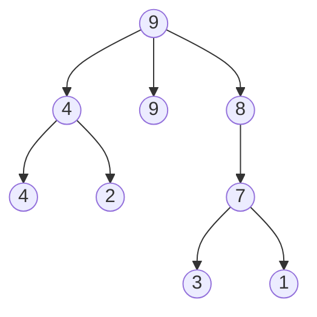
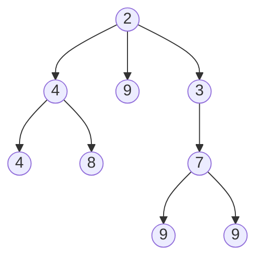

# 9강 — 우선순위 큐와 힙

[레포지토리 안내](../../README.ko.md) | [English](Concepts_Lecture.md) | [한국어](Concepts_Lecture.ko.md)

> **최종 수정일:** 2026-10-26

> **학습 목표:**
> 1. 배열을 사용하여 힙 자료 구조를 구현할 수 있다
> 2. 힙 생성과 힙 정렬 알고리즘을 적용할 수 있다
> 3. 우선순위 큐 연산의 시간 복잡도를 분석할 수 있다
> 4. 좌편향 트리의 s-값을 계산하고 두 좌편향 트리를 합병할 수 있다
> 5. 기계 스케줄링 문제에 LPT 규칙과 최소 힙을 적용할 수 있다

---

## 목차

- [1. 우선순위 큐](#1-우선순위-큐)
  - [1.1 정의](#11-정의)
  - [1.2 최소 및 최대 우선순위 큐](#12-최소-및-최대-우선순위-큐)
  - [1.3 구현 방법](#13-구현-방법)
- [2. 최대 트리와 최소 트리](#2-최대-트리와-최소-트리)
  - [2.1 최대 트리](#21-최대-트리)
  - [2.2 최소 트리](#22-최소-트리)
- [3. 힙](#3-힙)
  - [3.1 정의](#31-정의)
  - [3.2 배열 표현](#32-배열-표현)
  - [3.3 힙 삽입: Bubble Up](#33-힙-삽입-bubble-up)
  - [3.4 힙 삭제: Trickle Down](#34-힙-삭제-trickle-down)
  - [3.5 힙 초기화](#35-힙-초기화)
  - [3.6 복잡도 요약](#36-복잡도-요약)
  - [3.7 연산 종합 예제](#37-연산-종합-예제)
- [4. 좌편향 트리](#4-좌편향-트리)
  - [4.1 동기](#41-동기)
  - [4.2 확장 이진 트리](#42-확장-이진-트리)
  - [4.3 S-값 (최단 경로)](#43-s-값-최단-경로)
  - [4.4 좌편향 트리 정의](#44-좌편향-트리-정의)
  - [4.5 합병 연산](#45-합병-연산)
  - [4.6 합병을 통한 삽입과 삭제](#46-합병을-통한-삽입과-삭제)
  - [4.7 합병을 통한 초기화](#47-합병을-통한-초기화)
- [5. 우선순위 큐의 응용](#5-우선순위-큐의-응용)
  - [5.1 힙 정렬 (Heap Sort)](#51-힙-정렬-heap-sort)
  - [5.2 기계 스케줄링](#52-기계-스케줄링)
  - [5.3 실세계 응용](#53-실세계-응용)
- [6. 부록](#6-부록)
  - [6.1 힙 초기화가 O(n)인 이유](#61-힙-초기화가-on인-이유)
- [요약](#요약)
- [점검 문제](#점검-문제)

---

<br>

## 1. 우선순위 큐

### 1.1 정의

**우선순위 큐(priority queue)** 는 각 원소가 **우선순위 또는 값**을 가지는 0개 이상의 원소들의 모음이다. FIFO 큐와 달리, 삭제 순서는 도착 순서가 아닌 **원소의 우선순위**에 의해 결정된다.

즉 원소는 큐에 도착한 순서가 아니라 우선순위가 증가하는 순서나 감소하는 순서로 삭제된다. 다음에 서비스를 받을 사람을 도착 순서가 아니라 우선순위로 정하는 상황이 우선순위 큐에 해당한다.

### 1.2 최소 및 최대 우선순위 큐

우선순위 큐의 기본 연산은 원소 찾기(find), 새 원소 삽입(insert), 원소 삭제(delete)이다. 우선순위 큐는 찾기와 삭제가 어떤 원소를 대상으로 하는지에 따라 두 가지로 나뉜다.

| 유형 | Find | Delete | Insert |
|:-----|:-----|:-------|:-------|
| **최소 우선순위 큐** | **최솟값** 원소 | 최솟값 원소 삭제 | 새 원소 삽입 |
| **최대 우선순위 큐** | **최댓값** 원소 | 최댓값 원소 삭제 | 새 원소 삽입 |

*표 1. 최소 우선순위 큐와 최대 우선순위 큐의 연산*

두 개 이상의 원소가 같은 우선순위를 가질 수 있다. 이때 찾기와 삭제는 우선순위가 같은 원소 가운데 어느 것을 대상으로 해도 된다.

### 1.3 구현 방법

우선순위 큐는 주로 다음 두 구조로 구현한다.
1. **힙(Heap):** 배열 기반 표현으로 효율적으로 저장하는 완전 이진 트리이다.
2. **좌편향 트리(Leftist tree):** 효율적인 합병에 적합한 연결 자료구조이다.

> **핵심:** 힙은 $O(\log n)$ 삽입과 삭제 연산을 제공하며 $O(1)$ find-max/find-min을 지원한다. 좌편향 트리는 추가로 두 우선순위 큐의 $O(\log n)$ 합병을 지원한다.

---

<br>

## 2. 최대 트리와 최소 트리

### 2.1 최대 트리

**최대 트리(max tree)** 는 각 노드의 값이 자식(있는 경우)의 값보다 **크거나 같은** 트리이다. 루트에 **최댓값** 원소가 있다.

최대 트리의 노드는 두 개보다 많은 자식을 가질 수 있다(즉, 이진 트리가 아닐 수 있다).



*그림 1. 루트가 자식 세 개를 가지는 최대 트리*

그림 1에서는 어느 노드도 자식보다 작지 않으므로 루트 9가 최댓값이다. 부모와 자식이 같은 값(9와 9, 4와 4)을 가져도 최대 트리 성질은 성립한다.

### 2.2 최소 트리

**최소 트리(min tree)** 는 각 노드의 값이 자식의 값보다 **작거나 같은** 트리이다. 루트에 **최솟값** 원소가 있다.



*그림 2. 루트가 최솟값인 최소 트리*

---

<br>

## 3. 힙

### 3.1 정의

**최대 힙(max heap)** (최소 힙(min heap))은 **최대(최소) 트리**이면서 동시에 **완전 이진 트리**인 것이다.

- 최대 힙에서는 모든 부모가 자식보다 크거나 같으므로($\geq$) 루트가 최댓값이다.
- 최소 힙에서는 모든 부모가 자식보다 작거나 같으므로($\leq$) 루트가 최솟값이다.

완전 이진 트리는 8강에서 정의한 대로 마지막 레벨을 제외한 모든 레벨이 꽉 차 있고, 마지막 레벨의 노드가 가능한 한 왼쪽에 놓인 이진 트리이다.

```text
(a)      14             (b)    9          (c)   30
       /    \                 /                /
     12      7               6               25
    /  \    /               /
  10    8  6               5
```

*그림 3. 최대 힙인지 판별할 세 이진 트리*

그림 3의 (a)는 완전 이진 트리이고 모든 부모가 자식보다 크거나 같으므로 최대 힙이다. (b)는 최대 트리 성질은 만족하지만, 9의 오른쪽 자식이 비어 있는데 그 아래 레벨에 5가 있으므로 완전 이진 트리가 아니다. 따라서 최대 힙이 아니다. (c)는 노드 두 개로 된 완전 이진 트리(25가 왼쪽 자식)이고 30이 25보다 크므로 최대 힙이다.

**최대 힙이 아닌 경우:** 최대 트리 성질을 만족하더라도 완전 이진 트리가 아니면(예: 마지막 레벨에서 중간 노드가 빠진 경우) 최대 힙이 아니다.

노드 9개로 된 최대 힙의 예는 3.2절의 그림 4이다. 같은 모양의 최소 힙으로는 레벨 순서로 2, 4, 3, 6, 7, 9, 3, 8, 6을 담은 트리가 있다.

### 3.2 배열 표현

힙은 완전 이진 트리이므로, 노드 번호 성질을 사용하여 배열로 효율적으로 표현할 수 있다. 8강의 번호 매기기처럼 레벨 순서로 위에서 아래로, 같은 레벨에서는 왼쪽에서 오른쪽으로 1부터 번호를 매기고, 노드 $i$를 `heap[i]`에 저장한다(`heap[0]`은 쓰지 않는다). 완전 이진 트리는 번호 1부터 $n$까지를 빈틈없이 쓰므로 배열에 빈 칸이 생기지 않는다.

```text
            9
         /     \
        8       7
      /   \    / \
     6     7  2   6
    / \
   5   1
```

*그림 4. 노드 9개로 된 최대 힙*

```text
Heap:       [_, 9, 8, 7, 6, 7, 2, 6, 5, 1]
Index:       0  1  2  3  4  5  6  7  8  9
```

*그림 5. 그림 4의 최대 힙을 저장한 배열*

원소가 $n$개일 때 노드 $i$의 부모와 자식은 다음 위치에 있다.

- 노드 $i$의 부모: $\lfloor i/2 \rfloor$ ($i > 1$일 때)
- 노드 $i$의 왼쪽 자식: $2i$ ($2i \leq n$일 때, 그렇지 않으면 왼쪽 자식이 없다)
- 노드 $i$의 오른쪽 자식: $2i + 1$ ($2i + 1 \leq n$일 때, 그렇지 않으면 오른쪽 자식이 없다)

**마지막 노드:** 힙의 마지막 노드는 가장 깊은 레벨의 가장 오른쪽 노드이며, 배열에서는 `heap[n]`이다. 예를 들어 레벨 순서로 2, 5, 6, 9, 7을 담은 최소 힙에서 마지막 노드는 7이다. 트리 전체에서 가장 오른쪽에 그려지는 6은 가장 깊은 레벨에 있지 않으므로 마지막 노드가 아니다. 삽입은 `heap[n+1]`에 노드를 하나 더하고 삭제는 `heap[n]`의 노드를 없애므로, 두 연산 모두 완전 이진 트리 모양을 유지한다.

### 3.3 힙 삽입: Bubble Up

최대 힙에 새 원소를 삽입하려면:

1. 새 원소를 놓을 자리를 **다음 빈 위치**(배열의 `heap[n+1]`)에 만든다. 그래야 완전 이진 트리 모양이 유지된다.
2. **Bubble up:** 새 원소를 부모와 비교하여 새 원소가 더 크면 둘의 자리를 바꾼다.
3. 새 원소가 부모보다 크지 않거나 루트에 도달할 때까지 2단계를 반복한다.

그림 4의 힙에 5를 삽입하면 새 자리는 `heap[10]`이고 부모는 `heap[5]`의 7이다. 5는 7보다 크지 않으므로 삽입은 바로 끝난다. 같은 힙에 5 대신 20을 삽입하면, 20은 부모 7(`heap[5]`), 8(`heap[2]`), 9(`heap[1]`)보다 차례로 크므로 세 번 자리를 바꾸어 루트에 이른다. 결과는 그림 6이다.

```text
            20
         /      \
        9        7
      /   \     / \
     6     8   2   6
    / \   /
   5   1 7
```

*그림 6. 그림 4의 최대 힙에 20을 삽입한 결과*

아래 코드는 교환을 반복하는 대신 부모를 한 칸씩 아래로 내리고, 마지막에 새 원소를 한 번만 기록한다. `currentNode`는 새 리프 위치에서 출발하여 위로 올라간다. 결과는 교환을 반복할 때와 같지만 대입 횟수가 적다. 전체 `push` 함수는 이 코드 앞에서 배열이 가득 찼는지(`heapSize == arrayLength - 1`) 확인하고, 가득 찼으면 배열 길이를 두 배로 늘린다.

```cpp
int currentNode = ++heapSize;
while (currentNode != 1 && heap[currentNode / 2] < theElement) {
    heap[currentNode] = heap[currentNode / 2]; // 부모를 아래로 이동
    currentNode /= 2;                          // 부모로 이동
}
heap[currentNode] = theElement;
```

**시간 복잡도:** 레벨마다 비교를 최대 한 번 하므로 $O(\text{높이}) = O(\log n)$이다. 8강의 정의대로 높이를 레벨 수(루트가 레벨 1)로 세면, 원소가 $n$개인 완전 이진 트리의 높이는 $\lceil \log_2(n+1) \rceil$이다. 예를 들어 그림 6처럼 원소가 10개이면 높이는 $\lceil \log_2 11 \rceil = 4$이고, 새 원소는 레벨 4에서 출발하므로 비교는 최대 $4 - 1 = 3$번이다.

### 3.4 힙 삭제: Trickle Down

최대 힙에서 최댓값 원소를 삭제하려면:

1. 최댓값 원소가 있는 **루트를 제거**한다.
2. 힙의 **마지막 원소**를 빼내고(원소 수가 하나 줄어든다), 이 원소를 루트 자리에 다시 넣으려고 시도한다.
3. **Trickle down:** 자식들 가운데 **더 큰 자식**과 비교하여 그 자식이 더 크면 자리를 바꾼다.
4. 원소가 더 큰 자식보다 작지 않거나 리프에 도달할 때까지 3단계를 반복한다.

그림 7의 최대 힙(원소 11개)에서 최댓값 20을 삭제한다.

```text
              20
          /        \
        15          7
      /    \       / \
     6      9     2   6
    / \    / \
   5   1  7   8
```

*그림 7. 삭제 전의 최대 힙*

루트 20을 제거하면 원소는 10개가 되어야 하므로 마지막 원소 8(`heap[11]`)을 빼내 루트에 넣으려 한다. 루트의 자식 15와 7 가운데 큰 15가 8보다 크므로 15를 루트로 올린다. 다음 자리 `heap[2]`의 자식 6과 9 가운데 큰 9가 8보다 크므로 9를 올린다. 다음 자리 `heap[5]`의 자식은 `heap[10]`의 7 하나뿐이고 8이 7보다 크므로 8을 `heap[5]`에 놓는다. 결과는 `[-, 15, 9, 7, 6, 8, 2, 6, 5, 1, 7]`이다.

전체 `pop` 함수는 힙이 비어 있으면(`heapSize == 0`) 예외를 던지고, 그렇지 않으면 루트의 원소를 제거한 뒤 아래 코드로 마지막 원소의 자리를 찾는다.

```cpp
T lastElement = heap[heapSize--];
int currentNode = 1, child = 2;
while (child <= heapSize) {
    if (child < heapSize && heap[child] < heap[child + 1])
        child++;                              // 더 큰 자식 사용
    if (lastElement >= heap[child])
        break;                                // 위치 발견
    heap[currentNode] = heap[child];          // 자식을 위로 이동
    currentNode = child;
    child *= 2;
}
heap[currentNode] = lastElement;
```

**시간 복잡도:** 삽입과 같은 논리로 레벨마다 일정한 양의 일을 하므로 $O(\text{높이}) = O(\log n)$이다.

> **주의:** Trickle down에서 두 자식이 모두 배치할 원소보다 크더라도 둘 중 아무것이나 올려서는 안 되며, 최대 힙에서는 반드시 **더 큰 자식**을 올려야 한다. 예를 들어 배치할 원소가 8이고 두 자식이 10과 9일 때 9를 올리면 9가 10의 부모가 되어 최대 트리 성질이 깨진다. 더 큰 자식은 형제와 배치할 원소보다 모두 크거나 같으므로, 그 자식을 올려야 성질이 유지된다. 최소 힙에서는 반대로 더 작은 자식을 올린다.

### 3.5 힙 초기화

**힙 초기화(initialization)** 는 원소가 임의의 순서로 들어 있는 완전 이진 트리(배열)를 필요한 곳만 조정하여 힙으로 만드는 연산이다. 원소를 하나씩 $n$번 삽입하면 $O(n \log n)$이 걸리지만, 다음 상향식 방법은 임의의 $n$개 원소 배열로부터 $O(n)$ 시간에 최대 힙을 구축한다.

1. 자식이 있는 마지막 위치인 **가장 오른쪽 내부 노드**(위치 $\lfloor n/2 \rfloor$)에서 시작한다. 그보다 뒤의 위치는 모두 리프이다.
2. 각 내부 노드를 루트로 하는 서브트리에 **trickle down**(sift down이라고도 한다)을 적용하며, 위치를 하나씩 줄여 오른쪽에서 왼쪽으로, 아래에서 위로 이동한다.
3. 루트(위치 1)를 처리하면 끝난다.

위치 $i$를 처리할 때에는 그 아래의 두 서브트리가 이미 힙이므로, 위치 $i$의 원소 하나만 trickle down하면 $i$를 루트로 하는 서브트리 전체가 힙이 된다. 아래에서 위로 처리하는 이유가 이것이다. 전체 `initialize` 함수는 기존 배열을 해제하고(`delete [] heap`) 주어진 배열 `theHeap[1:theSize]`를 `heap`으로 삼아 `heapSize`를 `theSize`로 정한 뒤 아래 반복문을 실행한다.

```cpp
for (int root = heapSize / 2; root >= 1; root--) {
    // root에서 trickle down
    T rootElement = heap[root];
    int child = 2 * root;
    while (child <= heapSize) {
        if (child < heapSize && heap[child] < heap[child + 1])
            child++;
        if (rootElement >= heap[child]) break;
        heap[child / 2] = heap[child];
        child *= 2;
    }
    heap[child / 2] = rootElement;
}
```

**예시:** 입력 배열 `[-, 1, 2, 3, 4, 5, 6, 7, 8, 9, 10, 11]`은 초기화 후 최대 힙 `[-, 11, 10, 7, 9, 5, 6, 3, 8, 4, 2, 1]`이 된다.

$n = 11$이므로 시작 위치는 $\lfloor 11/2 \rfloor = 5$이다. 각 위치를 처리한 뒤의 배열은 표 2와 같다.

| 처리한 위치 | 일어난 일 | 처리 후 배열 |
|:-----|:-----|:-----|
| 5 | 5의 자식 10, 11 가운데 큰 11이 5보다 크므로 11을 올린다 | `[-, 1, 2, 3, 4, 11, 6, 7, 8, 9, 10, 5]` |
| 4 | 4의 자식 8, 9 가운데 큰 9를 올린다 | `[-, 1, 2, 3, 9, 11, 6, 7, 8, 4, 10, 5]` |
| 3 | 3의 자식 6, 7 가운데 큰 7을 올린다 | `[-, 1, 2, 7, 9, 11, 6, 3, 8, 4, 10, 5]` |
| 2 | 2의 자식 9, 11 가운데 11을 올리고, 새 자리의 자식 10, 5 가운데 10을 올린다 | `[-, 1, 11, 7, 9, 10, 6, 3, 8, 4, 2, 5]` |
| 1 | 1의 자식 11, 7 가운데 11, 그 아래 9, 10 가운데 10, 그 아래 2, 5 가운데 5를 차례로 올린다 | `[-, 11, 10, 7, 9, 5, 6, 3, 8, 4, 2, 1]` |

*표 2. 배열 [1, 2, ..., 11]의 최대 힙 초기화 과정*

**시간 복잡도:** $O(n \log n)$이 아니라 $O(n)$이다. 대부분의 노드가 하단 근처에 있어 매우 적은 수의 교환만 필요하기 때문이다. 자세한 계산은 6.1절에 있다.

### 3.6 복잡도 요약

원소 수(힙 크기)가 $n$일 때 힙 연산의 시간 복잡도는 표 3과 같다.

| 연산 | 시간 복잡도 |
|:-----|:-----------|
| 삽입 | $O(\log n)$ |
| 최대/최소 삭제 | $O(\log n)$ |
| 최대/최소 탐색 | $O(1)$ |
| 초기화 (heapify) | $O(n)$ |

*표 3. 힙 연산의 시간 복잡도*

### 3.7 연산 종합 예제

레벨 순서로 10, 2, 7, 6, 5, 9, 12, 35, 22, 15, 1, 3, 4를 담은 완전 이진 트리(원소 13개)를 최대 힙으로 초기화한 뒤, 15, 20, 45를 차례로 삽입하고 최댓값 삭제를 세 번 하면 배열은 표 4처럼 바뀐다.

| 단계 | 배열 |
|:-----|:-----|
| 초기 완전 이진 트리 | `[-, 10, 2, 7, 6, 5, 9, 12, 35, 22, 15, 1, 3, 4]` |
| 초기화 후 | `[-, 35, 22, 12, 10, 15, 9, 7, 6, 2, 5, 1, 3, 4]` |
| 15 삽입 | `[-, 35, 22, 15, 10, 15, 9, 12, 6, 2, 5, 1, 3, 4, 7]` |
| 20 삽입 | `[-, 35, 22, 20, 10, 15, 9, 15, 6, 2, 5, 1, 3, 4, 7, 12]` |
| 45 삽입 | `[-, 45, 35, 20, 22, 15, 9, 15, 10, 2, 5, 1, 3, 4, 7, 12, 6]` |
| 첫 번째 최댓값 삭제 | `[-, 35, 22, 20, 10, 15, 9, 15, 6, 2, 5, 1, 3, 4, 7, 12]` |
| 두 번째 최댓값 삭제 | `[-, 22, 15, 20, 10, 12, 9, 15, 6, 2, 5, 1, 3, 4, 7]` |
| 세 번째 최댓값 삭제 | `[-, 20, 15, 15, 10, 12, 9, 7, 6, 2, 5, 1, 3, 4]` |

*표 4. 초기화, 삽입 세 번, 최댓값 삭제 세 번에 따른 힙 배열의 변화*

15를 삽입하면 새 자리 `heap[14]`의 부모는 `heap[7]`의 7이므로 15가 7과 자리를 바꾸고, 다시 부모 `heap[3]`의 12보다 크므로 한 번 더 바꾼다. 루트 35보다는 작으므로 `heap[3]`에서 멈춘다. 같은 값 15가 `heap[3]`과 `heap[5]`에 함께 있어도 힙 성질에는 문제가 없다. 45는 루트보다 크므로 루트까지 올라가며, 이때 다섯 번째 레벨에 처음 노드가 생겨 높이가 5가 된다. 두 번째 삭제에서는 마지막 원소 12가 루트에서 출발하여 22와 15를 차례로 올린 뒤 `heap[5]`에 놓인다.

---

<br>

## 4. 좌편향 트리

### 4.1 동기

힙 구조는 공간과 시간 모두에서 효율적이지만 모든 우선순위 큐 응용에 알맞지는 않다. 특히 두 우선순위 큐를 **합병(meld, 결합)** 하거나 크기가 서로 다른 여러 큐를 함께 쓰는 응용에는 맞지 않다.

힙은 두 힙의 효율적인 **합병(merge)** 을 지원하지 않는다. 크기 $m$과 $n$인 두 배열 힙을 합병하려면, 두 배열을 이어 붙여 3.5절의 초기화를 다시 하는 데 $O(m+n)$, 한쪽 원소를 다른 쪽에 하나씩 삽입하는 데 $O(m \log(m+n))$이 걸린다. 어느 방법이든 적어도 한쪽 힙의 크기에 비례하는 시간이 든다. 좌편향 트리는 $O(\log(m+n))$ 합병을 가능하게 한다.

**좌편향 트리(leftist tree)** 는 우선순위 큐 구현에 알맞은 연결 이진 트리이며, 이름대로 왼쪽으로 기우는 모양을 가진다. 힙이 하는 모든 일을 같은 점근적 복잡도로 할 수 있고, 추가로 두 좌편향 트리 우선순위 큐를 $O(\log n)$ 시간에 합병할 수 있다.

### 4.2 확장 이진 트리

좌편향 트리를 정의하려면 먼저 외부 노드를 도입해야 한다.

- **외부 노드(external node)** 는 빈 서브트리 하나하나를 대신하는 특별한 노드이다.
- **내부 노드(internal node)** 는 원래 이진 트리에 있던 노드이다. 외부 노드를 붙이면 모든 내부 노드는 비어 있지 않은 서브트리 두 개를 가진다.
- **확장 이진 트리(extended binary tree)** 는 이진 트리의 빈 서브트리 자리마다 외부 노드를 붙인 트리이다.

내부 노드가 $n$개인 확장 이진 트리에는 외부 노드가 정확히 $n + 1$개 있다. 내부 노드 $n$개는 자식 자리 $2n$개를 가지고, 그중 루트를 뺀 $n - 1$개 노드가 자리를 하나씩 차지하므로, 남는 $2n - (n - 1) = n + 1$개 자리가 외부 노드가 되기 때문이다. 그림 8은 내부 노드 9개에 외부 노드 10개를 붙인 확장 이진 트리이다.

```text
                        A
                 /             \
              B                   C
           /     \             /     \
         D         E          H       []
       /   \      / \       /   \
      F     G    [] []     I     []
     / \   / \            / \
    [] [] [] []          [] []
```

*그림 8. 내부 노드 9개(A부터 I까지)와 외부 노드 10개([])로 된 확장 이진 트리*

### 4.3 S-값 (최단 경로)

확장 이진 트리의 노드 $x$에 대해, **s-값**(s-value, 또는 **랭크**)은 $x$를 루트로 하는 서브트리 안에서 $x$로부터 **외부 노드**(null 자손)까지 가는 최단 경로의 길이(가지 수)이다.

- $s(\text{null}) = 0$ (외부 노드)
- $s(x) = 1 + \min(s(x.\text{left}), s(x.\text{right}))$ (내부 노드)

그림 9는 그림 8의 각 노드에 s-값을 적은 것이다. 리프 F, G, E, I는 두 자식이 모두 외부 노드이므로 s-값이 1이다. H와 C는 오른쪽 자식이 외부 노드이므로 1이다. D는 $\min(1, 1) + 1 = 2$, B는 $\min(2, 1) + 1 = 2$, 루트 A는 $\min(2, 1) + 1 = 2$이다.

```text
                        2
                 /             \
              2                   1
           /     \             /     \
         2         1          1       0
       /   \      / \       /   \
      1     1    0  0      1     0
     / \   / \            / \
    0  0  0  0           0  0
```

*그림 9. 그림 8의 각 노드에 적은 s-값*

s-값과 함께 쓰는 값으로 **w 값**이 있다. 노드 $x$의 w 값 $w(x)$는 $x$를 루트로 하는 서브트리의 내부 노드 수이다. s-값이 경로 길이를 기준으로 삼는 것과 달리 w 값은 노드 수를 기준으로 삼는다. 그림 8에서 $w(A) = 9$, $w(B) = 5$, $w(C) = 3$이다. 이 강의의 좌편향 트리는 s-값으로 정의한다.

### 4.4 좌편향 트리 정의

**좌편향 트리(leftist tree)** 는 모든 내부 노드 $x$에 대해 다음을 만족하는 이진 트리이다. s-값(높이)을 기준으로 정의하므로 정확한 이름은 **높이 우선 좌편향 트리(HBLT, height-biased leftist tree)** 이다.

$$s(x.\text{left}) \geq s(x.\text{right})$$

이는 트리가 왼쪽으로 기울어 있음을 뜻한다. 어떤 노드에서든 오른쪽 자식을 거쳐 외부 노드에 이르는 최단 경로가 왼쪽 자식을 거치는 최단 경로보다 길지 않다.

그림 9의 트리는 모든 내부 노드에서 왼쪽 자식의 s-값이 오른쪽 자식의 s-값보다 크거나 같으므로 좌편향 트리이다(A는 2와 1, B는 2와 1, C와 H는 1과 0, 나머지는 같은 값). 어떤 내부 노드에서 이 조건이 깨지면 그 노드의 두 자식을 맞바꾸어 조건을 만족시킬 수 있다. 맞바꾸어도 그 노드의 s-값은 변하지 않으므로 조상의 조건에는 영향이 없다.

**성질 1:** 좌편향 트리에서 가장 오른쪽 경로(루트에서 오른쪽 자식만 따라 외부 노드에 이르는 경로)는 루트에서 외부 노드까지의 최단 경로이고, 그 길이는 $s(\text{root})$이다. 각 노드에서 $s(x.\text{right}) \leq s(x.\text{left})$이므로 $s(x) = s(x.\text{right}) + 1$이고, 오른쪽 자식으로 내려갈 때마다 s-값이 정확히 1씩 줄기 때문이다. 그림 9에서 A, C, 외부 노드로 이어지는 경로의 길이는 $2 = s(A)$이다.

**성질 2:** 내부 노드가 $n$개인 좌편향 트리에서 가장 오른쪽 경로의 내부 노드 수 $s(\text{root})$는 최대 $\lfloor \log_2(n+1) \rfloor$이다. $s(x) = k$이면 $x$에서 위쪽 $k$개 레벨에는 외부 노드가 없다. 외부 노드가 더 얕은 곳에 있으면 그곳까지의 경로가 $k$보다 짧아지기 때문이다. 따라서 위쪽 $k$개 레벨은 꽉 차 있고 내부 노드가 적어도 $2^k - 1$개이므로, $n \geq 2^{s(\text{root})} - 1$, 즉 $s(\text{root}) \leq \log_2(n+1)$이다. 그림 9에서는 $s(A) = 2$이고 $\lfloor \log_2 10 \rfloor = 3$이므로 성질을 만족한다.

**최대 HBLT**는 최대 트리이기도 한 HBLT이고, **최소 HBLT**는 최소 트리이기도 한 HBLT이다. **최소 좌편향 트리**는 좌편향 트리이면서 동시에 최소 트리(루트 = 최솟값)인 것이며 최소 우선순위 큐로 쓴다. 마찬가지로 최대 좌편향 트리는 최대 우선순위 큐로 쓴다.

예를 들어 그림 3의 세 트리는 모두 최대 HBLT이다. 특히 (b)는 완전 이진 트리가 아니어서 최대 힙은 아니지만, 각 노드가 왼쪽 자식만 가지므로 좌편향 조건을 만족한다. 최소 HBLT의 예로는 레벨 순서로 2, 7, 4, 10, 8, 6을 담은 완전 이진 트리, 10의 왼쪽 자식이 20이고 20의 왼쪽 자식이 50인 트리, 11의 왼쪽 자식이 21인 트리가 있다.

### 4.5 합병 연산

합병은 좌편향 트리의 기본 연산이다. 두 최소 좌편향 트리 $A$와 $B$를 합병하려면:

1. 두 루트를 비교하여 더 작은 루트를 합병된 트리의 루트로 삼는다.
2. 더 작은 루트의 오른쪽 서브트리를 나머지 트리와 재귀적으로 합병하고, 그 결과를 새 오른쪽 서브트리로 삼는다.
3. 합병 후 $s(\text{left}) < s(\text{right})$이면 왼쪽과 오른쪽 자식을 **교환**한다. 왼쪽 자식이 없으면 $s(\text{left}) = 0$으로 본다.
4. s-값을 $s(\text{root}) = s(\text{right}) + 1$로 갱신한다.

최대 좌편향 트리에서는 1단계에서 더 큰 루트를 고르고 나머지 단계는 같다. 두 루트가 같으면 어느 쪽을 골라도 된다.

그림 10의 두 최대 HBLT를 합병하는 과정은 다음과 같다. 각 노드 옆 괄호 안의 수는 s-값이다.

```text
       40(2)                      18(2)
      /     \                    /     \
   30(1)    10(1)             6(1)     7(1)
   /        /
 20(1)    5(1)
```

*그림 10. 합병할 두 최대 HBLT*

1. 루트 40과 18을 비교하면 40이 크므로 40이 결과의 루트가 되고, 40의 오른쪽 서브트리(10이 루트)와 18의 트리를 합병한다.
2. 루트 18과 10을 비교하면 18이 크므로, 18의 오른쪽 서브트리 7과 10의 서브트리를 합병한다.
3. 루트 10과 7을 비교하면 10이 크므로, 10의 오른쪽 서브트리(빈 트리)와 7을 합병한다. 빈 트리와 합병한 결과는 7이므로 7이 10의 오른쪽 자식이 된다. 10의 두 자식 5와 7의 s-값이 모두 1이므로 교환하지 않고, $s(10) = 2$가 된다.
4. 18로 돌아오면 왼쪽 자식 6의 s-값 1이 오른쪽 자식 10의 s-값 2보다 작으므로 두 자식을 교환한다. 그 결과 $s(18) = s(6) + 1 = 2$이다.
5. 40으로 돌아오면 왼쪽 자식 30의 s-값 1이 오른쪽 자식 18의 s-값 2보다 작으므로 교환한다. 그 결과 $s(40) = s(30) + 1 = 2$이다.

```text
            40(2)
          /       \
       18(2)      30(1)
      /     \      /
   10(2)   6(1)  20(1)
   /   \
 5(1)  7(1)
```

*그림 11. 그림 10의 두 최대 HBLT를 합병한 결과*

결과의 루트는 처음 두 루트 가운데 큰 쪽이고, 재귀 호출은 두 트리의 가장 오른쪽 경로(40에서 10, 18에서 7)를 따라서만 내려간다. 아래는 최대 HBLT의 합병을 재귀 함수로 구현한 것이다.

```cpp
struct HbltNode {
    int element;
    int s;                      // s-값
    HbltNode* left;
    HbltNode* right;
    HbltNode(int e) : element(e), s(1), left(nullptr), right(nullptr) {}
};

// 최대 HBLT x와 y를 합병하고 합병된 트리의 루트를 돌려준다
HbltNode* meld(HbltNode* x, HbltNode* y) {
    if (y == nullptr) return x;
    if (x == nullptr) return y;
    if (x->element < y->element) swap(x, y);   // 루트가 더 큰 쪽을 x로
    x->right = meld(x->right, y);              // x의 오른쪽 서브트리와 y를 합병
    int sLeft = (x->left == nullptr) ? 0 : x->left->s;
    if (sLeft < x->right->s) swap(x->left, x->right);  // 좌편향 성질 복구
    x->s = (x->right == nullptr) ? 1 : x->right->s + 1;
    return x;
}
```

새 노드는 두 자식이 모두 외부 노드이므로 s-값 1로 시작한다. `meld`의 처음 두 줄은 한쪽이 빈 트리이면 다른 쪽을 그대로 돌려준다. 루트가 작은 쪽이 `x`이면 `x`와 `y`를 맞바꾸어, 항상 `x`의 루트가 결과의 루트가 되게 한다. 이어서 `x`의 오른쪽 서브트리와 `y`를 재귀적으로 합병하고, 왼쪽 자식의 s-값(없으면 0)이 오른쪽보다 작으면 두 자식을 교환한다. 마지막으로 교환 뒤 오른쪽 자식의 s-값에 1을 더해 `x`의 s-값을 정하며, 교환으로 오른쪽이 비면 s-값은 1이다. 이 함수로 그림 10의 두 트리를 합병하면 그림 11의 트리가 나온다.

**시간 복잡도:** 재귀 호출마다 두 트리 가운데 한쪽의 가장 오른쪽 경로를 한 단계 내려가고, 두 경로의 길이는 성질 2에 의해 각각 $O(\log m)$, $O(\log n)$이다. 따라서 합병은 $O(\log m + \log n)$이다.

### 4.6 합병을 통한 삽입과 삭제

- **삽입:** 새 원소 하나로 된 단일 노드 좌편향 트리를 만들어 기존 트리와 합병한다. 시간은 $O(\log n)$이다.
- **최소 삭제:** 루트를 제거한 뒤 왼쪽과 오른쪽 서브트리를 합병한다. 시간은 $O(\log n)$이다. 최대 좌편향 트리의 최대 삭제도 같은 방법이다.

> **핵심:** 모든 좌편향 트리 연산은 합병 연산으로 귀결되므로, 합병이 이 자료구조의 핵심이다.

### 4.7 합병을 통한 초기화

원소 $n$개로 좌편향 트리를 만들 때에는 원소마다 단일 노드 트리를 만들어 FIFO 큐에 넣는다. 그다음 큐의 앞에서 트리 두 개를 꺼내 합병하고 그 결과를 큐의 뒤에 넣는 일을 트리가 하나 남을 때까지 반복한다. 합병은 모두 $n - 1$번 일어난다. 처음에는 작은 트리끼리 합병하므로, 노드가 약 $2^i$개인 트리끼리의 합병은 약 $n/2^{i+1}$번 일어나고 각각 $O(i + 1)$ 시간이 걸린다. 그 합은 6.1절과 같은 꼴의 급수이므로 전체 시간은 $O(n)$이다.

예를 들어 원소 12개로 최대 좌편향 트리를 만들 때, 처음 여섯 번의 합병으로 노드 두 개짜리 트리 여섯 개가 만들어졌다고 하자. 루트와 왼쪽 자식의 쌍으로 쓰면 (5, 3), (7, 6), (20, 8), (9, 2), (15, 12), (30, 17)이다. 다음 세 번의 합병은 큐의 앞에서부터 두 트리씩 합쳐 그림 12의 세 트리를 만든다.

```text
     7(2)            20(2)            30(2)
    /    \          /     \          /     \
  6(1)   5(1)     8(1)    9(1)     17(1)   15(1)
         /                /                /
       3(1)             2(1)             12(1)
```

*그림 12. 아홉 번째 합병까지 만들어진 세 최대 좌편향 트리*

열 번째 합병은 큐의 앞에 있는 7의 트리와 20의 트리를 합친다. 20의 오른쪽 서브트리(9와 그 왼쪽 자식 2)와 7의 트리를 합병하면 9가 루트가 된다. 7의 트리는 9의 오른쪽에 붙었다가, s-값 2가 왼쪽 자식 2의 s-값 1보다 크므로 왼쪽으로 교환된다. 20에서도 오른쪽의 9의 트리(s-값 2)가 왼쪽의 8(s-값 1)보다 크므로 두 자식이 교환된다. 마지막 열한 번째 합병은 30의 트리와 이 결과를 합치며, 최종 트리는 그림 13이다.

```text
                 30(2)
               /       \
           20(3)        17(1)
          /      \
       9(2)       15(2)
      /    \      /    \
   7(2)   2(1)  12(1)  8(1)
   /   \
 6(1)  5(1)
       /
     3(1)
```

*그림 13. 원소 12개로 초기화한 최대 좌편향 트리*

---

<br>

## 5. 우선순위 큐의 응용

우선순위 큐, 특히 힙의 대표적인 응용은 정렬(힙 정렬), 기계 스케줄링, 허프만 코드이다.

### 5.1 힙 정렬 (Heap Sort)

힙 정렬은 최대 힙을 사용한다: 최댓값을 $n$번 추출하여 정렬된 배열을 생성한다. 시간: $O(n \log n)$. 공간: $O(1)$ (제자리 정렬).

원소의 키를 우선순위로 삼는 힙 정렬 알고리즘은 다음과 같다.

1. 정렬할 원소를 우선순위 큐에 넣는다. 즉 힙을 초기화한다.
2. 우선순위 큐에서 원소를 하나씩 삭제한다. 최소 우선순위 큐를 쓰면 원소가 감소하지 않는 순서(nondecreasing order)로, 최대 우선순위 큐를 쓰면 증가하지 않는 순서(nonincreasing order)로 나온다.

원소 8, 4, 6, 1, 2를 최대 우선순위 큐에 넣은 뒤 최댓값을 다섯 번 삭제하면 원소가 8, 6, 4, 2, 1 순서로 나온다. 꺼낸 원소를 정렬 배열의 뒤에서부터 채우면 표 5처럼 `[1, 2, 4, 6, 8]`이 된다.

| 단계 | 힙 배열 | 정렬 배열 |
|:-----|:-----|:-----|
| 초기화 후 | `[-, 8, 4, 6, 1, 2]` | `[_, _, _, _, _]` |
| 첫 번째 최댓값 삭제 | `[-, 6, 4, 2, 1]` | `[_, _, _, _, 8]` |
| 두 번째 최댓값 삭제 | `[-, 4, 1, 2]` | `[_, _, _, 6, 8]` |
| 세 번째 최댓값 삭제 | `[-, 2, 1]` | `[_, _, 4, 6, 8]` |
| 네 번째 최댓값 삭제 | `[-, 1]` | `[_, 2, 4, 6, 8]` |
| 다섯 번째 최댓값 삭제 | `[-]` | `[1, 2, 4, 6, 8]` |

*표 5. 원소 8, 4, 6, 1, 2의 힙 정렬 과정*

배열 하나로 구현하면 최댓값을 삭제할 때마다 힙의 크기가 하나 줄어 맨 뒤 칸이 비고, 그 칸에 방금 삭제한 최댓값을 넣는다. 그래서 별도의 정렬 배열 없이 $O(1)$의 추가 공간으로 정렬할 수 있다.

**시간 복잡도:** 초기화가 $O(n)$, 삭제 한 번이 $O(\log n)$이고 삭제를 $n$번 하므로 전체는 $O(n) + n \cdot O(\log n) = O(n \log n)$이다. 삭제할 때마다 trickle down으로 힙을 다시 정돈해야 하므로 $\log n$ 인수가 붙는다. 이는 2강의 정렬 알고리즘 비교에 나오는 버블 정렬과 삽입 정렬의 $O(n^2)$보다 빠르다.

### 5.2 기계 스케줄링

**기계 스케줄링 문제(machine scheduling problem)** 는 똑같은 기계 $m$대와 수행할 작업 $n$개가 있을 때, 마지막 작업이 끝나는 시각(완료 시간, finish time)이 최소가 되도록 작업을 기계에 배정하는 문제이다. 각 기계는 한 번에 작업 하나만 처리하고, 작업 하나는 한 기계에서 중단 없이 처리한다.

기계 3대(A, B, C)와 작업 7개가 있고 작업 시간이 [6, 2, 3, 5, 10, 7, 14]라 하자. 가능한 스케줄 하나는 작업을 주어진 순서대로 보면서 가장 먼저 비는 기계에 배정하는 것이다. 그림 14는 이렇게 만든 스케줄이며, 칸 안의 수는 작업 시간이다.

```text
    0   2 3     6 7           13              21
    |   | |     | |           |               |
A   [----6-----][-----7------]
B   [2-][---5----][------------14------------]
C   [-3--][--------10--------]
```

*그림 14. 작업을 주어진 순서대로 가장 먼저 비는 기계에 배정한 스케줄*

이 스케줄의 완료 시간(길이)은 21이다. 목표는 완료 시간이 최소인 스케줄을 찾는 것이지만, 최소 완료 시간 스케줄링은 **NP-hard** 문제이다.

- NP-hard 문제는 아직 아무도 다항 시간 알고리즘을 찾지 못한 문제의 부류이다. 어떤 NP-hard 문제에 대해서도, 상수 $k$와 $l$에 대해 복잡도가 $O(n^k m^l)$인 알고리즘이 알려져 있지 않다.
- NP는 비결정적 다항 시간(Nondeterministic Polynomial)을 뜻한다.
- NP-hard 문제는 보통 최적해를 보장하지 않는 휴리스틱(또는 근사 알고리즘)으로 푼다.
- **LPT(Longest Processing Time) 규칙**은 최소 완료 시간 스케줄링을 위한 좋은 휴리스틱이다.

> **[계산이론]** 계산이론에서는 NP에 속하는 모든 문제를 다항 시간에 그 문제로 환원할 수 있을 때 그 문제를 NP-hard라고 정의한다. 다항 시간 알고리즘이 알려진 NP-hard 문제는 없고 하나라도 찾으면 P = NP가 성립하므로, 위에서 NP-hard 문제를 다항 시간 알고리즘이 알려지지 않은 문제로 설명한 것이다.

LPT 규칙은 작업을 처리 시간이 긴 순서로 정렬한 뒤, 차례로 가장 먼저 비는 기계에 배정한다. 가장 먼저 비는 기계를 빠르게 찾는 데 **최소 힙**을 쓴다. 각 기계가 비는 시각을 키로 하는 최소 힙에서 최솟값을 삭제하여 기계를 고르고, 작업을 배정한 뒤 그 기계가 새로 비는 시각을 키로 다시 삽입한다. 작업 정렬(힙 정렬)에 $O(n \log n)$, 배정 한 번에 $O(\log m)$이 걸리므로 전체 시간은 $O(n \log n + n \log m)$이다.

같은 예에 LPT 규칙을 적용하면 작업은 14, 10, 7, 6, 5, 3, 2 순서로 배정된다. 동시에 비는 기계가 여럿이면 A, B, C 순서로 고른다.

| 작업 시간 | 배정 기계 | 처리 구간 |
|:-----|:-----|:-----|
| 14 | A | 0~14 |
| 10 | B | 0~10 |
| 7 | C | 0~7 |
| 6 | C | 7~13 |
| 5 | B | 10~15 |
| 3 | C | 13~16 |
| 2 | A | 14~16 |

*표 6. 작업 시간 [6, 2, 3, 5, 10, 7, 14]에 LPT 규칙을 적용한 스케줄*

완료 시간은 16으로 그림 14의 스케줄(21)보다 짧다. 작업 시간의 합이 47이므로 어떤 스케줄이든 적어도 한 기계는 $\lceil 47/3 \rceil = 16$ 이상 일해야 한다. 따라서 이 예에서는 LPT 스케줄이 최적이다. 다만 LPT가 항상 최적해를 주는 것은 아니다(점검 문제 4).

### 5.3 실세계 응용

- **힙**은 Dijkstra 최단 경로 알고리즘, A* 탐색, 운영체제의 작업 스케줄링, 중앙값 유지에 쓰인다.
- **좌편향 트리**는 외부 정렬과, 그래프 알고리즘에서 합병이 필요한 우선순위 큐에 쓰인다.
- **허프만 코드(Huffman code)** 는 문자의 빈도를 가중치로 하는 트리를 최소 우선순위 큐에 넣고, 가중치가 가장 작은 트리 두 개를 꺼내 합친 트리를 다시 넣는 일을 반복하여 만든다.

---

<br>

## 6. 부록

### 6.1 힙 초기화가 O(n)인 이유

상향식 접근법이 효과적인 이유는 노드 대부분이 아래쪽에 있어 짧은 거리만 내려가면 되기 때문이다. 노드 수를 대략 세면 다음과 같다.
- 약 $n/2$개 노드는 리프이므로 교환하지 않는다(0번 교환).
- 약 $n/4$개 노드는 리프 바로 위에 있으므로 최대 1번 교환한다.
- 약 $n/8$개 노드는 최대 2번 교환한다.
- 총 작업량은 $\sum_{i=1}^{\log n} \frac{n}{2^{i+1}} \cdot i = O(n)$이다.

마지막 합은 $\frac{n}{2} \sum_{i \geq 1} \frac{i}{2^i} = \frac{n}{2} \cdot 2 = n$ 이하이므로 $O(n)$이다. 여기서 $\sum_{i \geq 1} i/2^i = 2$를 썼다.

---

<br>

## 요약

| 개념 | 핵심 요약 |
|:-----|:-----|
| 우선순위 큐 | 원소를 도착 순서가 아니라 우선순위에 따라 삭제하는 자료 구조이다. |
| 최대/최소 트리 | 모든 부모가 자식보다 크거나 같은(작거나 같은) 트리이며, 루트가 최댓값(최솟값)이다. |
| 힙 | 최대(최소) 트리이면서 완전 이진 트리인 구조이며, 배열에 빈틈없이 저장한다. |
| 힙 삽입 | 새 원소를 끝에 두고 부모보다 크면 위로 올리는 bubble up으로 $O(\log n)$에 수행한다. |
| 힙 삭제 | 루트를 빼고 마지막 원소를 루트에서 더 큰 자식 쪽으로 내리는 trickle down으로 $O(\log n)$에 수행한다. |
| 힙 초기화 | 위치 $\lfloor n/2 \rfloor$부터 1까지 거꾸로 sift down하는 상향식 방법으로 $O(n)$에 힙을 만든다. |
| 확장 이진 트리 | 빈 서브트리마다 외부 노드를 붙인 트리이며, 내부 노드가 $n$개이면 외부 노드는 $n + 1$개이다. |
| S-값 | 노드에서 그 서브트리의 외부 노드까지 가는 최단 경로의 길이이다. |
| 좌편향 트리 | 모든 내부 노드에서 $s(\text{left}) \geq s(\text{right})$인 이진 트리이며, 가장 오른쪽 경로의 내부 노드 수는 $\lfloor \log_2(n+1) \rfloor$ 이하이다. |
| 좌편향 합병 | 두 트리의 가장 오른쪽 경로만 따라 $O(\log m + \log n)$에 합병하며, 이를 이용해 삽입과 삭제를 빠르게 할 수 있다. |
| 힙 정렬 | 힙을 초기화한 뒤 최댓값을 $n$번 삭제하여 $O(n \log n)$ 시간과 $O(1)$ 추가 공간으로 정렬한다. |
| 기계 스케줄링 | 최소 완료 시간 스케줄링은 NP-hard이며, LPT 규칙과 최소 힙으로 좋은 스케줄을 빠르게 얻는다. |

---

<br>

## 점검 문제

1. **배열 표현:** 원소가 12개인 힙을 `heap[1]`부터 저장했다. `heap[9]`의 부모 위치와 `heap[6]`의 자식 위치를 쓰고, `heap[7]`이 리프인지 판별하라.

   <details>
   <summary>정답</summary>

   `heap[9]`의 부모는 $\lfloor 9/2 \rfloor = 4$, 즉 `heap[4]`이다. `heap[6]`의 왼쪽 자식 위치 $2 \cdot 6 = 12$는 $n = 12$ 이하이므로 `heap[12]`가 왼쪽 자식이고, 오른쪽 자식 위치 13은 12보다 크므로 오른쪽 자식은 없다. `heap[7]`은 $2 \cdot 7 = 14 > 12$이므로 자식이 없는 리프이다. 일반적으로 $\lfloor n/2 \rfloor = 6$보다 뒤의 위치는 모두 리프이다.

   </details>

2. **s-값과 좌편향 조건:** 루트 A의 왼쪽 자식 B는 리프이고, 오른쪽 자식 C는 두 리프 D, E를 자식으로 가진다. 각 노드의 s-값을 구하고, 이 트리가 좌편향 트리인지 판별하라. 좌편향 트리가 아니라면 어떻게 고치는가?

   <details>
   <summary>정답</summary>

   리프 B, D, E의 s-값은 1이고, $s(C) = \min(1, 1) + 1 = 2$, $s(A) = \min(1, 2) + 1 = 2$이다. A에서 $s(B) = 1 < s(C) = 2$이므로 좌편향 트리가 아니다. A의 두 자식을 맞바꾸면 왼쪽이 C(s-값 2), 오른쪽이 B(s-값 1)가 되어 모든 노드가 좌편향 조건을 만족한다. 맞바꾸어도 $s(A)$는 2로 변하지 않는다.

   </details>

3. **가장 오른쪽 경로:** 내부 노드가 15개인 좌편향 트리에서 가장 오른쪽 경로에 있을 수 있는 내부 노드의 최대 개수는 얼마인가? 그 최댓값을 갖는 트리의 예를 들라.

   <details>
   <summary>정답</summary>

   성질 2에 의해 최대 $\lfloor \log_2(15+1) \rfloor = 4$개이다. 노드 15개로 된 높이 4의 포화 이진 트리가 그 예이다. 리프의 s-값은 1이고 위로 올라가며 2, 3이 되어 루트의 s-값이 4이므로, 가장 오른쪽 경로에 내부 노드 4개가 있다.

   </details>

4. **LPT의 한계:** 기계 2대(A, B)와 작업 시간 [3, 3, 2, 2, 2]가 있다. LPT 규칙으로 스케줄하고 완료 시간을 구하라. 이 스케줄은 최적인가?

   <details>
   <summary>정답</summary>

   작업을 3, 3, 2, 2, 2 순서로 가장 먼저 비는 기계에 배정하면 A가 0\~3, B가 0\~3, A가 3\~5, B가 3\~5, A가 5\~7에 작업을 처리하므로 완료 시간은 7이다. 그러나 A에 3, 3을, B에 2, 2, 2를 배정하면 두 기계 모두 6에 끝나므로 최적 완료 시간은 6이다. 따라서 LPT 스케줄은 최적이 아니며, LPT는 최적해를 보장하지 않는 휴리스틱이다.

   </details>
