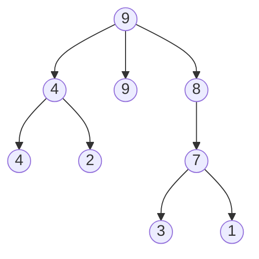
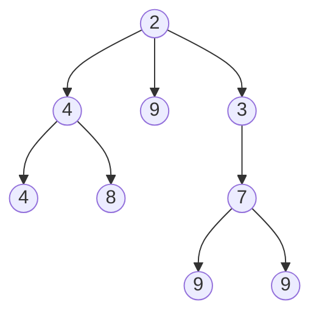

# Lecture 9 — Priority Queues and Heaps

[Repository Guide](../../README.md) | [English](Concepts_Lecture.md) | [한국어](Concepts_Lecture.ko.md)

> **Last Updated:** 2026-10-18

> **Learning Objectives:**
> 1. Implement the heap data structure using an array
> 2. Apply heap initialization (heapify) and heap sort algorithms
> 3. Analyze the time complexity of priority queue operations
> 4. Compute the s-values of a leftist tree and meld two leftist trees
> 5. Apply the LPT rule and a min heap to the machine scheduling problem

---

## Table of Contents

- [1. Priority Queues](#1-priority-queues)
  - [1.1 Definition](#11-definition)
  - [1.2 Min and Max Priority Queues](#12-min-and-max-priority-queues)
  - [1.3 Implementation Options](#13-implementation-options)
- [2. Max and Min Trees](#2-max-and-min-trees)
  - [2.1 Max Tree](#21-max-tree)
  - [2.2 Min Tree](#22-min-tree)
- [3. Heaps](#3-heaps)
  - [3.1 Definition](#31-definition)
  - [3.2 Array Representation](#32-array-representation)
  - [3.3 Heap Insert: Bubble Up](#33-heap-insert-bubble-up)
  - [3.4 Heap Delete: Trickle Down](#34-heap-delete-trickle-down)
  - [3.5 Heap Initialization](#35-heap-initialization)
  - [3.6 Complexity Summary](#36-complexity-summary)
  - [3.7 Combined Operations Example](#37-combined-operations-example)
- [4. Leftist Trees](#4-leftist-trees)
  - [4.1 Motivation](#41-motivation)
  - [4.2 Extended Binary Trees](#42-extended-binary-trees)
  - [4.3 S-Values (Shortest Path)](#43-s-values-shortest-path)
  - [4.4 Leftist Tree Definition](#44-leftist-tree-definition)
  - [4.5 Merge Operation](#45-merge-operation)
  - [4.6 Insert and Delete via Merge](#46-insert-and-delete-via-merge)
  - [4.7 Initialization via Merge](#47-initialization-via-merge)
- [5. Applications of Priority Queues](#5-applications-of-priority-queues)
  - [5.1 Heap Sort](#51-heap-sort)
  - [5.2 Machine Scheduling](#52-machine-scheduling)
  - [5.3 Real-World Applications](#53-real-world-applications)
- [6. Appendix](#6-appendix)
  - [6.1 Why Heap Initialization is O(n)](#61-why-heap-initialization-is-on)
- [Summary](#summary)
- [Self-Check Questions](#self-check-questions)

---

<br>

## 1. Priority Queues

### 1.1 Definition

A **priority queue** is a collection of zero or more elements where each element has a **priority or value**. Unlike FIFO queues, the order of deletion is **determined by the element priority**, not arrival order.

That is, elements are deleted in increasing or decreasing order of priority rather than in the order in which they arrived in the queue. Deciding who gets served next by priority instead of by arrival order is a priority queue situation.

### 1.2 Min and Max Priority Queues

The basic operations of a priority queue are find, insert, and delete. Priority queues come in two kinds, depending on which element the find and delete operations target.

| Type | Find | Delete | Insert |
|:-----|:-----|:-------|:-------|
| **Min Priority Queue** | Element with **minimum** priority | Remove min element | Insert new element |
| **Max Priority Queue** | Element with **maximum** priority | Remove max element | Insert new element |

*Table 1. Operations of min and max priority queues*

Two or more elements can have the same priority. In that case, find and delete may target any of the elements that share the priority.

### 1.3 Implementation Options

Priority queues are primarily implemented using one of two structures.
1. **Heaps:** a complete binary tree that is efficiently stored using the array-based representation.
2. **Leftist trees:** a linked data structure suitable for efficient merging.

> **Key Point:** Heaps provide $O(\log n)$ insert and delete operations with $O(1)$ find-max/find-min. Leftist trees additionally support $O(\log n)$ merge of two priority queues.

---

<br>

## 2. Max and Min Trees

### 2.1 Max Tree

A **max tree** is a tree in which the value in each node is **greater than or equal** to those in its children (if any). The root contains the **maximum** element.

Nodes of a max tree may have more than two children (i.e., it may not be a binary tree).



*Figure 1. A max tree whose root has three children*

In Figure 1, no node is smaller than its children, so the root 9 is the maximum. The max-tree property still holds when a parent and a child have the same value (9 and 9, 4 and 4).

### 2.2 Min Tree

A **min tree** is a tree in which the value in each node is **less than or equal** to those in its children. The root contains the **minimum** element.



*Figure 2. A min tree whose root is the minimum*

---

<br>

## 3. Heaps

### 3.1 Definition

A **max heap** (min heap) is a **max (min) tree** that is also a **complete binary tree**.

- In a max heap, every parent is greater than or equal to its children ($\geq$), so the root is the maximum.
- In a min heap, every parent is less than or equal to its children ($\leq$), so the root is the minimum.

As defined in Lecture 8, a complete binary tree is a binary tree in which every level except possibly the last is completely filled and the nodes on the last level are as far left as possible.

```text
(a)      14             (b)    9          (c)   30
       /    \                 /                /
     12      7               6               25
    /  \    /               /
  10    8  6               5
```

*Figure 3. Three binary trees to be checked for the max heap property*

Tree (a) in Figure 3 is a complete binary tree and every parent is greater than or equal to its children, so it is a max heap. Tree (b) satisfies the max-tree property, but the right child of 9 is empty while the level below contains 5, so it is not a complete binary tree. Therefore it is not a max heap. Tree (c) is a complete binary tree with two nodes (25 is the left child), and 30 is greater than 25, so it is a max heap.

**Not a max heap if:** the tree satisfies the max-tree property but is not a complete binary tree (e.g., missing a middle node on the last level).

Figure 4 in Section 3.2 is an example of a max heap with 9 nodes. A min heap of the same shape is the tree that holds 2, 4, 3, 6, 7, 9, 3, 8, 6 in level order.

### 3.2 Array Representation

Since a heap is a complete binary tree, it is efficiently represented as an array using the node number properties. As in the numbering of Lecture 8, the nodes are numbered from 1 level by level from top to bottom and from left to right within a level, and node $i$ is stored in `heap[i]` (`heap[0]` is unused). A complete binary tree uses the numbers 1 through $n$ without gaps, so the array has no empty slots.

```text
            9
         /     \
        8       7
      /   \    / \
     6     7  2   6
    / \
   5   1
```

*Figure 4. A max heap with 9 nodes*

```text
Heap:       [_, 9, 8, 7, 6, 7, 2, 6, 5, 1]
Index:       0  1  2  3  4  5  6  7  8  9
```

*Figure 5. The array that stores the max heap of Figure 4*

With $n$ elements, the parent and children of node $i$ are at the following positions.

- Parent of node $i$: $\lfloor i/2 \rfloor$ (when $i > 1$)
- Left child of node $i$: $2i$ (when $2i \leq n$; otherwise there is no left child)
- Right child of node $i$: $2i + 1$ (when $2i + 1 \leq n$; otherwise there is no right child)

**Last node:** The last node of a heap is the rightmost node on the deepest level, which is `heap[n]` in the array. For example, in the min heap that holds 2, 5, 6, 9, 7 in level order, the last node is 7. The node 6, which is drawn rightmost in the whole tree, is not on the deepest level, so it is not the last node. Insertion adds a node at `heap[n+1]` and deletion removes the node at `heap[n]`, so both operations keep the shape of a complete binary tree.

### 3.3 Heap Insert: Bubble Up

To insert a new element into a max heap:

1. Create the slot for the new element at the **next available position** (`heap[n+1]` in the array). This keeps the shape of a complete binary tree.
2. **Bubble up:** compare the new element with its parent; if the new element is larger, swap them.
3. Repeat step 2 until the new element is not larger than its parent or the root is reached.

Inserting 5 into the heap of Figure 4 creates the new slot `heap[10]`, whose parent is 7 in `heap[5]`. Since 5 is not larger than 7, the insertion ends immediately. Inserting 20 instead of 5 into the same heap moves 20 up past its parents 7 (`heap[5]`), 8 (`heap[2]`), and 9 (`heap[1]`), since it is larger than each, so it reaches the root after three exchanges. Figure 6 shows the result.

```text
            20
         /      \
        9        7
      /   \     / \
     6     8   2   6
    / \   /
   5   1 7
```

*Figure 6. The result of inserting 20 into the max heap of Figure 4*

Instead of repeated swaps, the code below moves each parent down one level and writes the new element only once at the end. `currentNode` starts at the new leaf and moves up the tree. The result is the same as with repeated swaps, but fewer assignments are made. The full `push` function first checks whether the array is full (`heapSize == arrayLength - 1`) and, if so, doubles the array length before running this code.

```cpp
int currentNode = ++heapSize;
while (currentNode != 1 && heap[currentNode / 2] < theElement) {
    heap[currentNode] = heap[currentNode / 2]; // move parent down
    currentNode /= 2;                          // move to parent
}
heap[currentNode] = theElement;
```

**Time complexity:** At most one comparison is made per level, so the time is $O(\text{height}) = O(\log n)$. Counting the height as the number of levels (the root is level 1) as defined in Lecture 8, a complete binary tree with $n$ elements has height $\lceil \log_2(n+1) \rceil$. For example, with 10 elements as in Figure 6, the height is $\lceil \log_2 11 \rceil = 4$, and the new element starts at level 4, so at most $4 - 1 = 3$ comparisons are made.

### 3.4 Heap Delete: Trickle Down

To delete the max element from a max heap:

1. **Remove the root**, which holds the max element.
2. Take out the **last element** of the heap (the number of elements drops by one) and attempt to place it at the root.
3. **Trickle down:** compare it with the **larger child**; if that child is bigger, swap them.
4. Repeat step 3 until the element is not smaller than its larger child or a leaf is reached.

We delete the maximum 20 from the max heap of Figure 7 (11 elements).

```text
              20
          /        \
        15          7
      /    \       / \
     6      9     2   6
    / \    / \
   5   1  7   8
```

*Figure 7. A max heap before deletion*

After the root 20 is removed, the heap must have 10 elements, so the last element 8 (`heap[11]`) is taken out and placed at the root. Of the root's children 15 and 7, the larger 15 is bigger than 8, so 15 moves up to the root. At the next position `heap[2]`, the larger of the children 6 and 9 is 9, which is bigger than 8, so 9 moves up. At the next position `heap[5]`, the only child is 7 in `heap[10]`, and 8 is larger than 7, so 8 is placed in `heap[5]`. The result is `[-, 15, 9, 7, 6, 8, 2, 6, 5, 1, 7]`.

The full `pop` function throws an exception if the heap is empty (`heapSize == 0`); otherwise it removes the root element and then uses the code below to find the place of the last element.

```cpp
T lastElement = heap[heapSize--];
int currentNode = 1, child = 2;
while (child <= heapSize) {
    if (child < heapSize && heap[child] < heap[child + 1])
        child++;                              // use larger child
    if (lastElement >= heap[child])
        break;                                // found the spot
    heap[currentNode] = heap[child];          // move child up
    currentNode = child;
    child *= 2;
}
heap[currentNode] = lastElement;
```

**Time complexity:** By the same reasoning as insertion, a constant amount of work is done per level, so the time is $O(\text{height}) = O(\log n)$.

> **Caution:** During trickle down, even if both children are larger than the element being placed, you may not move up either one; in a max heap you must move up the **larger child**. For example, if the element being placed is 8 and its two children are 10 and 9, moving 9 up makes 9 the parent of 10, which breaks the max-tree property. The larger child is greater than or equal to both its sibling and the element being placed, so moving it up keeps the property. In a min heap, the smaller child moves up instead.

### 3.5 Heap Initialization

**Heap initialization** turns a complete binary tree (array) whose elements are in arbitrary order into a heap by adjusting the tree where necessary. Inserting the elements one at a time $n$ times takes $O(n \log n)$, but the following bottom-up method builds a max heap from an arbitrary array of $n$ elements in $O(n)$ time.

1. Start at the **rightmost internal node** (position $\lfloor n/2 \rfloor$), which is the last position that has a child. Every later position is a leaf.
2. Apply **trickle down** (also called sift down) to the subtree rooted at each internal node, decreasing the position by one so that you move from right to left and from bottom to top.
3. Stop after the root (position 1) is processed.

When position $i$ is processed, its two subtrees are already heaps, so trickling down the single element at position $i$ makes the whole subtree rooted at $i$ a heap. This is why the positions are processed from the bottom up. The full `initialize` function frees the old array (`delete [] heap`), takes the given array `theHeap[1:theSize]` as `heap`, sets `heapSize` to `theSize`, and then runs the loop below.

```cpp
for (int root = heapSize / 2; root >= 1; root--) {
    // Trickle down from 'root'
    T rootElement = heap[root];
    int child = 2 * root;
    while (child <= heapSize) {
        if (child < heapSize && heap[child] < heap[child + 1])
            child++;
        if (rootElement >= heap[child]) break;
        heap[child / 2] = heap[child];
        child *= 2;
    }
    heap[child / 2] = rootElement;
}
```

**Example:** Input array `[-, 1, 2, 3, 4, 5, 6, 7, 8, 9, 10, 11]` becomes max heap `[-, 11, 10, 7, 9, 5, 6, 3, 8, 4, 2, 1]` after initialization.

Since $n = 11$, the starting position is $\lfloor 11/2 \rfloor = 5$. Table 2 shows the array after each position is processed.

| Position Processed | What Happens | Array Afterward |
|:-----|:-----|:-----|
| 5 | Of the children 10 and 11 of 5, the larger 11 is bigger than 5, so 11 moves up | `[-, 1, 2, 3, 4, 11, 6, 7, 8, 9, 10, 5]` |
| 4 | Of the children 8 and 9 of 4, the larger 9 moves up | `[-, 1, 2, 3, 9, 11, 6, 7, 8, 4, 10, 5]` |
| 3 | Of the children 6 and 7 of 3, the larger 7 moves up | `[-, 1, 2, 7, 9, 11, 6, 3, 8, 4, 10, 5]` |
| 2 | Of the children 9 and 11 of 2, 11 moves up; then of the children 10 and 5 at the new position, 10 moves up | `[-, 1, 11, 7, 9, 10, 6, 3, 8, 4, 2, 5]` |
| 1 | 11 (of the children 11 and 7 of 1), then 10 (of 9 and 10 below), then 5 (of 2 and 5 below) move up in turn | `[-, 11, 10, 7, 9, 5, 6, 3, 8, 4, 2, 1]` |

*Table 2. Max heap initialization of the array [1, 2, ..., 11]*

**Time complexity:** $O(n)$, not $O(n \log n)$. This is because most nodes are near the bottom and require very few swaps. Section 6.1 gives the detailed calculation.

### 3.6 Complexity Summary

Table 3 lists the time complexity of the heap operations when the number of elements (heap size) is $n$.

| Operation | Time Complexity |
|:----------|:---------------|
| Insert | $O(\log n)$ |
| Delete max/min | $O(\log n)$ |
| Find max/min | $O(1)$ |
| Initialization (heapify) | $O(n)$ |

*Table 3. Time complexity of heap operations*

### 3.7 Combined Operations Example

Start with the complete binary tree (13 elements) that holds 10, 2, 7, 6, 5, 9, 12, 35, 22, 15, 1, 3, 4 in level order, initialize it as a max heap, insert 15, 20, and 45 in turn, and then delete the maximum three times. The array changes as in Table 4.

| Step | Array |
|:-----|:-----|
| Initial complete binary tree | `[-, 10, 2, 7, 6, 5, 9, 12, 35, 22, 15, 1, 3, 4]` |
| After initialization | `[-, 35, 22, 12, 10, 15, 9, 7, 6, 2, 5, 1, 3, 4]` |
| Insert 15 | `[-, 35, 22, 15, 10, 15, 9, 12, 6, 2, 5, 1, 3, 4, 7]` |
| Insert 20 | `[-, 35, 22, 20, 10, 15, 9, 15, 6, 2, 5, 1, 3, 4, 7, 12]` |
| Insert 45 | `[-, 45, 35, 20, 22, 15, 9, 15, 10, 2, 5, 1, 3, 4, 7, 12, 6]` |
| First delete max | `[-, 35, 22, 20, 10, 15, 9, 15, 6, 2, 5, 1, 3, 4, 7, 12]` |
| Second delete max | `[-, 22, 15, 20, 10, 12, 9, 15, 6, 2, 5, 1, 3, 4, 7]` |
| Third delete max | `[-, 20, 15, 15, 10, 12, 9, 7, 6, 2, 5, 1, 3, 4]` |

*Table 4. Changes in the heap array after initialization, three insertions, and three max deletions*

When 15 is inserted, the parent of the new slot `heap[14]` is 7 in `heap[7]`, so 15 swaps with 7, and since it is also larger than its next parent 12 in `heap[3]`, it swaps once more. It is smaller than the root 35, so it stops at `heap[3]`. Having the same value 15 in both `heap[3]` and `heap[5]` does not violate the heap property. The element 45 is larger than the root, so it rises all the way to the root; this insertion creates the first node on the fifth level, so the height becomes 5. In the second deletion, the last element 12 starts at the root, moves 22 and then 15 up, and is placed in `heap[5]`.

---

<br>

## 4. Leftist Trees

### 4.1 Motivation

Although the heap structure is both space and time efficient, it is not suitable for all applications of priority queues. In particular, it does not suit applications that **meld** (combine) pairs of priority queues or use multiple queues of varying size.

Heaps do not support efficient **merge** of two heaps. Merging two array heaps of sizes $m$ and $n$ takes $O(m+n)$ if you concatenate the two arrays and rerun the initialization of Section 3.5, or $O(m \log(m+n))$ if you insert the elements of one heap into the other one at a time. Either way, the time is at least proportional to the size of one heap. Leftist trees enable $O(\log(m+n))$ merge.

A **leftist tree** is a linked binary tree suitable for implementing a priority queue, and as its name says, it tends to lean to the left. It can do everything a heap can do with the same asymptotic complexity, and in addition it can meld two leftist tree priority queues in $O(\log n)$ time.

### 4.2 Extended Binary Trees

To define leftist trees, we first introduce external nodes.

- An **external node** is a special node that replaces each empty subtree.
- An **internal node** is a node of the original binary tree. After the external nodes are added, every internal node has two nonempty subtrees.
- An **extended binary tree** is a binary tree with an external node added wherever there is an empty subtree.

An extended binary tree with $n$ internal nodes has exactly $n + 1$ external nodes. The $n$ internal nodes have $2n$ child slots, and the $n - 1$ nodes other than the root each occupy one slot, so the remaining $2n - (n - 1) = n + 1$ slots become external nodes. Figure 8 shows an extended binary tree with 10 external nodes added to 9 internal nodes.

```text
                        A
                 /             \
              B                   C
           /     \             /     \
         D         E          H       []
       /   \      / \       /   \
      F     G    [] []     I     []
     / \   / \            / \
    [] [] [] []          [] []
```

*Figure 8. An extended binary tree with 9 internal nodes (A through I) and 10 external nodes ([])*

### 4.3 S-Values (Shortest Path)

For a node $x$ of an extended binary tree, the **s-value** (or **rank**) is the length (number of branches) of a shortest path from $x$ to an **external node** (null descendant) in the subtree rooted at $x$.

- $s(\text{null}) = 0$ (external node)
- $s(x) = 1 + \min(s(x.\text{left}), s(x.\text{right}))$ (internal node)

Figure 9 writes the s-value of each node of Figure 8. The leaves F, G, E, and I have external nodes as both children, so their s-value is 1. H and C have an external node as the right child, so their s-value is 1. D has $\min(1, 1) + 1 = 2$, B has $\min(2, 1) + 1 = 2$, and the root A has $\min(2, 1) + 1 = 2$.

```text
                        2
                 /             \
              2                   1
           /     \             /     \
         2         1          1       0
       /   \      / \       /   \
      1     1    0  0      1     0
     / \   / \            / \
    0  0  0  0           0  0
```

*Figure 9. The s-value of each node of Figure 8*

A value used alongside the s-value is the **w-value**. The w-value $w(x)$ of a node $x$ is the number of internal nodes in the subtree rooted at $x$. Whereas the s-value is based on path length, the w-value is based on the number of nodes. In Figure 8, $w(A) = 9$, $w(B) = 5$, and $w(C) = 3$. The leftist trees of this lecture are defined by s-values.

### 4.4 Leftist Tree Definition

A **leftist tree** is a binary tree such that for every internal node $x$ the following holds. Since it is defined by s-values (heights), its precise name is **height-biased leftist tree (HBLT)**.

$$s(x.\text{left}) \geq s(x.\text{right})$$

This means the tree leans to the left. From any node, the shortest path to an external node through the right child is no longer than the shortest path through the left child.

The tree of Figure 9 is a leftist tree, because at every internal node the s-value of the left child is greater than or equal to that of the right child (A has 2 and 1, B has 2 and 1, C and H have 1 and 0, and the others have equal values). If the condition fails at some internal node, swapping the two children of that node satisfies it. The swap does not change the s-value of that node, so the conditions at its ancestors are not affected.

**Property 1:** In a leftist tree, the rightmost path (the path from the root that follows only right children to an external node) is a shortest root-to-external-node path, and its length is $s(\text{root})$. This is because $s(x.\text{right}) \leq s(x.\text{left})$ at each node gives $s(x) = s(x.\text{right}) + 1$, so the s-value drops by exactly 1 each time we move to a right child. In Figure 9, the path through A, C, and an external node has length $2 = s(A)$.

**Property 2:** In a leftist tree with $n$ internal nodes, the number of internal nodes on the rightmost path, $s(\text{root})$, is at most $\lfloor \log_2(n+1) \rfloor$. If $s(x) = k$, the top $k$ levels below $x$ contain no external node, since an external node at a shallower level would give a path shorter than $k$. So the top $k$ levels are full and contain at least $2^k - 1$ internal nodes, which gives $n \geq 2^{s(\text{root})} - 1$, that is, $s(\text{root}) \leq \log_2(n+1)$. In Figure 9, $s(A) = 2$ and $\lfloor \log_2 10 \rfloor = 3$, so the property holds.

A **max HBLT** is an HBLT that is also a max tree, and a **min HBLT** is an HBLT that is also a min tree. A **min leftist tree** is a leftist tree that is also a min tree (root = minimum), and it is used as a min priority queue. Likewise, a max leftist tree is used as a max priority queue.

For example, all three trees of Figure 3 are max HBLTs. In particular, (b) is not a max heap because it is not a complete binary tree, but every node has only a left child, so it satisfies the leftist condition. Examples of min HBLTs are the complete binary tree that holds 2, 7, 4, 10, 8, 6 in level order, the tree in which 10 has the left child 20 and 20 has the left child 50, and the tree in which 11 has the left child 21.

### 4.5 Merge Operation

The merge is the fundamental operation for leftist trees. To merge two min leftist trees $A$ and $B$:

1. Compare the two roots and let the smaller root be the root of the merged tree.
2. Recursively merge the right subtree of the smaller root with the other tree, and let the result be the new right subtree.
3. After merging, if $s(\text{left}) < s(\text{right})$, **swap** the left and right children. If there is no left child, treat $s(\text{left})$ as 0.
4. Update the s-value as $s(\text{root}) = s(\text{right}) + 1$.

For max leftist trees, step 1 picks the larger root and the other steps are the same. If the two roots are equal, either one may be picked.

The process of merging the two max HBLTs of Figure 10 is as follows. The number in parentheses next to each node is its s-value.

```text
       40(2)                      18(2)
      /     \                    /     \
   30(1)    10(1)             6(1)     7(1)
   /        /
 20(1)    5(1)
```

*Figure 10. Two max HBLTs to be merged*

1. Comparing the roots 40 and 18, 40 is larger, so 40 becomes the root of the result, and the right subtree of 40 (rooted at 10) is merged with the tree of 18.
2. Comparing the roots 18 and 10, 18 is larger, so the right subtree 7 of 18 is merged with the subtree of 10.
3. Comparing the roots 10 and 7, 10 is larger, so the right subtree of 10 (an empty tree) is merged with 7. Merging with an empty tree gives 7, so 7 becomes the right child of 10. The two children 5 and 7 of 10 both have s-value 1, so no swap occurs, and $s(10) = 2$.
4. Back at 18, the s-value 1 of the left child 6 is smaller than the s-value 2 of the right child 10, so the two children are swapped. As a result, $s(18) = s(6) + 1 = 2$.
5. Back at 40, the s-value 1 of the left child 30 is smaller than the s-value 2 of the right child 18, so they are swapped. As a result, $s(40) = s(30) + 1 = 2$.

```text
            40(2)
          /       \
       18(2)      30(1)
      /     \      /
   10(2)   6(1)  20(1)
   /   \
 5(1)  7(1)
```

*Figure 11. The result of merging the two max HBLTs of Figure 10*

The root of the result is the larger of the two original roots, and the recursive calls descend only along the rightmost paths of the two trees (40 to 10, 18 to 7). The following is a recursive implementation of the merge of max HBLTs.

```cpp
struct HbltNode {
    int element;
    int s;                      // s-value
    HbltNode* left;
    HbltNode* right;
    HbltNode(int e) : element(e), s(1), left(nullptr), right(nullptr) {}
};

// Melds max HBLTs x and y and returns the root of the merged tree
HbltNode* meld(HbltNode* x, HbltNode* y) {
    if (y == nullptr) return x;
    if (x == nullptr) return y;
    if (x->element < y->element) swap(x, y);   // let x have the larger root
    x->right = meld(x->right, y);              // merge x's right subtree with y
    int sLeft = (x->left == nullptr) ? 0 : x->left->s;
    if (sLeft < x->right->s) swap(x->left, x->right);  // restore leftist property
    x->s = (x->right == nullptr) ? 1 : x->right->s + 1;
    return x;
}
```

A new node starts with s-value 1 because both of its children are external nodes. The first two lines of `meld` return the other tree when one tree is empty. If `x` has the smaller root, `x` and `y` are swapped, so the root of `x` is always the root of the result. Next, the right subtree of `x` is merged recursively with `y`, and the two children are swapped if the s-value of the left child (0 if absent) is smaller than that of the right child. Finally, the s-value of `x` is set to the s-value of the right child after the swap plus 1, and it is 1 if the swap leaves the right side empty. Merging the two trees of Figure 10 with this function produces the tree of Figure 11.

**Time complexity:** Each recursive call moves one step down the rightmost path of one of the two trees, and by Property 2 the two paths have lengths $O(\log m)$ and $O(\log n)$. Therefore the merge takes $O(\log m + \log n)$.

### 4.6 Insert and Delete via Merge

- **Insert:** Create a single-node leftist tree that holds the new element and merge it with the existing tree. The time is $O(\log n)$.
- **Delete min:** Remove the root, then merge its left and right subtrees. The time is $O(\log n)$. Delete max in a max leftist tree works the same way.

> **Key Point:** All leftist tree operations reduce to the merge operation, making it the cornerstone of this data structure.

### 4.7 Initialization via Merge

To build a leftist tree from $n$ elements, create a single-node tree for each element and put the trees in a FIFO queue. Then repeatedly remove two trees from the front of the queue, merge them, and add the result to the back of the queue until only one tree is left. In total, $n - 1$ merges occur. Small trees are merged first, so merges of trees with about $2^i$ nodes happen about $n/2^{i+1}$ times and each takes $O(i + 1)$ time. The sum is a series of the same form as in Section 6.1, so the total time is $O(n)$.

For example, suppose that while building a max leftist tree from 12 elements, the first six merges have produced six trees of two nodes each. Written as (root, left child) pairs, they are (5, 3), (7, 6), (20, 8), (9, 2), (15, 12), and (30, 17). The next three merges combine the trees two at a time from the front of the queue and produce the three trees of Figure 12.

```text
     7(2)            20(2)            30(2)
    /    \          /     \          /     \
  6(1)   5(1)     8(1)    9(1)     17(1)   15(1)
         /                /                /
       3(1)             2(1)             12(1)
```

*Figure 12. The three max leftist trees produced by the ninth merge*

The tenth merge combines the tree of 7 and the tree of 20 at the front of the queue. Merging the right subtree of 20 (9 and its left child 2) with the tree of 7 makes 9 the root. The tree of 7 is attached to the right of 9 and then swapped to the left, because its s-value 2 is larger than the s-value 1 of the left child 2. At 20 as well, the tree of 9 on the right (s-value 2) is larger than 8 on the left (s-value 1), so the two children are swapped. The last, eleventh merge combines the tree of 30 with this result, and Figure 13 shows the final tree.

```text
                 30(2)
               /       \
           20(3)        17(1)
          /      \
       9(2)       15(2)
      /    \      /    \
   7(2)   2(1)  12(1)  8(1)
   /   \
 6(1)  5(1)
       /
     3(1)
```

*Figure 13. A max leftist tree initialized from 12 elements*

---

<br>

## 5. Applications of Priority Queues

Representative applications of priority queues, especially heaps, are sorting (heap sort), machine scheduling, and Huffman codes.

### 5.1 Heap Sort

Heap sort uses a max heap: extract the maximum $n$ times to produce a sorted array. Time: $O(n \log n)$. Space: $O(1)$ (in-place).

The heap sort algorithm, which uses the element key as the priority, is as follows.

1. Put the elements to be sorted into a priority queue, that is, initialize a heap.
2. Delete the elements from the priority queue one at a time. With a min priority queue the elements come out in nondecreasing order of priority, and with a max priority queue they come out in nonincreasing order of priority.

If the elements 8, 4, 6, 1, 2 are put into a max priority queue and the maximum is deleted five times, the elements come out in the order 8, 6, 4, 2, 1. Filling the sorted array from the back with the extracted elements gives `[1, 2, 4, 6, 8]`, as in Table 5.

| Step | Heap Array | Sorted Array |
|:-----|:-----|:-----|
| After initialization | `[-, 8, 4, 6, 1, 2]` | `[_, _, _, _, _]` |
| First delete max | `[-, 6, 4, 2, 1]` | `[_, _, _, _, 8]` |
| Second delete max | `[-, 4, 1, 2]` | `[_, _, _, 6, 8]` |
| Third delete max | `[-, 2, 1]` | `[_, _, 4, 6, 8]` |
| Fourth delete max | `[-, 1]` | `[_, 2, 4, 6, 8]` |
| Fifth delete max | `[-]` | `[1, 2, 4, 6, 8]` |

*Table 5. Heap sort of the elements 8, 4, 6, 1, 2*

In a single-array implementation, each max deletion shrinks the heap by one and frees the last slot, and the max just deleted is stored in that slot. Therefore the sort needs no separate sorted array and only $O(1)$ extra space.

**Time complexity:** Initialization takes $O(n)$ and each deletion takes $O(\log n)$, and $n$ deletions are made, so the total is $O(n) + n \cdot O(\log n) = O(n \log n)$. The $\log n$ factor appears because the heap must be rearranged by trickle down after each deletion. This is faster than the $O(n^2)$ of bubble sort and insertion sort in the sorting algorithm comparison of Lecture 2.

### 5.2 Machine Scheduling

The **machine scheduling problem** is, given $m$ identical machines and $n$ jobs to be performed, to assign the jobs to machines so that the time at which the last job completes (the finish time) is minimum. Each machine processes one job at a time, and each job is processed on one machine without interruption.

Suppose there are 3 machines (A, B, C) and 7 jobs with job times [6, 2, 3, 5, 10, 7, 14]. One possible schedule assigns the jobs, in the given order, to the machine that becomes free first. Figure 14 shows this schedule, and the number in each block is the job time.

```text
    0   2 3     6 7           13              21
    |   | |     | |           |               |
A   [----6-----][-----7------]
B   [2-][---5----][------------14------------]
C   [-3--][--------10--------]
```

*Figure 14. A schedule that assigns jobs in the given order to the machine that becomes free first*

The finish time (length) of this schedule is 21. The objective is to find a schedule with minimum finish time, but minimum finish time scheduling is an **NP-hard** problem.

- NP-hard problems are a class of problems for which no one has developed a polynomial time algorithm. For no NP-hard problem is an algorithm of complexity $O(n^k m^l)$ known, for any constants $k$ and $l$.
- NP stands for Nondeterministic Polynomial.
- NP-hard problems are often solved by heuristics (or approximation algorithms), which do not guarantee optimal solutions.
- The **LPT (Longest Processing Time) rule** is a good heuristic for minimum finish time scheduling.

> **[Theory of Computation]** Strictly, a problem is NP-hard when every problem in NP can be reduced to it in polynomial time. No NP-hard problem has a known polynomial time algorithm, and finding one for even a single NP-hard problem would establish P = NP.

The LPT rule sorts the jobs in decreasing order of processing time and then assigns them in turn to the machine that becomes free first. A **min heap** finds the machine that becomes free first quickly. Keyed by the time at which each machine becomes free, the min heap yields a machine by a delete-min, and after the job is assigned, the machine is reinserted with its new free time as the key. Sorting the jobs (by heap sort) takes $O(n \log n)$ and each assignment takes $O(\log m)$, so the total time is $O(n \log n + n \log m)$.

Applying the LPT rule to the same example assigns the jobs in the order 14, 10, 7, 6, 5, 3, 2. When several machines become free at the same time, they are picked in the order A, B, C.

| Job Time | Assigned Machine | Processing Interval |
|:-----|:-----|:-----|
| 14 | A | 0-14 |
| 10 | B | 0-10 |
| 7 | C | 0-7 |
| 6 | C | 7-13 |
| 5 | B | 10-15 |
| 3 | C | 13-16 |
| 2 | A | 14-16 |

*Table 6. The schedule obtained by applying the LPT rule to job times [6, 2, 3, 5, 10, 7, 14]*

The finish time is 16, shorter than the 21 of the schedule in Figure 14. Since the job times sum to 47, in any schedule at least one machine must work at least $\lceil 47/3 \rceil = 16$. Therefore the LPT schedule is optimal in this example. However, LPT does not always give an optimal solution (Self-Check Question 4).

### 5.3 Real-World Applications

- **Heaps** are used in Dijkstra's shortest path algorithm, A* search, OS task scheduling, and median maintenance.
- **Leftist trees** are used in external sorting and as mergeable priority queues in graph algorithms.
- A **Huffman code** is built by putting trees weighted by character frequencies into a min priority queue and repeatedly removing the two trees of smallest weight and inserting the tree that combines them.

---

<br>

## 6. Appendix

### 6.1 Why Heap Initialization is O(n)

The bottom-up approach works because most nodes are near the bottom and move down only a short distance. Counting the nodes roughly gives the following.
- About $n/2$ nodes are leaves, so they need no swaps (0 swaps).
- About $n/4$ nodes are just above the leaves, so they need at most 1 swap.
- About $n/8$ nodes need at most 2 swaps.
- The total work is $\sum_{i=1}^{\log n} \frac{n}{2^{i+1}} \cdot i = O(n)$.

The last sum is at most $\frac{n}{2} \sum_{i \geq 1} \frac{i}{2^i} = \frac{n}{2} \cdot 2 = n$, so it is $O(n)$. Here we used $\sum_{i \geq 1} i/2^i = 2$.

---

<br>

## Summary

| Concept | Key Summary |
|:--------|:----------|
| Priority Queue | A data structure that deletes elements by priority, not by arrival order. |
| Max/Min Tree | A tree in which every parent is greater (less) than or equal to its children, so the root is the maximum (minimum). |
| Heap | A structure that is both a max (min) tree and a complete binary tree, stored in an array without gaps. |
| Heap Insert | Done in $O(\log n)$ by bubble up, which places the new element at the end and moves it up while it is larger than its parent. |
| Heap Delete | Done in $O(\log n)$ by trickle down, which removes the root and moves the last element down from the root toward the larger child. |
| Heap Initialization | Builds a heap in $O(n)$ by the bottom-up method that sifts down positions $\lfloor n/2 \rfloor$ down to 1. |
| Extended Binary Tree | A tree with an external node added for each empty subtree; with $n$ internal nodes it has $n + 1$ external nodes. |
| S-Value | The length of a shortest path from a node to an external node in its subtree. |
| Leftist Tree | A binary tree with $s(\text{left}) \geq s(\text{right})$ at every internal node, whose rightmost path has at most $\lfloor \log_2(n+1) \rfloor$ internal nodes. |
| Leftist Merge | Merges in $O(\log m + \log n)$ by following only the rightmost paths of the two trees, which enables fast insert and delete. |
| Heap Sort | Sorts in $O(n \log n)$ time and $O(1)$ extra space by initializing a heap and deleting the maximum $n$ times. |
| Machine Scheduling | Minimum finish time scheduling is NP-hard, and the LPT rule with a min heap quickly gives a good schedule. |

---

<br>

## Self-Check Questions

1. **Array representation:** A heap with 12 elements is stored starting at `heap[1]`. Give the parent position of `heap[9]` and the child positions of `heap[6]`, and determine whether `heap[7]` is a leaf.

   <details>
   <summary>Answer</summary>

   The parent of `heap[9]` is $\lfloor 9/2 \rfloor = 4$, that is, `heap[4]`. The left child position of `heap[6]` is $2 \cdot 6 = 12$, which is at most $n = 12$, so `heap[12]` is its left child; the right child position 13 exceeds 12, so there is no right child. For `heap[7]`, $2 \cdot 7 = 14 > 12$, so it is a leaf with no children. In general, every position after $\lfloor n/2 \rfloor = 6$ is a leaf.

   </details>

2. **S-values and the leftist condition:** The left child B of the root A is a leaf, and the right child C has two leaves D and E as children. Compute the s-value of each node and determine whether the tree is a leftist tree. If it is not, how do you fix it?

   <details>
   <summary>Answer</summary>

   The leaves B, D, and E have s-value 1, $s(C) = \min(1, 1) + 1 = 2$, and $s(A) = \min(1, 2) + 1 = 2$. At A, $s(B) = 1 < s(C) = 2$, so the tree is not a leftist tree. Swapping the two children of A puts C (s-value 2) on the left and B (s-value 1) on the right, and then every node satisfies the leftist condition. The swap does not change $s(A)$, which stays 2.

   </details>

3. **Rightmost path:** In a leftist tree with 15 internal nodes, what is the maximum number of internal nodes that can lie on the rightmost path? Give an example of a tree that attains this maximum.

   <details>
   <summary>Answer</summary>

   By Property 2, the maximum is $\lfloor \log_2(15+1) \rfloor = 4$. An example is the full binary tree of height 4 with 15 nodes. The leaves have s-value 1, the values become 2 and 3 going up, and the root has s-value 4, so the rightmost path has 4 internal nodes.

   </details>

4. **Limits of LPT:** There are 2 machines (A, B) and job times [3, 3, 2, 2, 2]. Schedule them by the LPT rule and find the finish time. Is this schedule optimal?

   <details>
   <summary>Answer</summary>

   Assigning the jobs in the order 3, 3, 2, 2, 2 to the machine that becomes free first gives A at 0-3, B at 0-3, A at 3-5, B at 3-5, and A at 5-7, so the finish time is 7. However, assigning 3 and 3 to A and 2, 2, and 2 to B makes both machines finish at 6, so the optimal finish time is 6. Therefore the LPT schedule is not optimal, and LPT is a heuristic that does not guarantee an optimal solution.

   </details>
