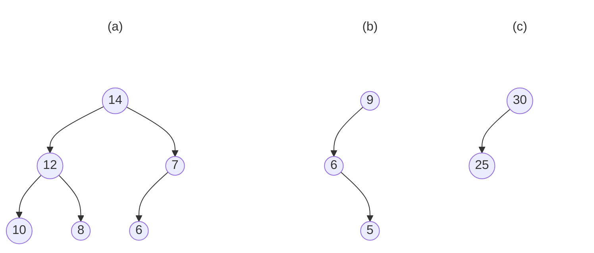

# Lecture 9 Exercises — Priority Queues and Heaps

[Repository Guide](../../README.md) | [English](Exercises.md) | [한국어](Exercises.ko.md)

> **Last Updated:** 2026-11-04

---

 

## Table of Contents

- [Exercise 1: Max Heap Insert Trace](#exercise-1-max-heap-insert-trace)
- [Exercise 2: Max Heap Delete Trace](#exercise-2-max-heap-delete-trace)
- [Exercise 3: Heap Initialization](#exercise-3-heap-initialization)
- [Exercise 4: Is This a Heap?](#exercise-4-is-this-a-heap)
- [Exercise 5: Leftist Tree Merge](#exercise-5-leftist-tree-merge)

---

 

## Exercise 1: Max Heap Insert Trace

**Problem:** Given a max heap `[-, 20, 15, 7, 6, 9, 2, 6, 5, 1]`, insert the element 25. Show the heap after insertion.

**[Solution](Solutions.md#exercise-1-max-heap-insert-trace)**

---

 

## Exercise 2: Max Heap Delete Trace

**Problem:** Given a max heap `[-, 20, 15, 7, 6, 9, 2, 6, 5, 1, 8]`, perform deleteMax. Show the heap after deletion.

**[Solution](Solutions.md#exercise-2-max-heap-delete-trace)**

---

 

## Exercise 3: Heap Initialization

**Problem:** Build a max heap from the array `[-, 3, 1, 6, 5, 2, 4]` using the bottom-up initialization algorithm. Show each step.

**[Solution](Solutions.md#exercise-3-heap-initialization)**

---

 

## Exercise 4: Is This a Heap?

**Problem:** Determine whether each of the following binary trees is a valid max heap: (a) the complete binary tree that holds 14, 12, 7, 10, 8, 6 in level order, that is, the array `[-, 14, 12, 7, 10, 8, 6]` (b) the tree in which the root 9 has the left child 6 and 6 has only a right child 5 (c) the tree in which the root 30 has only a left child 25, that is, the array `[-, 30, 25]`

*Figure 1. Three binary trees to be checked for the max heap property*

**[Solution](Solutions.md#exercise-4-is-this-a-heap)**

---

 

## Exercise 5: Leftist Tree Merge

**Problem:** Explain why leftist trees are preferred over heaps when frequent merge operations are needed. What is the time complexity of merging two leftist trees of sizes $m$ and $n$?

**[Solution](Solutions.md#exercise-5-leftist-tree-merge)**
